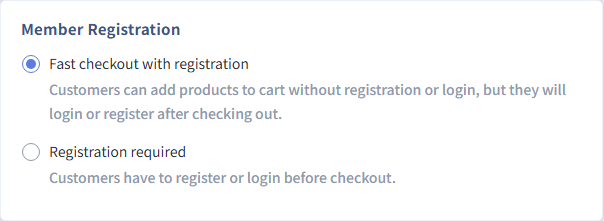
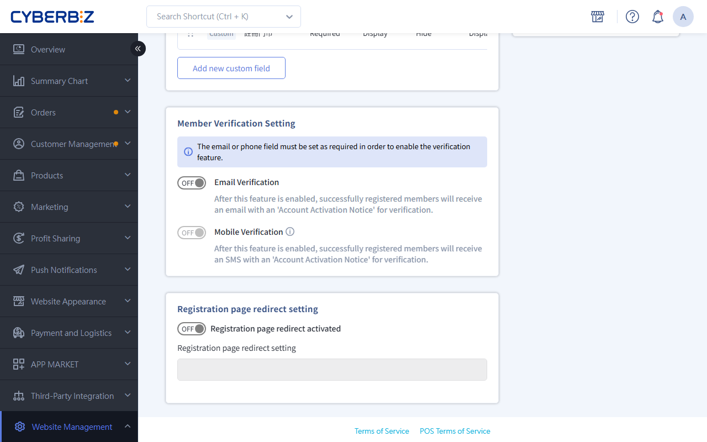
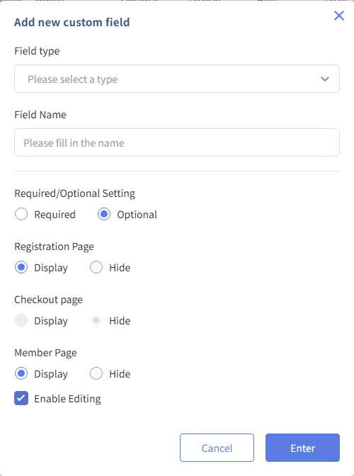

# Customer Registration Flow and Fields

A good registration flow can greatly improve new customer conversion. Choose the Registration Required or Quick Checkout mode based on your business strategy, and use custom fields to collect more detailed member information.
{ .subtitle }

{ .hero-page }

!!! tip "Use Cases"
    - **Improve the checkout experience**: Turn on Quick Checkout and Register to lower the barrier to a first purchase and shorten the path to buying.
    - **Build fuller member profiles**: For industries such as beauty or pets, use custom fields to collect skin type or pet type for targeted marketing.
    - **Strengthen security**: Turn on email or mobile verification to make sure member data is genuine and reduce ghost accounts.

## Before You Start { #prerequisites-customer-reg }

Before you change registration settings, note the differences and limits between plans:

- **Required field rule**: The system requires **at least one** of **Email** or **mobile number** to be required.

## Step 1: Choose the Customer Registration and Checkout Mode { #operate-customer-reg-mode }

Choose the checkout flow that best fits your business model.

1. Log in to the admin panel and go to **Website Management > Member Registration Setting**.
2. In the **Member Registration** section, choose a mode:
    - **Fast checkout with registration**: Customers can go to the checkout page first and log in during checkout, or register when they place the order.
    - **Registration required**: Customers must register and log in before they can check out.
3. Click **Save**.

## Step 2: Set Default Field Properties { #operate-customer-reg-fields }

The field options you can set depend on your plan:

=== "Enterprise"

    The Enterprise plan offers a highly flexible field management interface:

    - **Default field control**: Set name, email, mobile number, birthday, and gender as **required or optional** and **shown or hidden on the storefront** one by one.
    - **Advanced property settings**: Choose whether each field appears on the **Registration Page**, the **Checkout Page**, or the **member profile page**, and whether members can edit it themselves after registering.

    !!! warning "System Limits"
        Some settings for default fields are defined by the system and can't be changed.

    

=== "Other Plans"

    Other plans provide a basic, standard registration setup:

    - **Default field properties**: Supports basic fields such as name, email, mobile number, birthday, and gender.
    - **Required**: You can make the email or mobile account field required.

    

## Step 3: Set up Account Verification and Redirects { #operate-customer-reg-verify }

### 1. Turn on Customer Verification { #operate-customer-reg-enable }

To improve the quality of your member list, turn on verification.

1. Turn on **Email Verification** or **Mobile Verification**.
    - If both are on, the system sends the email verification first by default.
2. With verification on, members receive an **account activation notification** by email or SMS when they register, and must open it and click the link to finish verification.

    > **Template path**: Go to **Push Notifications > 通知樣板 > 顧客相關** to edit the **Customer Account Activation Reminder** template.

### 2. Redirect After Registration { #operate-customer-reg-redirect }

1. Find the **Registration page redirect setting** section and turn on the switch.
2. Enter the link you want to send members to.

!!! info "Plan Availability"
    Redirect after registration is only available on **Expert PLUS and Enterprise** plans.

## Step 4: Create and Manage Custom Fields { #operate-customer-reg-custom }

### Feature Limits { #prerequisites-customer-reg-custom }

- **Plan availability**: This feature is only available to **Expert PLUS and Enterprise** customers.
- **Theme limits**: Custom fields only work with **drag-and-drop** themes.
- **Quantity and editing limits**: You can create **up to 10** custom fields. Once a field is created, it can't be deleted or edited. If you don't want to show it, you can only set it to **Hidden**.
- **Security and personal data protection**: If you use custom fields to collect sensitive personal data (such as national ID numbers or medical information), make sure your website's **privacy policy** clearly explains why you collect it.

### Add a Custom Field { #operate-customer-reg-add-field }

1. Click the **Add new custom field** button.
2. Choose a field type. The system supports these five types:
    - **Image upload**: For uploading warranty cards, certificates, or receipts.
    - **Text box**: Lets members enter short text freely.
    - **Checkbox**: Supports multiple selections.
    - **Dropdown**: Preset options for members to choose one.
    - **Date picker**: A standard year/month/day picker.
3. Enter the **Field Name** and click **Confirm**.

{ .hero-page }

### Bulk Import Custom Data { #operate-customer-reg-import }

To include custom field data when you import members in bulk, follow these rules:

- **Supported types**: Text box, dropdown, and date picker.
- **Unsupported types**: Image upload and checkbox.

To edit the Excel template:

1. In the member import template, manually add a column header in the format `[0]自訂欄位名稱` (for example, `[0]會員編號`).
2. Enter the information that matches each field type.
  - Date format: Always use YYYY/MM/DD.
  - Dropdown: The value must exactly match the option text set in the admin panel.
3. To download the member template and upload the file, see [Bulk Import New Members](../members/batch-import-and-edit-members.md).

!!! tip "Bulk Edit Custom Fields for Existing Members"
    - **Applicable plans**: Only the **Enterprise** plan can overwrite or change custom fields for existing members in bulk.
    - **Other plans**: Custom fields can only be included when you bulk import new members. You can't update custom fields for existing members with bulk edits.
    - **Related steps**: On the Enterprise plan, go to [Bulk Edit Existing Member Data](../members/batch-import-and-edit-members.md#operate-batch-members-edit).

## Related Reading { #reference-customer-reg }

- :lucide-user-plus:{ .lg }
  [__Bulk Import New Members__](../members/batch-import-and-edit-members.md#operate-batch-members-import)
  Learn how to download the Excel template and upload member lists in bulk.

- :lucide-mail:{ .lg }
  [__Set Up Email Notification Templates__](../notifications/manage-email-templates.md)
  Customize the account activation email to improve your first message to new members.

