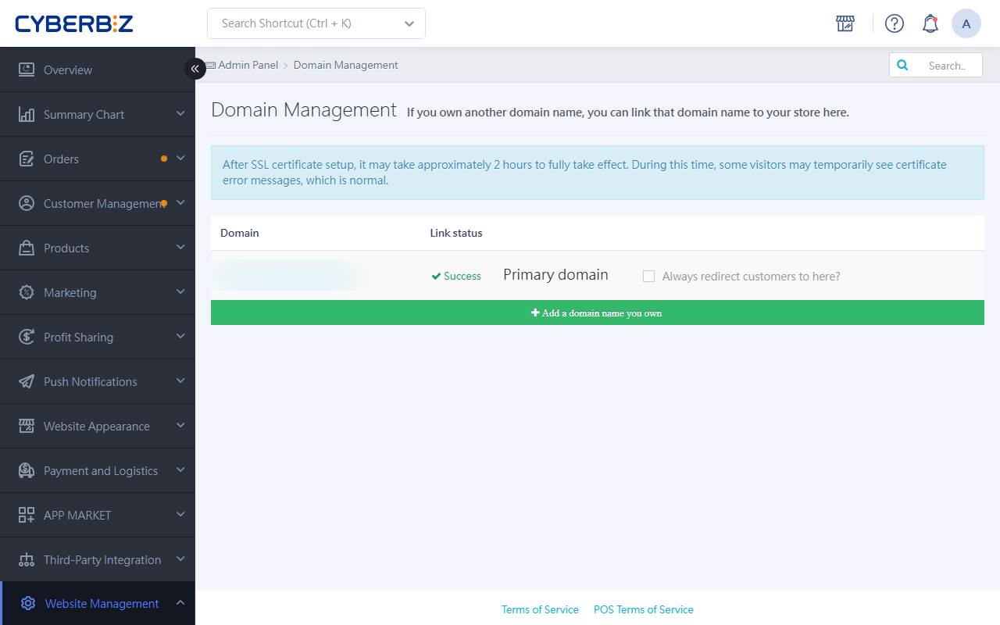

# Domain Management

After you buy a custom domain from a third-party provider, point the domain to your CYBERBIZ store with DNS settings, and then finish binding it in the CYBERBIZ admin panel.
{ .subtitle }

{ .hero-page }

## Before You Start { #prerequisites-domain-mgmt }

Depending on your domain provider, setup usually involves these two key settings:

1.  **CNAME setting (required)**: Point the URL that starts with `www` (such as `www.yourshop.com`) to the CYBERBIZ servers.
2.  **Root domain redirect (depends on the provider)**: Makes sure customers who enter the URL without `www` (such as `yourshop.com`) are also redirected to your store.

## DNS Setup Guides for Major Providers { #operate-domain-mgmt-dns }

Find your domain registrar below and follow its setup instructions:

=== "HiNet (Chunghwa Telecom)"

    1. Log in to the [HiNet dashboard](https://domain.hinet.net/#/dnlogin).
        
    2. **CNAME setting**: Go to **HiNet DNS 代管 > 更新 DNS 紀錄**. Delete the existing `A 紀錄`, and then add a new record.
        

        - **Ldata (host name/alias)**: `www`
        - **Record type**: `CNAME`
        - **Rdata (IP/host name)**: Enter the system default URL, for example: `xxx.cyberbiz.co`

            > **Do not add `.`** after the host URL.

            

    3. **Redirect setting**: Go to **轉址服務 > 設定轉址**.
        

        - **Website title**: Enter a custom website title.
        - **Source URL**: Leave blank.
        - **Destination URL**: Enter the **Ldata (host name/alias)** from the CNAME record, for example: `www...`
        - **Address bar display**: `目的網址`

            

    4. Copy the **host IP** shown in the **instructions**.
        
    5. Go to **DNS代管 > 更新DNS紀錄** and click **Add a row**.

        - **Record type**: `A`
        - **Rdata (IP/host name)**: Paste the **host IP**.

        

=== "PChome"

    1. Log in to the [PChome dashboard](https://myname.pchomebiz.com.tw/) and click **Manage My Domains**.
        
    2. **CNAME setting**: Click **Enter** in the **DNS settings and changes** column.
        

        - **Host**: `www`
        - **Address**: Enter the system default URL, for example: `xxx.cyberbiz.co.`

            > **Add `.`** after the host URL.

        - **Type**: `CNAME`

        

    3. **Redirect setting**:

        - **Address**: Enter your brand's custom URL, for example: `http://www...`
        - **Type**: `redirect`

        

=== "GoDaddy"

    1. Log in to the [GoDaddy dashboard](https://www.godaddy.com/zh) and click **DNS** in the domain section.
        
    2. **CNAME setting**: Select the **DNS Records** tab, find the CNAME record for the domain, and click **Edit**.
        

        - **Type**: `CNAME`
        - **Name**: `www`
        - **Value**: Enter the system default URL, for example: `xxx.cyberbiz.co.`
        - **TTL**: `1天`

        

    3. **Redirect setting**: Go to the **Forwarding** tab and select **Add Forwarding** for the domain.
        

        - **Enter the destination URL**: Enter your brand's custom URL, for example: `http://www...`

        

=== "Gandi"

    1. Log in to the [Gandi dashboard](https://www.gandi.net/zh-Hant), go to **Domain names**, and click the domain you bought.
        
    2. **CNAME setting**: Click **DNS Records**, and then click **Add record**.
        

        - **Type**: `CNAME`
        - **TTL (cache time)**: `10800`
        - **Unit**: `秒`
        - **Name**: `www`
        - **Hostname**: Enter the system default URL, for example: `xxx.cyberbiz.co.`

            > **Add `.`** after the host URL.

        !!! info "Troubleshooting Domain Setup Errors"
            If an error message appears during setup, first delete the default CNAME record in your Gandi account, and then run the setup again.

        

    3. **Redirect setting**: Go to **域名 > 網頁轉址** and click **Add web forwarding address**.
        
        

        - **Location**: Select `http:// + https://` and leave the field after it blank.
        - **Forward to**: Select ` http://` and enter your brand's custom URL, for example: `http://www...`
        

=== "TWNIC"

    1. Log in to the [TWNIC dashboard](https://rs.twnic.tw/cgi-bin/setupdns.cgi) and go to **DNS 設定服務 > DNS 設定/代管**.

        - **Domain name**: Enter the domain you want to add and select the domain suffix.
        - **Verification password**: Enter your password.

        

    2. **CNAME setting**: Select **Host mode (hosted by TWNIC)**.

        - **Domain/host name**: Enter your brand's custom URL, for example: `www...com.tw`
        - **Record type**: `CNAME`
        - **IP address/host name**: Enter the system default URL, for example: `xxx.cyberbiz.co.`

            > **Add `.`** after the host URL.

        

=== "Net-Chinese"

    1. Log in to the [Net-Chinese dashboard](https://www.net-chinese.com.tw/), go to **域名管理 > 域名總覽**, and click the domain you bought.
        
    2. **CNAME setting**: In the left menu, select **DNS > DNS紀錄設定** and enter the following:

        - **Record type**: `CNAME`
        - **Host name/alias**: `www`
        - **IP/domain**: Enter the system default URL, for example: `xxx.cyberbiz.co.`

        

=== "Taiwan Mobile"

    1. Log in to the [Taiwan Mobile dashboard](https://domains.tfn.net.tw/domains/session/showConsoleIndex.do) and go to **產品服務 > 域名申請服務 > 轉址設定**.
        
    2. **CNAME setting**: Click **DNS hosting**.
        

        - **Setting type**: `CNAME(別名)`
        - **Alias**: `www`
        - **Target host name**: Enter the system default URL, for example: `xxx.cyberbiz.co`

        

=== "Yuanzhen"

    1. Log in to the [Yuanzhen dashboard](https://twnoc.net/whmcs/login) and go to **網域 > Manage DNS**.
        
    2. **CNAME setting**: Select the domain you bought, click :lucide-pencil:, and click **Add Record**.
        

        - **TYPE**: `CNAME`
        - **NAME**: `www`
        - **TTL**: `14400`
        - **Cname**: Enter the system default URL, for example: `xxx.cyberbiz.co.`
        

=== "Pumeng"

    1. Log in to the [Pumeng dashboard](https://www.pumo.com.tw/) and go to **Domain Management**.
        
    2. **CNAME setting**: Select the domain you bought, open the dropdown menu, and select **Set DNS records**.
        

        - **Record type to add**: `CNAME`
        - **Host name**: `www`
        - **CNAME alias**: Enter the system default URL, for example: `xxx.cyberbiz.co`

        

=== "Far EasTone"

    1. Log in to the [Far EasTone dashboard](https://rs.seed.net.tw/) and go to **My Domain Management**.
        
    2. Enter your account information.

        - **Tax ID number/national ID number**: Enter the one that matches your account type.
        - **Password**: Enter the one that matches your account type.
        - **Domain name**: Enter the domain you want to add and select the domain suffix.
        
    3. Select **DNS (Host / IP)**.
        
    4. Select **Far EasTone DNS hosting mode**.
        
    5. **CNAME setting**:
        - **Host**: `www`
        - **Record type**: `CNAME`
        - **IP/Domain/Content**: Enter the system default URL, for example: `xxx.cyberbiz.co`
        
    6. When you finish, click **Hosting settings**.
        

## Add the Domain in the CYBERBIZ Admin Panel { #operate-domain-mgmt-add }

After you finish the DNS settings with your provider, go back to CYBERBIZ to finish binding the domain:

1.  Log in to the CYBERBIZ admin panel and go to **Website Management > Domain**.
2.  Click **Add a domain you already own** and enter the full URL (for example, `www.yourshop.com`).
3.  Select **Always redirect customers here**.

!!! info "When Changes Take Effect"
    - DNS changes usually take **24 to 48 hours** to take effect.
    - About 1 hour after the change takes effect, you can enter the URL in the CYBERBIZ admin panel.
    - Use [DNS Checker](https://dnschecker.org/#CNAME/) to check whether your domain points to the right place.

