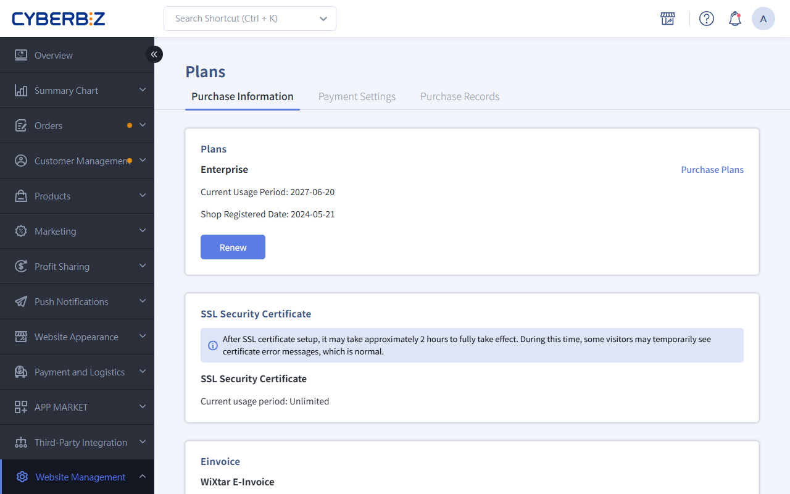
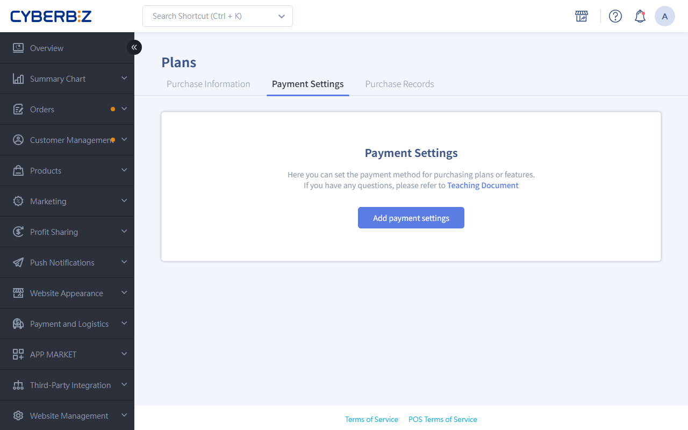

# Renewal Purchases and Automatic Renewal

To keep your store running without interruption, regularly maintain the validity of your store plan, SSL certificate, and add-on services. CYBERBIZ offers two options, manual renewal purchase and automatic renewal, so you can manage service periods flexibly.
{ .subtitle }

{ .hero-page }

## Before You Start { #prerequisites-renewal }

- **Staff permissions**: The website owner can control which admin panel staff can manage renewal purchases and automatic renewal.
    - Go to **Website Management > User Account Settings** and turn the **Plans** item on or off.
    - Any staff member with the **Plans** permission can make renewal purchases and change the credit card, so grant it carefully.

## Features by Plan { #specs-renewal }

What you can do with renewal purchases and automatic renewal depends on your store plan. Check the table below:

| Service | Professional | Advanced/Expert | PLUS | Enterprise |
| :--- | :--- | :--- | :--- |:--- |
| **Store plan renewal purchase** | Plan upgrade only Renewal not supported | Supported | Supported (legal review required) | Supported (legal review required)|
| **Store plan automatic renewal** | Not supported | Supported | Not supported | Not supported |
| **SSL certificate renewal purchase** | Supported | Supported on Advanced (not needed on Expert)  | Not needed | Not needed |
| **SSL certificate automatic renewal** | Not supported | Supported | Not needed | Not needed |
| **Add-on service renewal purchase** | Not supported | Not supported | Supported | Not needed |

!!! info "SSL Certificate Notes"
    - **Using a CYBERBIZ subdomain**: All plans include an SSL certificate, so you don't need to renew it yourself.
    - **Expert and all PLUS plans with your own domain**: The SSL certificate comes free with the plan, and its validity matches the plan.

## Preparation: Set up Payment and Invoice Information { #operate-renewal-prep }

To use automatic renewal, or to check out faster when you renew, set up your credit card and invoice information first.

### 1. Link a Credit Card { #operate-renewal-card }

1. Go to **Website Management > Plans > 付款設定頁籤**.
2. Click **Add payment settings**.
3. Enter your credit card information and click **Confirm**.

    - The system can only save **one** credit card number.
    - After you link a card, admin panel staff with permission to view **Plans** receive an email notification.

### 2. Set up Invoice Information { #operate-renewal-invoice }

1. In the **Invoice Informations** section further down the same page, click **Edit**.
2. Enter your e-invoice recipient information (such as tax ID number and invoice title).
3. Click **Confirm**. After future renewal purchases, the system issues invoices with this information.

## Manual Renewal Purchase { #operate-renewal-manual }

Use manual renewal purchase whenever you need to extend a service period.

### 1. Renew the Store Plan and SSL Certificate { #operate-renewal-plan }
1. Go to **Website Management > Plans > 購買資訊**.
2. Find the item you want to extend and click **Renew**.
    
3. Fill in the checkout information and choose a payment method (virtual ATM transfer or credit card).
    
4. After you pay, the system extends the service period automatically.

!!! info "Renewal Review Rules"
    After clicking Renew, **PLUS and Enterprise** users must agree to the contract and upload a **change registration form**. You can continue to payment after CYBERBIZ Legal approves it (about 3–5 business days).

### 2. Renew Add-On Services { #operate-renewal-addons }

1. Go to **APP MARKET > My Apps**.
2. Next to the feature you bought as an add-on, click **Renew**.
3. Enter the order information and complete the payment.
    - The "choose 2 of 11" optional features have no expiry date and don't need to be renewed.

!!! info "Plan Renewals and Additional Purchases"
    This page only offers renewals for your existing plan. To buy new features, contact a CYBERBIZ specialist.

## Set up Automatic Renewal { #operate-renewal-auto }

Automatic renewal keeps your plan from expiring by accident. This feature is only available on the **Advanced** and **Expert** plans.

### 1. Turn on Automatic Renewal { #operate-renewal-auto-enable }

1. Make sure you have linked a credit card on the **Payment Settings** tab.
2. Go to **Website Management > Plans > 購買資訊**.
3. Click **Automatic renewal**, check the renewal cycle, and click **Confirm**.
    - The system charges your card automatically **10 days** before the contract expires.

### 2. Change the Renewal Cycle { #operate-renewal-auto-cycle }

- To change the automatic renewal cycle, click **Change Cycle**.
- Make the change **before the charge date** so that it applies to the next cycle.

### 3. Cancel Automatic Renewal { #operate-renewal-auto-cancel }

- To upgrade, renew manually, or stop automatic charges, click **Stop automatic renewal**.
- Cancel at least **15 days** before the plan expires. Otherwise, the system still charges you for the next period.

