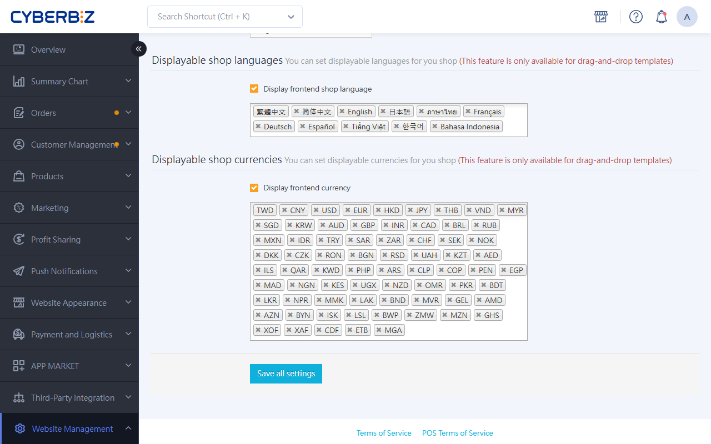

# Set up Multi-Language and Multi-Currency for Your Storefront

Multi-language and multi-currency features help you build a localized online store. Offering shoppers their native language and a familiar currency strengthens your brand's international image and improves the shopping experience for overseas customers.
{ .subtitle }

[:lucide-tag:{ title="Applicable Plans" }](../../resources/conventions#適用方案) | All PLUS plans / Enterprise
[:lucide-bolt:{ title="Applicable Features" }](../../resources/conventions#適用功能) | Drag-and-drop themes
{ .doc-badge }

{ .hero-page }

!!! info "Plan Differences"
    - On PLUS plans, multi-language and multi-currency is an optional module (choose 2 of 11), so make sure you have selected this module before you use it. The Enterprise plan includes this feature.


!!! tip "Use Cases"
    - **Expand into overseas markets**: Build an English or Japanese version of your store so that potential overseas customers can order directly on your website.
    - **Build brand trust**: Accurate localized wording and local currency display remove shoppers' doubts about buying across borders.
    - **International SEO**: Multi-language content improves your website's visibility in search engines in different languages.


## Before You Start { #prerequisites-multilang }

**Is this guide what you need?**

This guide explains how to build a multi-language **storefront**, so that **shoppers** see translated store content and local currencies.

- **If you want to** build a multi-language website for shoppers in different countries, change storefront translations, or set display currencies, **keep reading**.
- **If you want to** change the language of your own **admin panel interface** (for example, switch admin panel menus to English), see [Set the Admin Panel Display Language and Currency](setup-store-basic-info/#operate-general-preferences-admin-language).

**Before you turn on multi-language features, make sure you understand the following technical rules and logic:**

- **Supported languages and currencies**: Currently supported languages are Traditional Chinese, English, Japanese, Simplified Chinese, Thai, French, German, Spanish, Vietnamese, Korean, and Indonesian. Most major currencies are supported. To activate other languages or currencies, contact Customer Service.
- **AI translation**: Some languages (Thai, French, German, Spanish, Vietnamese, Korean, and Indonesian) are translated by AI. You can review them and correct any inaccurate wording.
- **Automatic language selection**: The system chooses the display language based on the shopper's browser language.
- **Checkout currency**: The system converts the displayed currency based on the shopper's region, but **checkout still uses your store's primary currency** (for example, a Taiwan store checks out in TWD).
- **Theme limits**: **Only drag-and-drop themes are supported.** Choose a theme with the `拖拉設定` and `多國版型` tags.
- **Plans and activation**:
    - **Enterprise**: Activated automatically. Add languages or currencies directly in the admin panel.

        !!! info "Your Store's Default Display Settings"
            - If your store opened after August 28, 2025, `顯示前台商店語言` and `顯示前台幣值` are **on** by default, showing `中文` and `台幣` by default.
            - If your store opened before August 28, 2025, and you had not activated storefront multi-language and multi-currency, `顯示前台商店語言` and `顯示前台幣值` are **off** by default.
            - If your store opened before August 28, 2025, and you had already activated storefront multi-language and multi-currency, the system automatically applies the languages and currencies you set to display.

    - **PLUS plans**: This is an optional feature. Contact CYBERBIZ Customer Service to activate it before you set it up.


## Steps { #operate-multilang }

### Step 1: Turn on Storefront Languages and Currencies { #operate-multilang-enable }

1. Log in to the CYBERBIZ admin panel and go to **Website Management > General**.
2. In the **Storefront language display** section, select the **languages** to show.
3. In the **Storefront currency display** section, select the **currencies** to show.
4. Click **Save**.

!!! info "Note for Event Pages"
    A new event page (one-page store) uses the store's current languages and currencies. If you change the store settings later, existing event pages stay the same. To update them, create the event page again.

### Step 2: Add Multi-Language Content { #operate-multilang-content }

Text shown on the storefront must be entered for each language in each admin panel module:

1. Go to an edit page that supports multiple languages (such as product editing, marketing campaign settings, or menu settings).
2. Look for the 🌐 **icon** or the **language tab fields** on the page.
3. Click the icon to switch to the target language, and enter the translation.
4. Save your changes.

**Main areas to translate:**

- **Product management**: Product names, descriptions, and category names.
- **Marketing campaigns**: Promotion names and promotion details.
- **Website appearance**: Menu item names, custom page content, and blog articles.
- **Notifications**: Email notification template content.

!!! tip "Search Tip"
    To find multi-language setup guides, enter the **multi-country** tag in this website's search bar. The results show guides for features with multi-country support, which helps you set up cross-border selling quickly.

### Step 3: Change Default System Text (Optional) { #operate-multilang-defaults }

Built-in button and checkout page text (such as Logout and Amount) has already been translated by AI. If needed, edit the dictionary files to correct translations by hand or add languages the system doesn't support:

#### General Storefront Text { #operate-multilang-storefront }

1. Go to **Website Appearance > Theme Setting > CSS/HTML 編輯器**.
2. **Edit and extend dictionary files**: In the language management interface, do the following depending on your case.
    - **Fine-tune AI translations**: Click **Dictionary files** and find the `__.yml` file for the target language (for example, `es.yml` for Spanish).
    - **Add a language the system doesn't support**: Click **Add dictionary file**, enter the target language, copy the syntax from the English dictionary file (`en.yml`), and paste it into the target language dictionary file.
3. Edit the translated text in the matching fields.

    !!! example "Syntax Example"
        Original file

        ```
          es:
          account:
          account_logout: Logout
          amount: 'Amount: {{ q }}'
          ...下略
        ```

        Example edited for Spanish

        ```
          es:
          account:
          account_logout: cerrar sesión
          amount: 'Cantidad: {{ q }}'
          ...下略
        ```

4. Click **Save**.

#### Checkout Page Text { #operate-multilang-checkout }

1. Go to **Website Appearance > Theme Setting > CSS/HTML 編輯器**.
2. Contact CYBERBIZ Customer Service to get the dictionary file, and rename it to `locales/_目標語系_.yml` (for example, `locales/es.yml` for Spanish).
3. Edit the translated text in the matching fields.

    !!! example "Syntax Example"
        Original file

        ```
          es:
          order:
          about: "(around %{amount, moneyformat})"
          accepts_marketing: I agree to receive merchant's newsletter and marketing messages.
          ...下略
        ```

        Example edited for Spanish

        ```
        es:
        order:
        about: "(alrededor de %{amount, moneyformat})"
        accepts_marketing: Acepto recibir el boletín informativo y los mensajes de marketing del comerciante.
        ...下略
        ```
4. Click **Save**.


!!! warning "Keep System Parameters"
    Don't change system parameters such as `{{...}}` or `%{...}`. Keep their original format and spelling, and only change the text around them.


## Switching Storefront Language and Currency { #specs-multilang-switch }

Shoppers can change the display language and currency on the storefront at any time. Where to find the setting depends on the device:

- **Desktop**: In the **top navigation bar** in the upper-right corner of the page.
- **Mobile**: Tap the three-line icon in the upper-left corner to open the **side menu**, and scroll to the **bottom** of the menu to see the options.


## FAQ { #faq-multilang }

??? quote "Can I change third-party blocks or fixed system text?"
    - **Third-party blocks**: These come from outside vendors (such as the LINE share button) and can't be edited directly. It depends on what the vendor supports.
    - **Fixed system text**: Text such as the words in the language selector is part of the core system and can't be edited.


