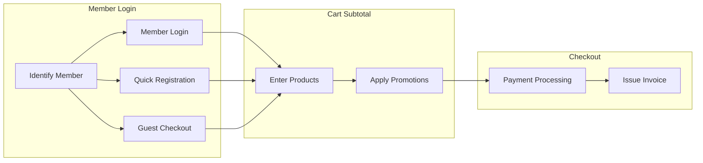

# Checkout
From member identification to payment and invoicing, this guide walks you through each key step of in-store checkout to deliver a smooth customer experience.
{ .subtitle }

[:lucide-layers:{ title="Applicable Products" }](../../resources/conventions#適用產品) | Smart POS
{ .doc-badge }

!!! tip "Use Cases"
    - **Daily Sales**: Quickly add products and complete payment, with inventory synced in real time.
    - **Member Benefits**: Log in a member to apply tier-specific offers, redeem bonus points, or use coupon.

## Complete Checkout Process

## Step 1: Member Login

Before checkout begins, identifying the customer ensures that member benefits are applied correctly and purchases are recorded.

=== "Interface Overview"

    ### Select Customer Identity on the Login Page

    1. **Start Checkout**: Click the **Checkout** button on the right side of the POS Front Desk.
    2. **Select Customer Checkout Identity**:
        - **Member Login**:
            - **Mobile Number**: The most common login method. Quickly enter the customer's phone number.
            - **Customer Barcode**: Scan the member barcode shown in the customer's mobile app.
            - **Email Search**: Enter an email address to search.
        - **Quick Member Registration**: If the customer is not a member but wants to join, enter their mobile number and click **Quick Registration**. The system automatically sends an **Account Activation Notice** SMS.
        - **Guest Checkout**: If the customer does not want to provide information, click **Guest Checkout** to go directly to the cart.
    3. **Bind Registrant Profit Sharing**: Specify a **Registrant Profit Sharing** code.

    { .screenshot }

    ### Add Member Details at Checkout

    === "Member Login"

        After logging in, you can view the customer's VIP tier, current bonus points, and purchase history. Click to view details.

        { .screenshot }

    === "Quick Member Registration"

        To switch customers, click **Switch Member** to log in again.

        { .screenshot }

    === "Guest Checkout"

        In guest checkout mode, click **Member Login** to switch to member checkout. The order is automatically converted to a member order and receives the corresponding benefits.

        { .screenshot }

=== "Detailed Instructions"

    

    - :lucide-plug:{ .lg }
    [__Guest Checkout__](guest-checkout/) 
    For customers who do not provide information. Quickly go to the cart.

    - :lucide-plug:{ .lg }
    [__Offline Checkout__](offline-checkout-mode/) 
    Keeps transactions recorded without interruption when the network is unstable.

    - :lucide-plug:{ .lg }
    [__Registrant Profit Sharing__](../../ec/profit-sharing/registrant-profit-sharing/) 
    Set up promotional rewards to recognize people who refer new customers to register.

    

## Step 2: Cart Subtotal

Enter the items the customer is buying into the system and confirm whether they qualify for marketing campaigns.

### Add Products

=== "Interface Overview"

    1. **Scan/Enter**: Use a barcode scanner to read the product barcode, or enter the SKU or vendor product number in the search bar.

    2. **Manual Search**: Click **Product Search** to open a pop-up window.

        - **Search Method**: Select **Starts With** or **Fuzzy Search**.
        - **Multi-Field Search**: Search by **Product**, **SKU**, or **Vendor Product Number**.
        - **Quick Select**: Click a product row to add it to the list. Click it again to remove it quickly.

        { .screenshot }

    3. **Adjust Quantity**: Click an added product row to change its quantity directly.

    4. **Notes**: Click the **Notes** button below to edit.

        - **Merchant Notes**: **Internal only**. This information is visible only to back-office administrators and is not visible to customers.
        - **Order Notes**: **Visible to both parties**. This information is shared with both the merchant and the member.

            > Member access path: Members can log in to the website, go to **Orders > All Orders**, and view this note on the order details page.

        { .screenshot }

=== "Detailed Instructions"

    

    - :lucide-plug:{ .lg }
    [__Set Up Low-Stock Alert Method__](low-stock-notifications/) 
    Track inventory levels in real time to avoid overselling or running out of stock.

    

### Apply Marketing Campaigns

=== "Interface Overview"

    1. **bonus points**: Manually enter the redemption amount (cannot exceed the cap) or select **Redeem All**.
    2. **Promo Code**: From the drop-down menu, select the **Promo Code** or **coupon** that applies to the customer.

        !!! info "Don't see the **Bonus Discount** or **Promo Code** field on the page?"
            If a field is missing, it is usually related to authentication settings. Go to the back-office and adjust the following:

            Go to **Marketing > Shop-wide Discount – Bonus & Coupons** and set **Require Barcode Authentication for POS coupon/bonus points** to **No** to display the field on the page.

    3. **Referral Code**: Enter a referral code to apply the **Referrer Profit Sharing** plan to this order.
    4. **Switch Checkout Profit Sharing Staff**: Assign a checkout staff member to apply the **Checkout Profit Sharing** plan to this order.

        { .screenshot }

    5. **Add Order Discount**: **Store Managers** can adjust order prices.

        - **Order-Wide Discount**: Click **Add Order-Wide Discount** and enter the discount value.
        - **Override Product Price**: Click the target product, then enter the discount value in the drop-down menu.

        { .screenshot }

    6. Other marketing campaigns: Click **Marketing Campaigns** to open a pop-up window.
        - **Add-On Purchase**: The system displays eligible add-on products. Scan the barcode or select the add-on item.
        - **Spend/Quantity Gift**: View the remaining amount needed to qualify. If the threshold is met, the system automatically adds the gift.

            > If gift stock is insufficient, the system displays a pop-up alert and does not add the gift automatically.

        - **Bonus Mall**: Select and apply the bonus product the customer wants to redeem.

        { .screenshot }

=== "Detailed Instructions"

    

    - :lucide-plug:{ .lg }
    [__Send Member-Exclusive bonus points__](../../ec/marketing/bonus-and-gifts/setup-bonus-points.md) 
    Issue bonus rewards to increase repeat purchases and member loyalty.

    - :lucide-plug:{ .lg }
    [__Create Promo Codes__](../../ec/marketing/coupon/setup-promo-codes.md) 
    Create exclusive discount codes for customers to enter manually at checkout.

    - :lucide-plug:{ .lg }
    [__Create coupon__](../../ec/marketing/coupon/setup-coupons.md) 
    Manage coupon that apply automatically or let customers select them.

    - :lucide-plug:{ .lg }
    [__Set Up Multiple coupon__](../../ec/marketing/coupon/multiple-coupons.md) 
    Allow multiple coupon on a single order to add checkout flexibility.

    - :lucide-plug:{ .lg }
    [__Create Referrer Profit Sharing__](../../ec/profit-sharing/referrer-profit-sharing.md) 
    Set up referral commissions to reward existing customers, employees, and third parties who refer new customers.

    - :lucide-plug:{ .lg }
    [__Order-Wide Discount__](storewide-order-discounts/) 
    Motivate store staff by calculating bonuses based on checkout amounts.

    - :lucide-plug:{ .lg }
    [__Store Manager Price Override__](pos-manager-price-override/) 
    Authorized staff can manually adjust orders or prices.

    - :lucide-plug:{ .lg }
    __Create Add-On Purchase Campaign__ 
    Increase average order value by recommending value add-on products at checkout.
        - [Order Add-On Purchase](../../ec/marketing/upsells/setup-order-upsell.md)
        - [Product Add-On Purchase](../../ec/marketing/upsells/setup-product-upsell.md)

    - :lucide-plug:{ .lg }
    [__Create Spend and Quantity Gift Campaigns__](../../ec/marketing/discounts/threshold-gifts-and-quantity-gifts.md) 
    Encourage customers to buy more. Gifts are automatically given once the threshold is met.

    - :lucide-plug:{ .lg }
    [__Set Up Low-Stock Alert Method__](low-stock-notifications/) 
    Track inventory in real time to keep sales running smoothly.

    - :lucide-plug:{ .lg }
    [__Create Bonus Mall__](bonus-point-mall/) 
    Offer varied redemption options to give bonus points real value.
        - [Bonus MallProduct Checkout](bonus-point-mall/#於前台結帳)

    

## Step 3: Complete Checkout

The final stage of payment and receipt processing. Once complete, the order is officially placed.

=== "Interface Overview"

    ### Payment Processing

    1. **Proceed to Checkout**: Click **Proceed to Checkout** in the lower-right corner to open the payment page.
    2. **Select a Payment Method**:

        - **Single Payment**: For cash or credit card, select the method and enter the amount received.
        - **Multiple Payment Methods**: If the customer needs to split payment (for example, partly cash and partly 5x Vouchers), select **Multiple Payment Methods** and enter each amount in turn.

        { .screenshot }

    3. **Sales Recognition Date**: Defaults to today. To record sales under a different date, edit it manually.

        - This date field is the search basis when the system generates the [POS Product Sales Report](../inventory/pos-reports-list-guide/#商品銷售報表). The system assigns orders to the matching report period based on the date set here.

        { .screenshot }

=== "Detailed Instructions"

    

    - :lucide-plug:{ .lg }
    [__Turn On Payment Methods__](payment-method/) 
    Manage in-store payment channels and set the most suitable checkout order.

    - :lucide-plug:{ .lg }
    [__Create Multiple Payment Methods__](payment-method/multiple-payment-methods/) 
    Supports split payments to meet diverse customer payment needs.

    

### Issue Invoices

=== "Interface Overview"

    1. **Select Invoice Type**:

        { .screenshot }

        - **Member Carrier (Personal/Company)**: With an invoice machine, enter the Unified Business Number or carrier code to issue an e-invoice.
        - **Self-Issued (Manual Invoice)**: If no invoice machine is connected, select this option and fill in the invoice number and Unified Business Number after checkout.

            { .screenshot }

            > You can also [issue an invoice later](../orders/manage-general-orders/#補開發票--列印明細) from the **Orders** page.

        - **Other Carriers**: Mobile barcode, Citizen Digital Certificate, or donation code.

    2. **Complete Checkout**: Confirm that the amount is correct, then click **Collect Payment**.

=== "Detailed Instructions"

    

    - :lucide-plug:{ .lg }
    [__Automatically Print Invoices and Itemized Details__](print-invoice-details/) 
    Print automatically at checkout, or turn off automatic printing to save invoice paper.

    - :lucide-plug:{ .lg }
    [__Issue Mixed-Tax Invoices__](mixed-tax-invoices/) 
    Handle products with different tax rates and calculate and issue invoices accurately.

    - :lucide-plug:{ .lg }
    [__Export Order Reports__](../../ec/orders/reports/export-order-report.md) 
    Export invoice number and Unified Business Number fields for orders.

    - :lucide-plug:{ .lg }
    [__Omnichannel Inventory Management__](../inventory/index.md) 
    Manage inventory across all channels to ensure there are no gaps between online and offline stock.

    

