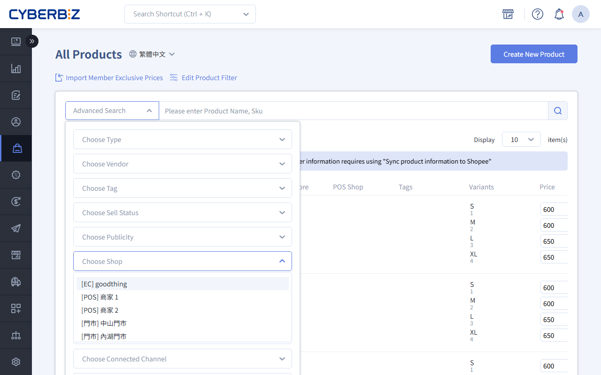

# LINE Pay Barcode Payment
Integrate LINE Pay barcode payment so POS staff can use a barcode scanner to read the customer's phone payment code directly, enabling a fast, contactless checkout experience.
{ .subtitle }

[:lucide-layers:{ title="Applicable Products" }](../../resources/conventions#適用產品) | Smart POS
{ .doc-badge }

!!! tip "Use Cases"
    - **Fast checkout**: During busy periods, use the barcode scanner to complete payments in seconds and shorten customer wait times.
    - **Contactless payment**: Supports hygiene practices and modern shopping habits by offering customers a safe and convenient payment option.
    - **Multi-store management**: Direct-operated chain stores can use a single Tax ID account and Device IDs to track sales by store.

## Before You Start { #prerequisites-line-pay }

- **Application timeline**: After you submit complete information, review and activation take about **3 to 4 weeks**.
- **Hardware requirement**: Your store needs a **barcode scanner** that can scan phone screens.
- **Fee inquiry**: For specific rates, see **Website Management > Reconciliation Center > Payment Processing Fees**.
- **Payment restriction**: Currently, **only merchant scanning of customer barcodes is supported**. **Customers scanning the store's QR code** and entering the amount themselves is **not supported**.

## Application Process { #operate-line-pay }

### 1. Fill in the Online Application Form { #operate-line-pay-1 }

First, prepare your basic business information, then go to the [CYBERBIZ x LINE Pay Integration Form](https://docs.google.com/forms/d/13H2sqFvR_99iDtHOPEOmPzTjoYv6fX-eTEYSTJTXPeU/edit) and complete it.

### 2. Prepare Required Documents { #operate-line-pay-2 }

Submit clear electronic copies (scans) of the following documents in the form:

- **Company documents**: Company registration or change-of-registration form, business registration transcript, or tax registration certificate.
- **Storefront photos and menu**:
    - Include photos of the storefront sign, the store interior, and product prices.
    - Provide a physical menu or a product list exported from the admin.

        !!! tip "How do I export the product list by store?"
            1. Go to **Products > All Products**.
            2. Open **Advanced Search**, and in the **Store** field, select the store you want to export.
            3. Select all products in the filtered list, then click **Export product**.

            { .small-image }

- **Responsible person's ID**: Front and back copies of the national ID card (foreign nationals should provide a passport).
- **Company bank passbook**: Provide the bank account for disbursements. The account name must match the registered company name. Personal accounts are not allowed.

### 3. Review and Activation { #operate-line-pay-3 }

1. **Progress tracking**: About 10 business days after submission, you will receive a preliminary review notice.
2. **Get keys**: After approval, CYBERBIZ provides your dedicated **LINEPAY account credentials**, **Channel ID**, and **Channel Secret**. Follow the steps below to fill in the keys and enable the feature.
3. **Claim promotional materials**: After you provide shipping details, we will send the LINE Pay standees and LOGO stickers. Send a photo of the completed store setup to **finish the go-live process**.

    > Shipping details must include the recipient's name, phone number, and address.

## Setup Steps { #operate-flow }

### Step 1: Link Keys in the Admin { #operate-flow-step-a-admin }

1. Log in to the CYBERBIZ admin and go to **POS > POS Store List**.
2. Select the store you want to configure, then go to **POS Checkout Settings**.
3. Fill in the **LINE Pay Channel ID** and **LINE Pay Channel Secret**.
    > **Note**: If you have both a storefront (EC) and POS, their keys cannot be shared. Be sure to fill in the information you applied for specifically for POS.
4. Save the settings.

{ .screenshot }

### Step 2: Enable a Payment Method { #operate-flow-step-b-enable }

1. Click the **Payment Methods** tab.
2. Switch the **LINE Pay** toggle to `開啟 (ON)`.

{ .screenshot }

### Step 3: Checkout on the POS { #operate-flow-step-c-pos }

1. On the checkout screen, select **Other Payment Methods**, then choose **LINE Pay**.
    { .screenshot }
3. When the system displays the **Scan Payment Barcode** window, aim the barcode scanner at the customer's phone barcode.
    { .screenshot }
4. Click **Confirm**. Once the system shows that checkout succeeded, the transaction is complete.

!!! tip "Tip"
    If you accidentally close the scan window, click the **Collect Payment** button on the screen to reopen the scan box.

## FAQ { #faq-line-pay }

??? quote "I already have a LINE Pay account. Can I use it directly with CYBERBIZ POS?"
    First, check with [LINE Pay Merchant Support](https://pay.line.me/merchant-apply/tw/contact-request?locale=zh_TW) whether your existing account supports **offline POS integration**. If it does, apply to LINE Pay to transfer the agency to CYBERBIZ so you can get the corresponding integration keys.

??? quote "Does the store have multiple checkout counters? Can I apply for multiple standees?"
    Yes. Contact your technical support or account representative, specify how many sets you need, and we will arrange shipment.

??? quote "How do I check LINE Pay's disbursement schedule?"
    Log in to the [LINE Pay Merchant Admin](https://pay.line.me/), then go to **Manage Basic Information > Manage Merchant Information > Contract Details > Payout Cycle** to view the detailed rules.

??? quote "What is the [LINE Pay Deals Map](https://pay.line.me/portal/tw/customer/faq?categoryId=cooperate), and what real benefits does it offer my store?"
    **LINE Pay Deals Map** is a built-in store map and search feature in the LINE Wallet.

    - **Key benefit**: Nearby LINE users can quickly find your store location and offers through **automatic location** or **keyword search**.
    - **How to increase visibility**: Log in to the [LINE Pay Merchant Admin](https://pay.line.me/tw/login/) and complete your store registration. Follow these steps:

        1.  Go to **Manage Basic Information** > **Store Information**.
        2.  Click **Store Information Registration**, and carefully fill in your business details and service address.
        3.  **Upload a brand image**: Upload a **1:1 (square)** store image or brand logo to improve brand recognition.