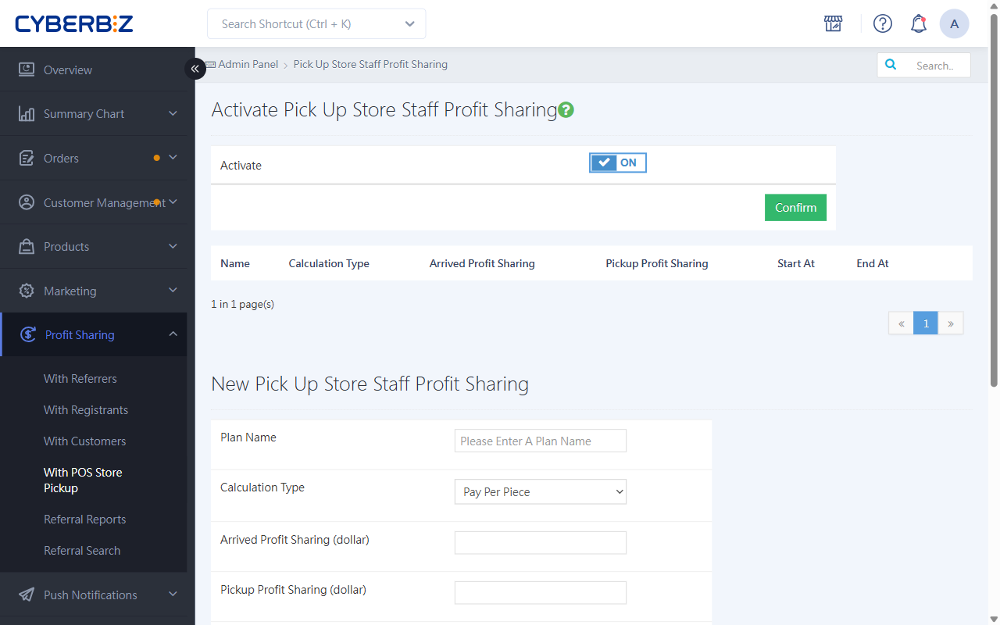
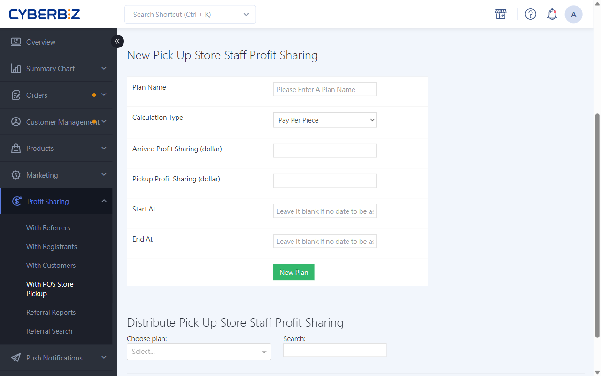
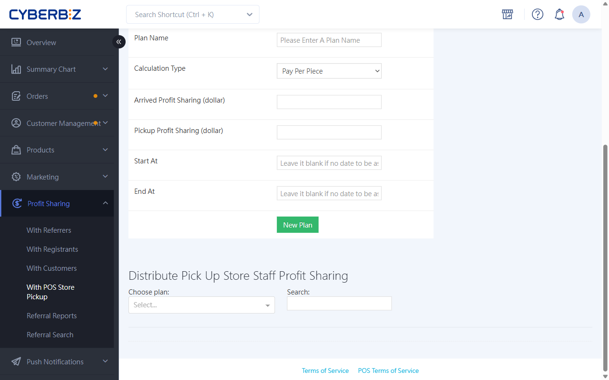

# POS Store Pickup Staff Commission
Use a commission mechanism to motivate store staff to process "Store Pickup" orders more efficiently. You can customize the rewards for in-store arrival and pickup, and automatically calculate staff commission amounts.
{ .subtitle }

[:lucide-layers:{ title="Applicable Products" }](../../resources/conventions#適用產品) | Smart POS
{ .doc-badge }

{ .hero-page }

!!! tip "Use Cases"
    - **Improve store staff engagement**: Provide store staff with additional processing incentives for orders placed on the storefront and picked up in store, balancing the workload between physical and online channels.
    - **Fair compensation for labor**: Set commissions separately for the "In-Store Arrival" and "Customer Handover" steps, so every staff member involved in the process receives the corresponding bonus.
    - **Simplify accounting and settlement**: The system automatically calculates commissions based on order status and the staff who handled each order. Administrators only need to download the report to pay out bonuses, which reduces manual calculation errors.

## Before You Start { #prerequisites-pickup-commission }

- **One plan per employee**: Each staff member can join only **one** commission plan. If you cannot find a specific staff member in the staff list, first check whether they have already joined another plan.
- **Unique plan names**: When you add a plan, its name must not duplicate an existing plan name, so reports are easier to identify later.
- **Effective time and scope**: The system starts calculating commissions from the **next order** after a staff member joins the plan. It does not retroactively calculate or backfill commissions for orders placed before the staff member joined.

## Procedure { #operate-pickup-commission }

### Step 1: Enable the Feature and Create a Commission Plan { #operate-pickup-commission-step-a-enable }

First, enable the commission toggle, and create commission calculation rules based on your store management needs.

1. Log in to the CYBERBIZ admin dashboard and go to **Profit Sharing > With POS Store Pickup**.
2. Switch the **Enable Commission** status to `ON`, and click **Confirm**.
3. Scroll down to the **Add Store Pickup Staff Commission Plan** section and create a commission plan.

    - **Plan name**: The identifier for this plan.
    - **Calculation method**: **Per-Item Commission** / **Percentage Commission**.
    - **Arrival commission**: Set the commission bonus for when a product **arrives at the store**.
    - **Pickup commission**: Set the commission bonus for when a customer **completes pickup**.
    - **Effective/expiration date**: Set the start and end dates of the plan.

        > If there is no start or end date limit, leave the fields blank.

4. After setup, click **Save**.

{ .screenshot }

### Step 2: Assign Staff to the Plan { #operate-pickup-commission-step-b-assign }

After you create the plan, add the relevant store staff to it. The system tracks the orders they handle and calculates commission amounts only after they are added.

1. Scroll down to **Assign Store Pickup Staff Commission Plan**. In the **Select Plan** dropdown menu, select the plan.
2. In the left-hand list, use **Search**, or filter by **Role** or **Affiliated Store**, to find the target staff members.
3. Select the staff member's name, then click the **Add to Plan** button.
4. Confirm that the staff member appears in the **Added Staff** list on the right.

{ .screenshot }

## FAQ { #faq-pickup-commission }

??? quote "Why can't I find a certain staff member in the employee list?"
    The most common cause is that the staff member has already joined **another Store Pickup commission plan**. First, check the Added Staff list of the other plan, or confirm that the staff member has POS operation permissions.

??? quote "Can commissions be retroactively applied to orders placed before the employee joined the plan?"
    No. Commissions take effect immediately. The system only calculates commissions for arrival or pickup actions that the staff member handles **after** joining the plan.

## More Actions { #next-steps-pickup-commission }

- :lucide-truck:{ .lg }   
  [__Store Pickup Feature Guide__](../../ec/payments-and-logistics/store-pickup/index.md)     
  Learn how to process orders placed online for store pickup.

- :lucide-chart-column-increasing:{ .lg }   
  [__View and Manage Commission Reports__](../../ec/profit-sharing/export-profit-sharing-reports.md)     
  Export detailed reports for accounting reconciliation and performance evaluation.

- :lucide-search:{ .lg }   
  [__Look Up an Employee's Commission Plan__](../../ec/profit-sharing/query-profit-sharing-partners-and-codes.md)     
  Quickly check each staff member's current assignment and commission rate to confirm the setup is correct.

