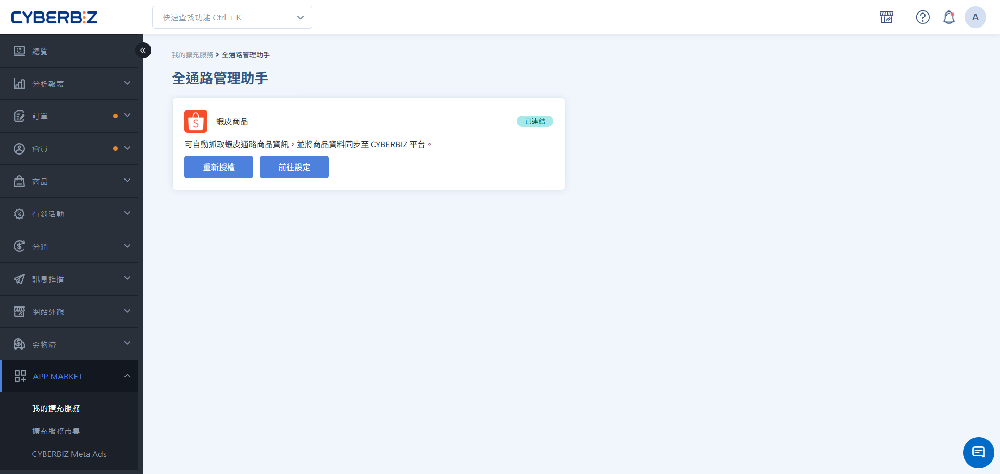
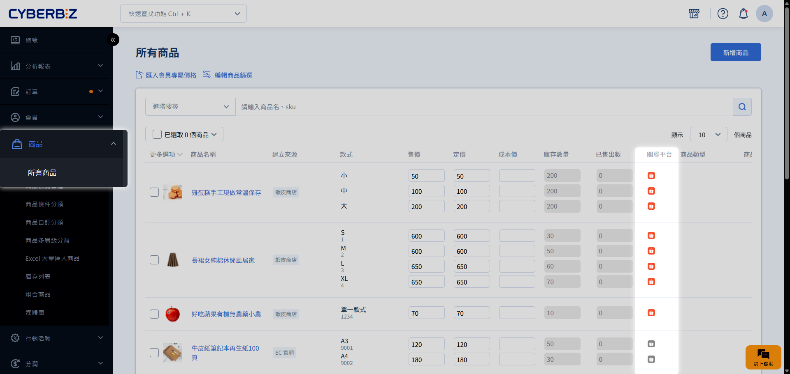
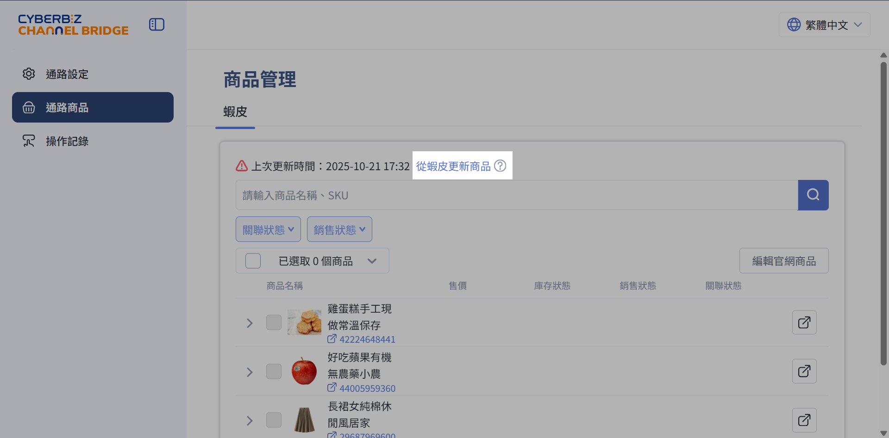
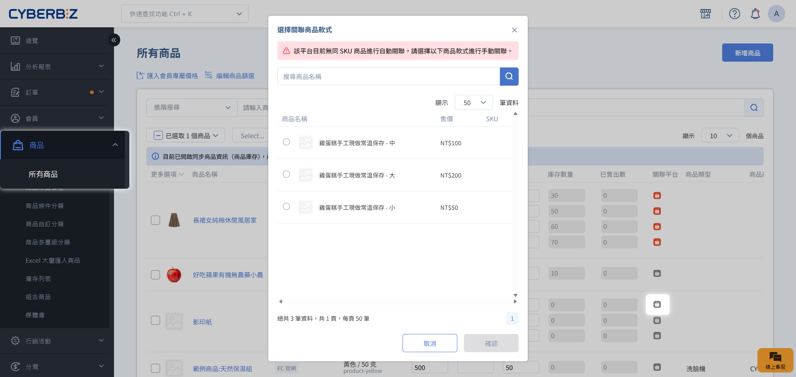
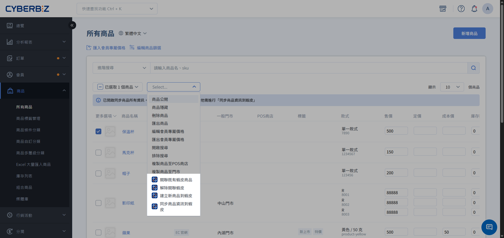
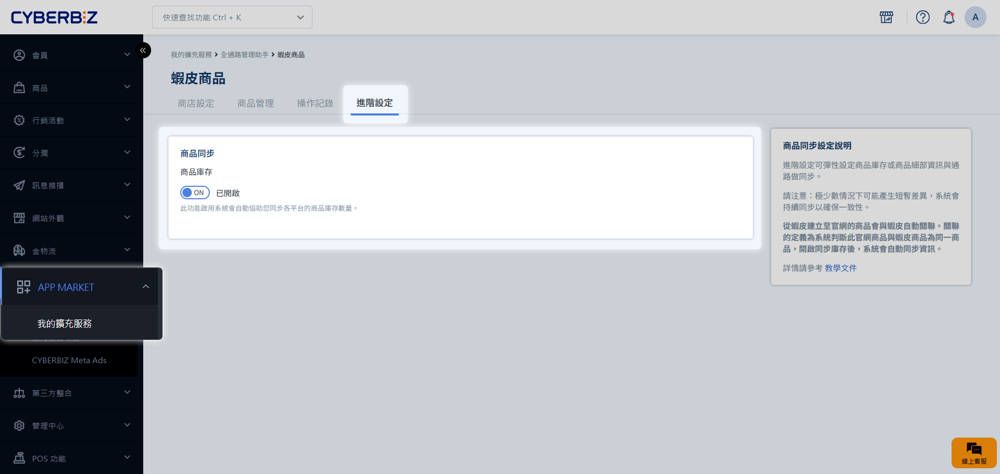
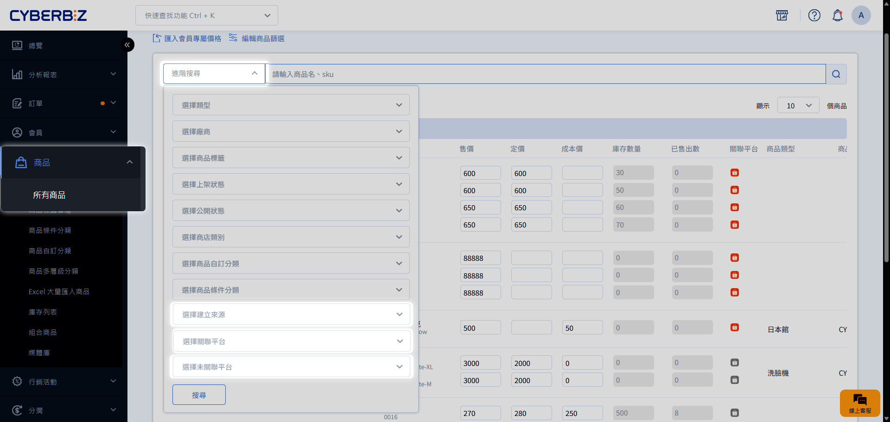

# Step 3 官網與蝦皮商店庫存同步

透過建立商品關聯與開啟同步功能，您可以讓官網與蝦皮商店的庫存維持連動。當任一端產生訂單或在官網修改庫存時，系統將自動更新兩端的剩餘數量。
{ .subtitle }

[:lucide-lock:{ title="適用方案" }](../../resources/conventions#適用方案) | 所有 PLUS / 企業 
[:lucide-grid-2x2-plus:{ title="適用擴充" }](../../resources/conventions#適用擴充) | CYBERBIZ CHANNEL BRIDGE
{ .doc-badge }

{ .hero-page }

!!! tip "應用情境"
    - **避免超賣**：當官網賣出一件商品，蝦皮庫存同步扣減，防止多通路重複下單。
    - **統一管理**：只需在官網後台更新庫存，即可同步更新至蝦皮，無需重複操作。
    - **靈活控制**：針對特定促銷商品，可暫時解除關聯以獨立管理各通路的配貨量。

## 使用須知 { #prerequisites-shopee-s3 }

- **首次同步**：開啟庫存同步後，第一次同步會以官網庫存數量覆蓋蝦皮的庫存數量。請先確認官網庫存數字正確再開啟。
- **無限庫存處理**：若官網商品設為無限庫存，蝦皮端將設定為該平台允許的最大數量，且不會隨訂單扣減。
- **負庫存警示**：若官網商品設為「允許負庫存販售」（如預購），導致 **庫存為負數時，建議不要開啟關聯**。由於蝦皮端不支援負庫存，同步後可能導致該商品在蝦皮端無法販售。

## 庫存同步運作機制 { #specs-shopee-s3 }

庫存同步必須同時滿足 **開啟功能開關** 與 **建立商品關聯** 兩個條件：

| 庫存同步開關 | 商品關聯狀態 | 最終結果 |
| :--- | :--- | :--- |
| 開啟 | 已關聯 | **正常同步** |
| 開啟 | 未關聯 | 僅該商品不執行同步 |
| 關閉 | (不限狀態) | 全站停止同步 |

- **停止全站同步**：關閉全站同步總開關，停止所有商品之資料對接。
- **停止單一商品同步**：解除特定商品的關聯設定，僅針對該項目停止同步。
- **啟動指定商品同步**：開啟全站同步總開關，並逐一配置欲同步之商品關聯。

### 庫存同步觸發時機 { #specs-shopee-s3-sync }

| 行為 | 官網 (EC) | 蝦皮 (Shopee) |
| :--- | :---: | :---: |
| **訂單成立** |  觸發同步 |  觸發同步 |
| **訂單取消** |  觸發同步 |  觸發同步 |
| **手動修改庫存** |  觸發同步 | **不會同步** |

- **手動修改限制**：開啟同步後，**若需手動調整庫存，請統一在官網後台修改**。在蝦皮端直接修改庫存不會反向同步至官網。

## 操作流程 { #operate-shopee-s3 }

### 步驟 1：建立商品關聯 { #operate-shopee-s3-step-1-create }

=== "自動建立（蝦皮後台匯入之商品）"

    當您使用全通路管理助手的 [建立官網商品](step2-import-products-and-link/#operate-shopee-s2-step-2-create) 功能時，系統會自動完成連結。
    
    您可前往 **商品 > 所有商品**，確認該商品的 **關聯平台** 欄位中，蝦皮圖示已亮起。

    

=== "手動建立（官網與蝦皮各自建立的商品）"

    若您的官網商品是自行手動建立，而非透過搬站工具匯入，須手動建立關聯。

    建立前，請先到 CHANNEL BRIDGE 點選 **從蝦皮更新商品**。

    

    系統會優先比對 SKU，自動對應蝦皮上相同 SKU 的款式：

    === "單筆關聯"

        點選該款式 **關聯平台** 欄位的蝦皮圖示。若 SKU 比對得到，自動建立關聯；比對不到時，會跳出視窗讓您手動選擇蝦皮款式。

        

    === "批次關聯"

        勾選商品，點選 **更多操作 > 關聯既有蝦皮商品**。若官網款式沒有填 SKU，或找不到相同 SKU 的蝦皮款式，該款式會關聯失敗，請補上 SKU 後再重新操作。

        

### 步驟 2：開啟全站庫存同步開關 { #operate-shopee-s3-step-2-enable }

1. 前往 **APP MARKET > 我的擴充服務 > CYBERBIZ CHANNEL BRIDGE**。
2. 進入 **蝦皮商品** 分頁，點選 **進階設定** 頁籤。
3. 將 **商品庫存** 開關切換為 `開啟 (ON)`。
4. 系統將開始以官網庫存為準，同步更新至所有已關聯的蝦皮商品。

### 步驟 3：管理指定商品的同步狀態 { #operate-shopee-s3-step-3-manage }

若想針對特定商品暫停庫存同步，無需關閉全站開關，對該商品解除關聯即可：

=== "單筆解除關聯"

    點擊款式旁邊的蝦皮圖示，手動關閉關聯。

    

=== "批次解除關聯"

    在 **所有商品** 列表勾選商品，點選 **解除關聯**。

    

    - **限制**：若勾選的商品包含 **POS 商品**、**串倉商品**、**門市商品** 或 **快速到貨商品**，解除關聯按鈕將不會出現。請確認僅勾選一般官網商品。

解除關聯後，該款式不再進行庫存同步。系統仍會保留官網與蝦皮款式的 1 對 1 綁定紀錄，之後可再開啟關聯，不需要重新建立。

## 管理與篩選技巧 { #operate-manage }

在 **商品 > 所有商品** 頁面，您可以使用篩選器快速管理商品：

- **建立來源**：
    - 選擇 `EC 官網`：查看手動建立的商品。
    - 選擇 `蝦皮商店`：查看透過搬站工具匯入而建立的商品。
- **關聯平台**：選擇 `蝦皮商店` 可快速找到目前正與蝦皮同步庫存的商品。
- **未關聯平台**：選擇 `蝦皮商店` 可找出尚未與蝦皮連動的官網商品，方便進行手動關聯。

## 常見問題 { #faq-shopee-s3 }

??? quote "刪除商品會對關聯造成什麼影響？"
    - **在官網刪除商品**：該商品在官網及其相關的「匯入紀錄」會同步刪除，但**蝦皮賣場（賣家中心）內的商品不會受影響**。若需重新匯入，請前往全通路管理助手點擊 **同步蝦皮商品**。
    - **在蝦皮後台刪除商品**：請到 CHANNEL BRIDGE 點選「從蝦皮更新商品」，系統判斷該商品已不存在後，才會自動清除與官網商品的關聯（官網商品不會被刪除）。若未執行更新，系統仍認定蝦皮商品存在，官網商品會繼續綁著原有關聯。

??? quote "如果蝦皮授權過期了，庫存還會同步嗎？"
    不會。授權過期會導致 API 連線中斷，庫存同步將暫停。請務必在授權到期前完成重新授權。

??? quote "建立關聯失敗的常見原因？"
    1. 該商品已在蝦皮被刪除。
    2. 找不到對應款式（SKU 重複，或官網款式未填 SKU）。
    3. CHANNEL BRIDGE 尚未取得蝦皮最新商品資訊，請先點選 **從蝦皮更新商品**。
    4. 該蝦皮款式已被其他官網商品關聯。請至 CHANNEL BRIDGE 商品列表確認該款式的關聯狀態。

    可至 CHANNEL BRIDGE **操作記錄** 查看關聯操作的失敗原因（庫存同步本身不會留下記錄）。系統遇到第一個錯誤就會停止檢查，修正後若出現其他錯誤訊息，請依新的訊息再次修正。