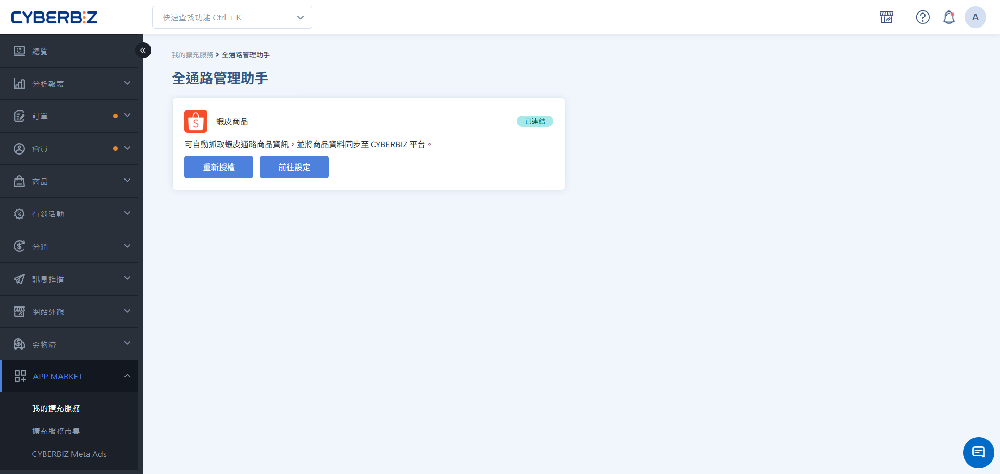
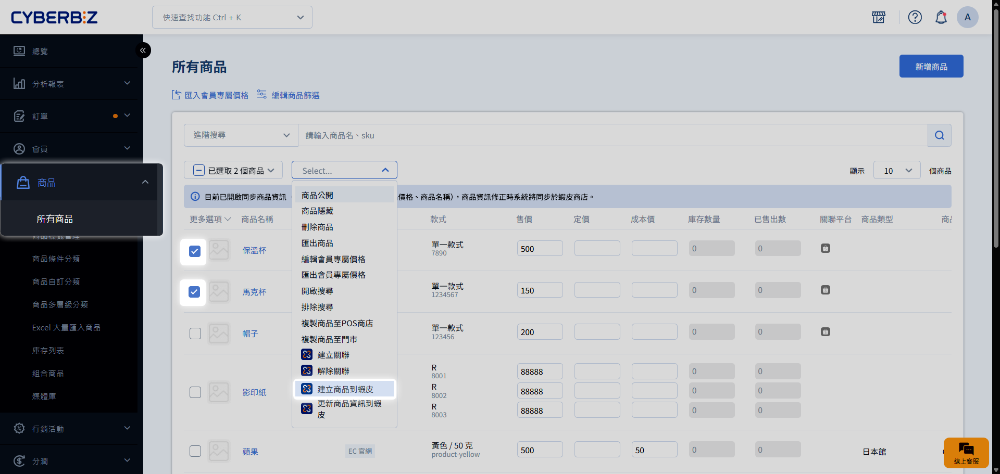
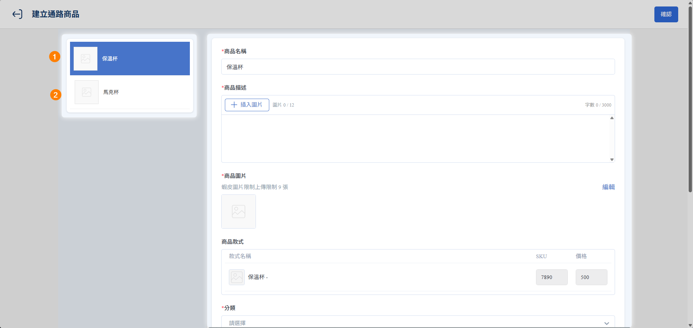
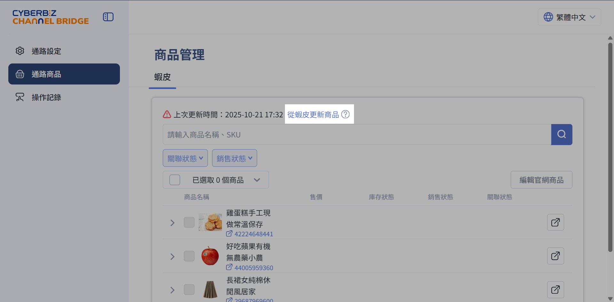

# Step 4 官網商品建立為蝦皮商品

您也可以將官網既有的商品快速發佈至蝦皮賣場。發佈成功後，系統將自動完成雙端關聯，方便您後續進行庫存與資訊的自動化同步。
{ .subtitle }

[:lucide-lock:{ title="適用方案" }](../../resources/conventions#適用方案) | 所有 PLUS / 企業 
[:lucide-grid-2x2-plus:{ title="適用擴充" }](../../resources/conventions#適用擴充) | CYBERBIZ CHANNEL BRIDGE
{ .doc-badge }

{ .hero-page }

!!! tip "應用情境"
    - **跨平台拓點**：已在官網經營一段時間，現欲將精選商品快速上架至蝦皮賣場。
    - **同步新品上架**：在官網建立新品後，一鍵同步至蝦皮，省去重複貼上圖文的過程。
    - **維持關聯一致**：確保兩端商品從發佈起就建立正確關聯，避免手動比對 SKU 的誤差。

## 建立前的準備 { #prerequisites-shopee-s4 }

在開始發佈前，請確認欲操作的商品符合以下條件：

| 檢查項目 | 說明與限制 |
| :--- | :--- |
| **商品來源** | 必須是由官網手動建立、且 **尚未與蝦皮建立關聯** 的商品 |
| **類型限制** | **不支援** POS 商品、快速到貨商品 串倉商品可建立為蝦皮商品，但不可進行資訊同步 |
| **授權狀態** | 蝦皮商店授權需在有效期內 |

## 操作流程 { #operate-shopee-s4 }

### 步驟 1：選取商品並啟動發佈 { #operate-shopee-s4-step-1-product }

1. 前往 **商品 > 所有商品**。
2. 使用篩選器加速查找：
    - **商店類別**：選擇 `EC`。
    - **建立來源**：選擇 `EC 官網`。
    - **未關聯平台**：選擇 `蝦皮商店`。
3. 勾選欲發佈的商品，點選 **更多操作 > 建立商品到蝦皮**。

### 步驟 2：編輯蝦皮特定欄位 { #operate-shopee-s4-step-2-edit }

系統會跳轉至蝦皮資訊編輯頁面，您可在此微調發佈至蝦皮的內容（**此處修改不影響官網原始資料**）。

!!! warning "蝦皮平台商品填寫規範"
    為確保商品順利轉換，請務必確認所有欄位均符合 [欄位填寫規則](#reference-shopee-s4)，以免匯入失敗。

### 步驟 3：核對發佈結果 { #operate-shopee-s4-step-3 }

1. 前往 **App MARKET > 我的擴充服務 > CYBERBIZ CHANNEL BRIDGE**。
2. 切換至 **操作紀錄** 頁籤。
3. 確認發佈狀態。若失敗，可點擊 **失敗原因** 查看並修正（常見原因：SKU 重複或字數超標）。
4. 發佈成功後，商品將自動轉為 `已關聯`。您可進一步開啟 [庫存同步](step3-sync-inventory-with-shopee.md) 或[商品資訊同步](step5-sync-product-info-with-shopee.md)功能。

??? quote "操作紀錄顯示失敗，但蝦皮上看得到商品？"
    蝦皮建立商品分為兩步：
    
    1. 先建立商品
    2. 再為商品加上款式。
    
    若第二步因不符合蝦皮規範（例如價格為 0）而失敗，第一步建立的商品仍會留在蝦皮，成為款式不完整的商品。

    處理方式：

    1. 到蝦皮賣家中心刪除該商品。
    2. 依「操作記錄」的失敗原因修正官網商品。
    3. 重新執行「建立商品到蝦皮」。

        

    修正後若出現其他錯誤訊息，是因為系統遇到第一個錯誤就停止檢查，請依新的訊息再次修正。

## 欄位填寫規則 { #reference-shopee-s4 }

為避免發佈失敗，請嚴格遵守蝦皮平台的規範：

### 商品名稱

- **字數**：**超過 10 個字**
- **格式**：頭尾不可有空格

### 商品價格

- **價格區間**：多款式商品，不同款式價格高價與最低價不得相差超過 5 倍

### 商品描述

- **格式**：僅支援 JPG、JPEG、PNG，不支援 WebP、GIF
- **尺寸**：圖片高度 > 32px、圖片寬度 > 700px、寬高比例介於0.5 ~ 3.2 之間
- **大小**：不可超過 2MB
- **數量**：上限 12 張

### 商品圖片

- **數量**：若超過數量上限，系統將自動取前 9 張作為預設 

    - **蝦皮商城**：請上傳 3 ~ 9 張圖片
    - **一般賣家**：請上傳 1 ~ 9 張圖片 
    

### 商品款式

- **名稱**：規格名稱不可超過 14 個字元、選項名稱不可超過 20 個字元，開頭與結尾不可有空格
- **格式**：**最多 2 個規格組合**（如尺寸 ✕ 顏色），原商品須有完整的商品款式組合，**不可缺漏款式（詳見下方範例1）**

    !!! example "範例 1：款式組合完整選項"
        款式規格若為：尺寸（S/M/L）✕ 顏色（黑/白）

        - **正確選項**：（S/黑）（S/白）（M/黑）（M/白）（L/黑）（L/白）
        - **錯誤選項**：（S/黑）（S/白）（M/黑）（L/黑）

- **數量**：款式總數上限 100 個（單一規格或多規格組合皆計算在內）。

### 款式圖片

- **格式**：請確保所有款式皆有圖；若無法，請保持所有款式皆無圖，**不支援部分款式有圖**
- **數量**：上限 1 張，超過會自動以第 1 張為預設
- **顯示方式**：**雙規格時僅支援依第一層規格區分圖片（詳見下方範例2）**

    !!! example "範例 2：雙規格商品款式圖片套用方式"
        針對雙規格商品，系統僅支援依據 **第一層規格** 區分圖片。各款式將自動帶入該層級第一個選項之圖片作為共用圖，無法針對第二層規格個別設定。

        - 款式規格若為：尺寸（S/M/L）✕ 顏色（黑/白）。
        - 第一層規格則為：尺寸（S/M/L），款式選項有（S/M/L）3 種。

        | 選項 | 官網款式圖 | 套用方式 | 蝦皮款式圖 |
        | ------- | --------- | ------- | --------- |
        | 尺寸（S）| （S/黑/**圖A**） （S/白/圖B）| **圖A** 視為尺寸（S）的共用圖 | （S/黑/**圖A**） （S/白/**圖A**）|
        | 尺寸（M）| （M/黑/**圖C**） （M/白/圖D）| **圖C** 視為尺寸（M）的共用圖 | （M/黑/**圖C**） （M/白/**圖C**）|
        | 尺寸（L）| （L/黑/**圖E**） （L/白/圖F）| **圖E** 視為尺寸（L）的共用圖 | （L/黑/**圖E**） （L/白/**圖E**）|

### 分類

- **套用規則**：套用蝦皮商店的物流選項

### 較長備貨（選填）

- **套用規則**：可自訂預計出貨天數

<!--
| 欄位名稱 | 關鍵填寫規範 |
| :--- | :--- |
| **商品名稱** | **超過 10 個字** 頭尾不可有空格 | 
| **商品價格** | 多款式商品，不同款式價格高價與最低價不得相差超過 5 倍 | 
| **商品描述** | 檔案格式僅支援 JPG、JPEG、PNG，不支援 WebP、GIF 圖片高度 > 32px 圖片寬度 > 700px 寬高比例介於0.5 ~ 3.2 之間 圖片大小不可超過 2MB 數量上限 12 張 | 
| **商品圖片** | 蝦皮商城：請上傳 3 ~ 9 張圖片 一般賣家：請上傳 1 ~ 9 張圖片 若超過此限制，系統將自動取前 9 張作為預設 | 
| **商品款式** | **最多 2 個規格組合**（如尺寸 x 顏色） 原商品須有完整的商品款式組合，**不可缺漏款式（詳見下方範例1）** 規格名稱不可超過 14 個字元 選項名稱不可超過 20 個字元 開頭與結尾不可有空格 款式總數上限 100 個（單一規格或多規格組合皆計算在內） | 
| **款式圖片** | 請確保所有款式皆有圖；若無法，請保持所有款式皆無圖 **不支援部分款式有圖** 上限 1 張，超過會自動以第 1 張為預設 **雙規格時僅支援依第一層規格區分圖片（詳見下方範例2）**  |
| **分類** | 套用蝦皮平台的類別層級 | 
| **物流設定** | 套用蝦皮商店的物流選項 | 
| **較長備貨（選填）** | 可自訂預計出貨天數 | 

!!! example "範例 1：款式組合完整選項"
    款式規格若為：尺寸（S/M/L）✕ 顏色（黑/白）

    - **正確選項**：（S/黑）（S/白）（M/黑）（M/白）（L/黑）（L/白）
    - **錯誤選項**：（S/黑）（S/白）（M/黑）（L/黑）

!!! example "範例 2：雙規格商品款式圖片套用方式"
    針對雙規格商品，系統僅支援依據 **第一層規格** 區分圖片。各款式將自動帶入該層級第一個選項之圖片作為共用圖，無法針對第二層規格個別設定。

    - 款式規格若為：尺寸（S/M/L）✕ 顏色（黑/白）。
    - 第一層規格則為：尺寸（S/M/L），款式選項有（S/M/L）3 種。

    | 選項 | 官網款式圖 | 套用方式 | 蝦皮款式圖 |
    | ------- | --------- | ------- | --------- |
    | 尺寸（S）| （S/黑/**圖A**） （S/白/圖B）| **圖A** 視為尺寸（S）的共用圖 | （S/黑/**圖A**） （S/白/**圖A**）|
    | 尺寸（M）| （M/黑/**圖C**） （M/白/圖D）| **圖C** 視為尺寸（M）的共用圖 | （M/黑/**圖C**） （M/白/**圖C**）|
    | 尺寸（L）| （L/黑/**圖E**） （L/白/圖F）| **圖E** 視為尺寸（L）的共用圖 | （L/黑/**圖E**） （L/白/**圖E**）|

-->

## 欄位自動帶入對應表

下表說明系統如何將官網資料自動對應至各欄位，並標示匯入後的編輯權限：

| 欄位名稱 | 資訊填入邏輯 | 可否編輯 | 
| :--- | :--- | :--- |
| **商品名稱** | 自動帶入官網欄位 | ✓ |
| **商品描述** | 自動帶入 **商品介紹** 欄位內容，並僅保留純文字與圖片 路徑：**商品 > 所有商品 > 點擊商品 > 商品描述頁籤** | ✓ |
| **商品圖片** | 自動帶入官網欄位 | ✓ |
| **商品款式** | 自動帶入 **規格名稱、選項名稱、SKU、價格** | **✕** |
| **款式圖片** | 自動帶入官網欄位 | ✓ | 
| **分類** | 系統依品名自動判定 | ✓ | 
| **物流設定** | **留空** | ✓ | 
| **較長備貨(選填)** | **留空** | ✓ | 

## 常見問題

??? quote "官網商品已建立到蝦皮，後來在官網新增了款式，如何建立到蝦皮？"
    範例：商品 A 原有款式 A1、A2 已建立到蝦皮，後續在官網新增款式 A3。

    1. 確認 A1、A2 為「關聯中」。
    2. 勾選商品 A，點選「更多操作 > 更新商品資訊到蝦皮」，A3 會一併建立到蝦皮。

    :lucide-triangle-alert: A1、A2 的商品資訊也會一併更新到蝦皮。

??? quote "官網商品建立到蝦皮失敗的常見原因有哪些？"
    - 款式組合有缺漏（例如尺寸 3 種 × 顏色 2 種，需要設定 6 種組合）。
    - 款式名稱或選項名稱開頭有空白。
    - 款式總數超過 100 個。
    - 商品描述圖片為 WebP 或 GIF 格式，或超過 12 張。
    - 多款式價格最高與最低相差超過 5 倍。