# 同步蝦皮訂單並出貨

將已授權的蝦皮商店訂單匯入 CHANNEL BRIDGE。可在 **通路訂單** 批次申請物流編號、列印出貨文件，並處理取消。
{ .subtitle }

[:lucide-lock:{ title="適用方案" }](../../resources/conventions#適用方案) | 所有 PLUS / 企業 
[:lucide-grid-2x2-plus:{ title="適用擴充" }](../../resources/conventions#適用擴充) | CYBERBIZ CHANNEL BRIDGE
{ .doc-badge }

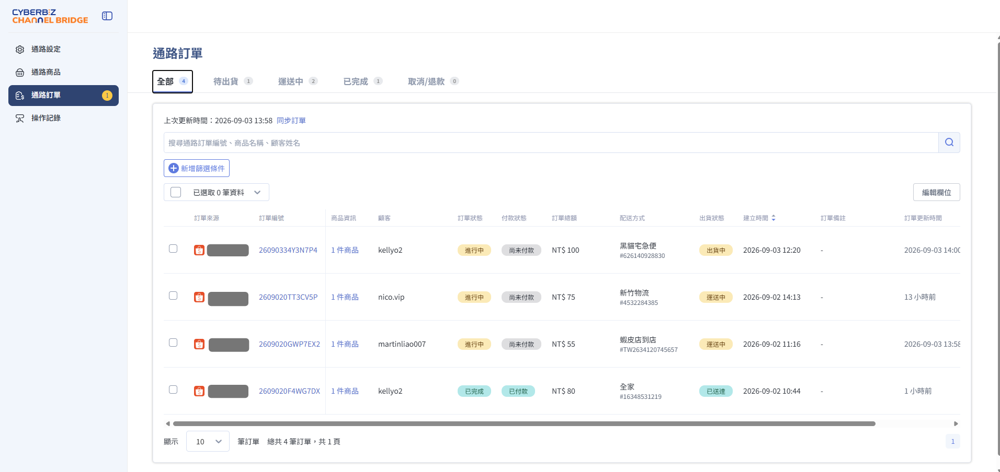{ title="通路訂單列表" .hero-page }

## 使用須知 { #prerequisites-shopee-orders }

### 開通與授權 { #prerequisites-shopee-orders-access }

- **開通訂單同步**：若左側沒有 **通路訂單**，請聯繫 CYBERBIZ 客服開通。開通前請先完成 [蝦皮商店授權](step1-install-and-activate.md)。
- **一次只綁一間商店**：重新綁定另一間蝦皮商店時，系統會清除原商店的訂單，避免兩店訂單混在一起。取消授權或解除綁定時，也會清除該商店的訂單。
- **授權過期先暫停**：授權過期後，既有訂單仍保留，但暫停同步與訂單相關操作。請依 [重新授權](step1-install-and-activate.md#operate-shopee-s1-step-3-manage) 恢復。
- **超過 90 天的個資**：訂單建立超過 90 天後，系統刪除蝦皮訂單編號、購買人蝦皮帳號與託運單資訊，仍保留購買品項、訂單金額與訂單狀態。

### 不支援情境 { #prerequisites-shopee-orders-seller-center }

以下情況請改到蝦皮賣家中心處理：

- **只出部分商品**：目前只支援整筆訂單出貨，不能拆單或部分出貨。
- **退貨、退款、申訴**：請在蝦皮賣家中心處理。
- **關轉要重選門市**：收到關轉通知時，請在蝦皮賣家中心重新選店。
- **退貨門市或退貨地址**：請先在蝦皮賣家中心設定，再回到 CHANNEL BRIDGE 出貨。未設定時，申請編號可能失敗。
- **自訂物流，或須另外與蝦皮簽約才開啟的物流**：請在蝦皮賣家中心出貨。

## 物流操作

### 支援配送方式 { #specs-shopee-orders-logistics }

| 類型 | 配送方式 | 
| --- | --- | 
| 蝦皮店 | 蝦皮店到店、蝦皮店到店-隔日到貨、店到家宅配 | 
| 超商 | 7-11、全家、全家冷凍超取（不寄送離島）、萊爾富、萊爾富-經濟包 | 
| 宅配 | 黑貓、宅配通、新竹物流、嘉里快遞 | 

### 出貨與貨態 { #prerequisites-shopee-orders-shipping }

- **出貨走蝦皮物流**：系統串接蝦皮，編號與託運單由蝦皮平台回拋，不會使用 CYBERBIZ 的物流方式出貨。
- **貨態以蝦皮為準**：列表上的訂單狀態與出貨狀態，顯示蝦皮回傳的最新結果。請用 **同步訂單** 取得更新。

## 一般操作 { #operate-shopee-orders }

### 匯入訂單 { #operate-shopee-orders-import }

第一次把蝦皮訂單帶進 CHANNEL BRIDGE 時，依以下步驟操作：

1. 開啟 **CYBERBIZ CHANNEL BRIDGE**，點選 **通路訂單**。
2. 尚無訂單時，點選 **匯入訂單**。

    - **匯入範圍**：系統匯入這間商店近 30 天建立的訂單。
    - **匯入時間**：約需 3–5 分鐘。完成後列表將顯示訂單資訊。

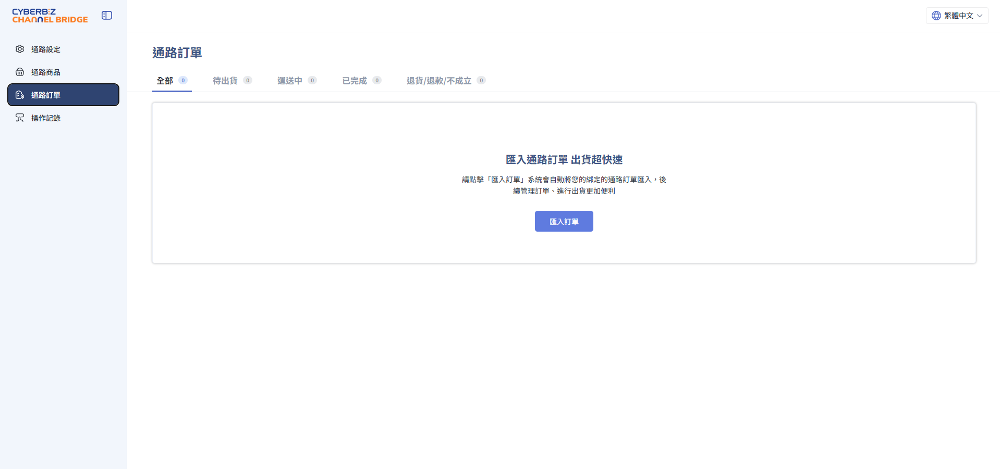{ title="通路訂單尚無資料時匯入訂單" .screenshot }

### 更新訂單 { #operate-shopee-orders-update }

匯入完成後，日常要抓新訂單或更新狀態時，依以下步驟操作：

在 **通路訂單** 點選 **同步訂單**。

- **更新範圍**：
    - **新訂單**：帶入近 15 天內建立的新訂單。
    - **既有訂單**：把列表中已有的訂單更新為最新狀態。

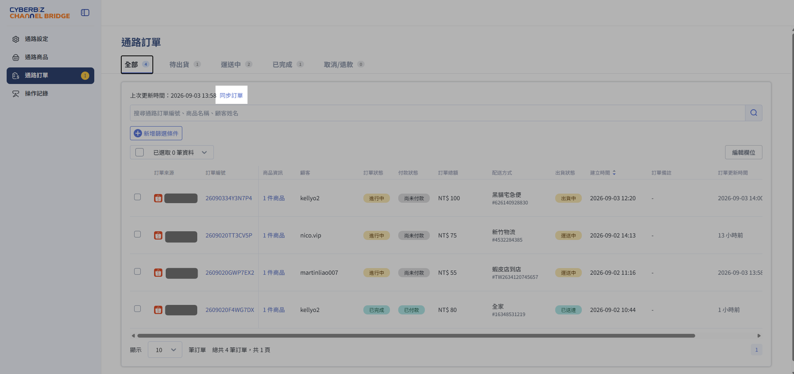{ title="點上次更新時間旁的同步訂單" .screenshot }

### 查看訂單 { #operate-shopee-orders-list }

頁籤分為 **全部**、**待出貨**、**運送中**、**已完成**、**取消/退款**。可用通路訂單編號、商品名稱或顧客姓名搜尋，也可點 **新增篩選條件**。

點 **商品資訊** 可查看該筆訂單的品項、單價與數量。點 **編輯欄位** 可調整列表要顯示的欄位。

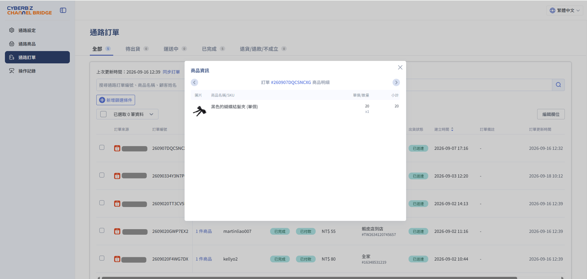{ title="點商品資訊查看品項明細" .screenshot }

### 編輯訂單欄位 { #operate-shopee-orders-columns }

若於訂單列表頁中無法找到指定欄位，請點擊 **編輯欄位**，於右側視窗勾選對應欄位，並可點擊 :lucide-grip-vertical: 拖曳欄位排序。

- 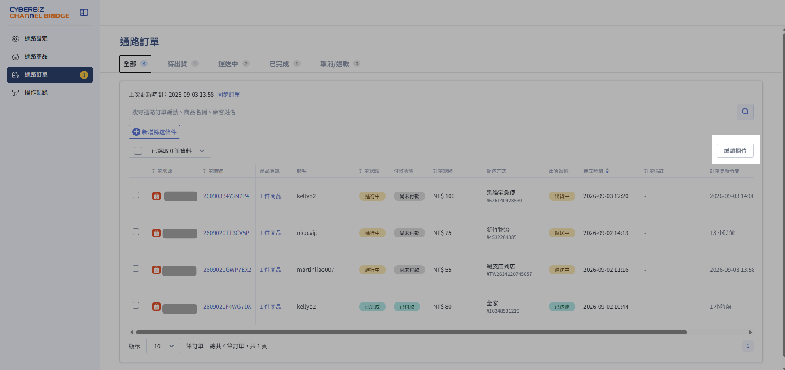{ title="點列表右側的編輯欄位" .screenshot }
- 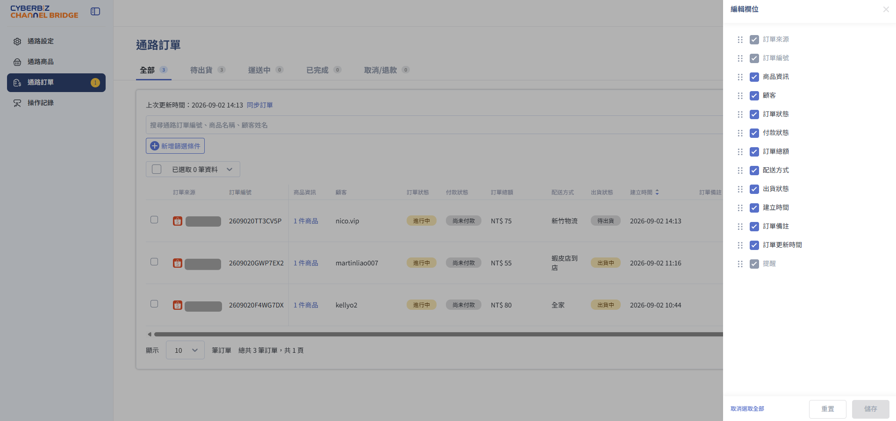{ title="勾選要顯示的欄位並拖曳排序" .screenshot }

## 出貨作業 { #operate-shopee-orders-shipping }

### 步驟 1：找出要出貨訂單 { #operate-shopee-orders-pick }

1. 點 **待出貨**。頁籤上的數字是尚未申請物流編號、需要處理的訂單數。

    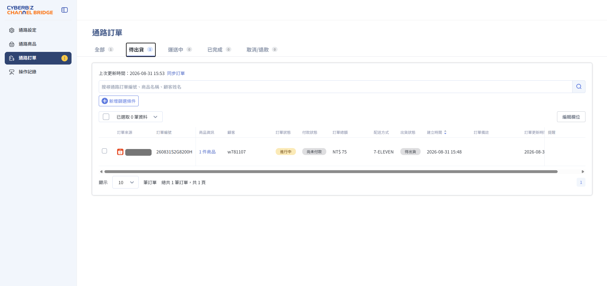{ title="待出貨頁籤與訂單數" .screenshot }

2. **提醒** 一欄會對今明兩天須出貨的訂單，標出截止時間，例如「明日截止」。請先處理這些訂單，避免超過蝦皮的出貨天數。

    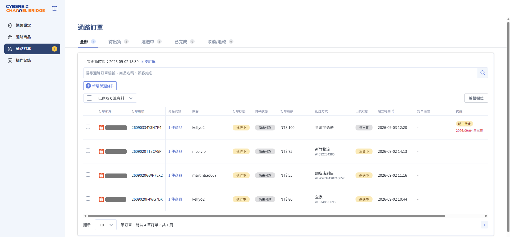{ title="提醒欄標示即將截止的訂單" .screenshot }

!!! tip "效率出貨小撇步"
    可直接切到 **待出貨** 頁籤，利用篩選的功能，出貨狀態篩選 **待出貨**，表示此單尚未申請託運單號，即可批次操作出貨。
    可搭配 **建議出貨期限** 欄位，篩選出 **建議今天內出貨** 或 **建議明天內出貨** 訂單。

### 步驟 2：批次申請物流編號 { #operate-shopee-orders-ship }

1. 勾選要出貨的訂單，點 **更多操作** > **訂單出貨**。請只勾選出貨狀態為 **待出貨** 的訂單。

    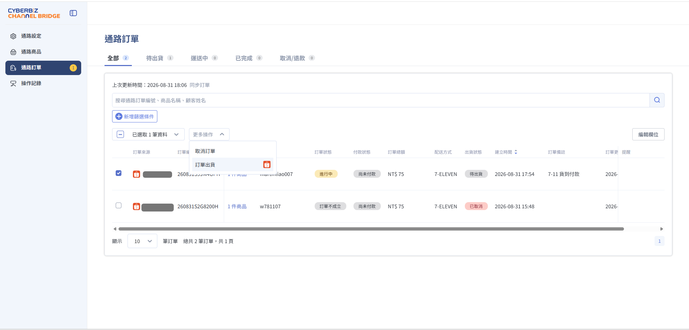{ title="更多操作中的訂單出貨" .screenshot }

2. 依這批訂單的配送方式填寫後，點 **申請編號**。

    === "7-ELEVEN／蝦皮"

        不用填寫欄位，直接申請編號即可。

        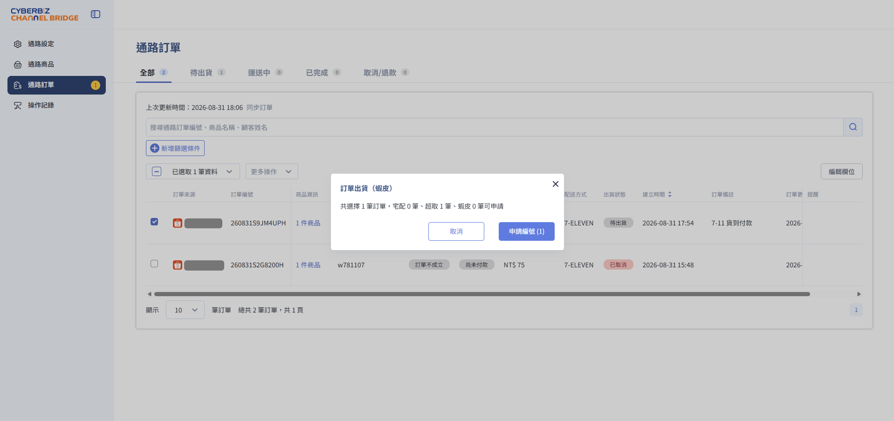{ title="7-ELEVEN 或蝦皮配送直接申請編號" .screenshot }

    === "全家／萊爾富"

        填寫 **寄件人真實姓名**，才能申請物流編號。

        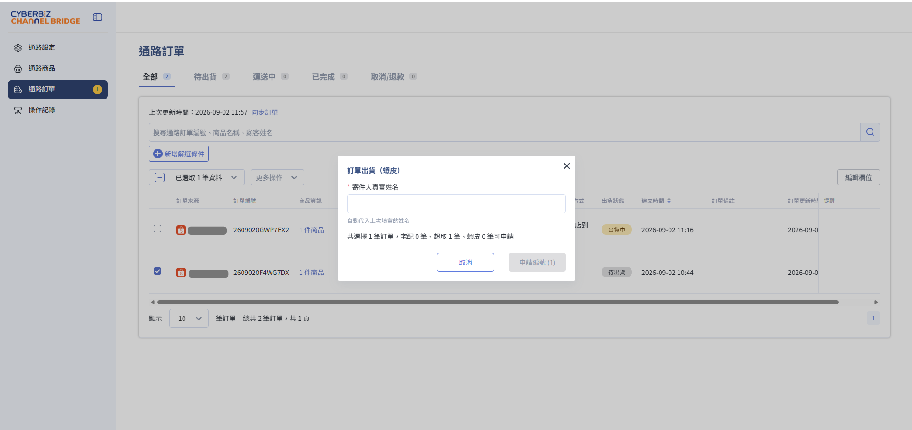{ title="超取訂單填寫寄件人真實姓名" .screenshot }

    === "宅配"

        填寫 **快遞取件位置** 與 **快遞取件時間**，才能申請物流編號。

        **欄位說明：**

        - **快遞取件位置**：預先帶入蝦皮後台設定的快遞取件地址。可點擊下拉選單，選擇蝦皮後台設定的其他地址。
        - **快遞取件時間**：此時間為蝦皮系統回傳的各物流最快可取件時間。時間僅為參考，實際取件日期和時間依快遞安排為主。

        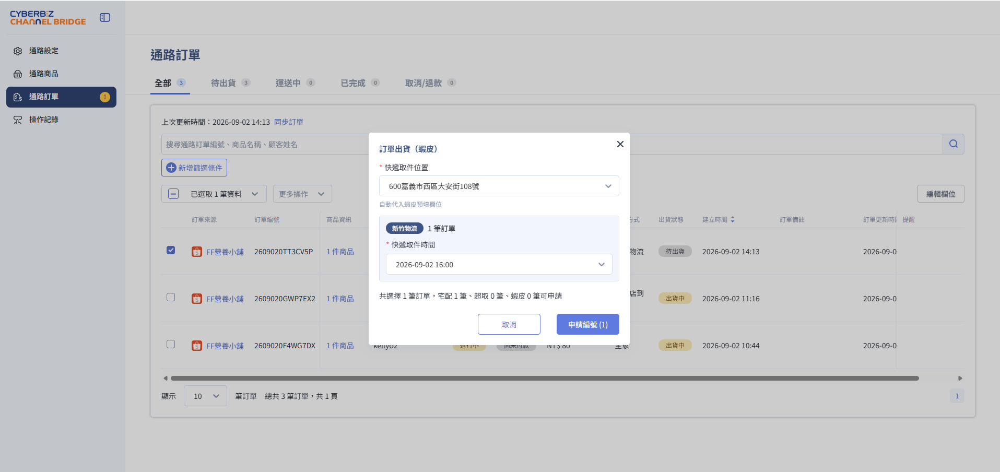{ title="宅配訂單填寫取件位置與時間" .screenshot }

3. 申請完成後，結果列出每筆訂單的物流編號。
  
    > 失敗的列會顯示原因，例如：蝦皮未設定退貨門市或門市關轉。

    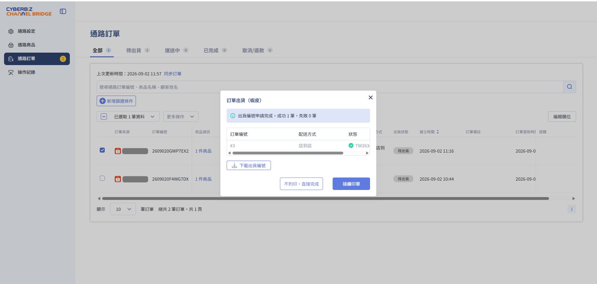{ title="出貨編號申請結果" .screenshot }

4. 要保存這批編號，點擊 **下載出貨編號**，取得 CSV。若要印單，點擊 **接續印單**。

### 步驟 3：列印出貨文件 { #operate-shopee-orders-print }

1. 在 **列印出貨文件** 勾選要印的文件，例如揀貨單、託運單/寄件單、訂單明細。

    !!! note "黑貓宅急便"
        一般商家不用列印託運單。申請編號成功後即完成出貨，請點 **不列印，直接完成**。若商家與蝦皮簽約開放列印託運單，請聯繫 CYBERBIZ 客服開啟列印。

2. 若出現 **列印方式**，再選 **一般列印（A4）** 或 **熱感列印（A6）**。

    !!! note "列印格式由蝦皮決定"
        這份文件由蝦皮提供，不由 CYBERBIZ CHANNEL BRIDGE 產生，支援列印的格式依蝦皮平台而定。

3. 點 **列印**，在預覽分頁選擇已連線的印表機。

    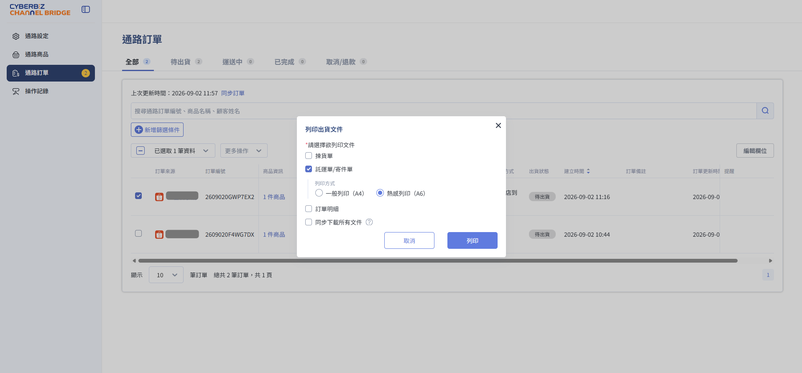{ title="選擇出貨文件與列印方式" .screenshot }

## 出貨狀態欄位說明 { #specs-shopee-orders-status }

| 出貨狀態 | 此時訂單在哪 |
| --- | --- |
| 待出貨 | 尚未申請物流編號 |
| 出貨中 | 已有物流編號，包裹尚未寄出 |
| 運送中 | 物流商已收到貨 |
| 已送達 | 買家已收貨，且撥款已入帳。訂單狀態改為 **已完成** |
| 已取消 | 買家取消且不需賣家核決。訂單狀態改為 **不成立** |

## 補印出貨文件 { #operate-shopee-orders-print-reprint }

已有物流編號、但出貨狀態仍是 **待出貨** 或 **出貨中** 時，可再印一次。狀態改為 **運送中** 之後，依蝦皮規定不能再補印託運單。

勾選訂單後，點 **更多操作** > **補印出貨文件**。若只要編號，點 **下載出貨編號**。

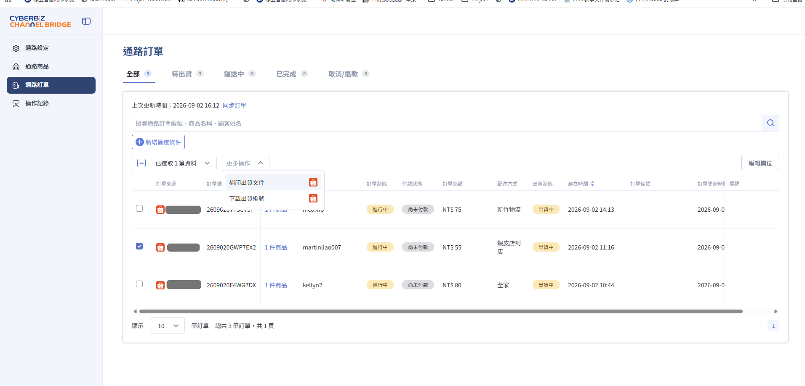{ title="補印出貨文件或下載出貨編號" .screenshot }

## 調整文件列印順序 { #operate-shopee-orders-docs-sort }

要調整多筆文件的列印順序，前往 **通路設定**，開啟蝦皮商店的 **進階設定**，在 **列印訂單排序方式** 選一種：

=== "依文件類型排序"

    - **排列方式**：先印完全部訂單的揀貨單，再印託運單，最後印訂單明細。

    - **適用情境**：相同類型的文件集中成一疊，適合分批處理。

    - **列印範例**：

        - 第一步：揀貨單`訂單 A` ➔ 揀貨單`訂單 B` ➔ 揀貨單`訂單 C` ➔ 揀貨單`訂單 D`
        - 第二步：託運單`訂單 A` ➔ 託運單`訂單 B` ➔ 託運單`訂單 C` ➔ 託運單`訂單 D`
        - 第三步：訂單明細`訂單 A` ➔ 訂單明細`訂單 B` ➔ 訂單明細`訂單 C` ➔ 訂單明細`訂單 D`

=== "依訂單編號排序"

    - **排列方式**：先印完同一筆訂單勾選的文件，再印下一筆。同一筆內的順序為揀貨單、託運單、訂單明細。

    - **適用情境**：同一筆訂單的文件接在一起，適合逐筆打包。

    - **列印範例**：

        - 第一步：揀貨單`訂單 A` ➔ 託運單`訂單 A` ➔ 訂單明細`訂單 A`
        - 第二步：揀貨單`訂單 B` ➔ 託運單`訂單 B` ➔ 訂單明細`訂單 B`
        - 第三步：揀貨單`訂單 C` ➔ 託運單`訂單 C` ➔ 訂單明細`訂單 C`
        - 第四步：揀貨單`訂單 D` ➔ 託運單`訂單 D` ➔ 訂單明細`訂單 D`

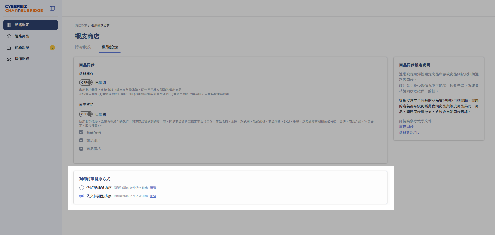{ title="進階設定中的列印訂單排序方式" .screenshot }

## 訂單處理 

### 買家取消訂單 { #operate-shopee-orders-buyer-cancel }

買家取消後，請先看這筆訂單要不要賣家決定。

=== "商家不須核決"

    出貨狀態自動改為 **已取消**，訂單狀態改為 **不成立**。

=== "商家須核決"

    >  通常為已有物流編號的訂單，才須進行核決作業。

    **提醒** 欄會出現 **馬上處理** 按鈕與剩餘時間提示。

    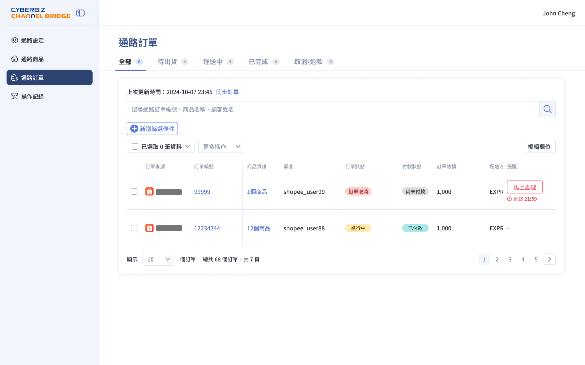{ title="提醒欄的馬上處理" .screenshot }

    1. 點擊 **馬上處理**，確認顧客取消原因與須回應的時間。
    2. 同意取消時，點 **接受申請**。訂單轉為不成立。
    3. 要繼續出貨時，點 **拒絕申請，繼續出貨**。訂單維持原來的狀態。

    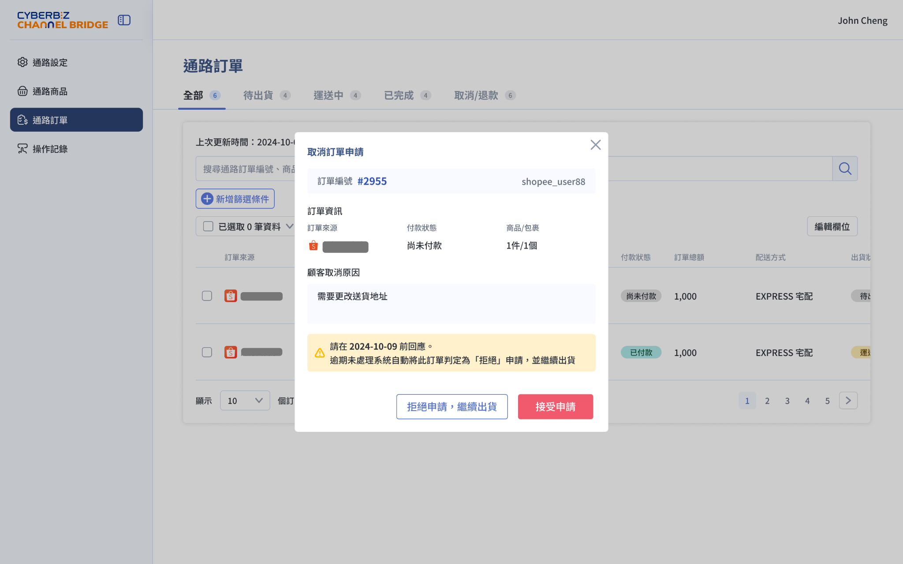{ title="接受或拒絕買家取消申請" .screenshot }

    逾期沒有回應時，系統視為拒絕申請，並繼續出貨。請在對話框寫的時間前完成選擇。

### 賣家取消訂單 { #operate-shopee-orders-seller-cancel }

出貨狀態為 **尚未出貨** 或 **待出貨** 時，才可從這裡取消。

1. 勾選訂單，點 **更多操作** > **取消訂單**。
2. 選擇 **取消訂單原因**，確認取消後無法復原，再點 **取消訂單**。訂單轉為不成立。

    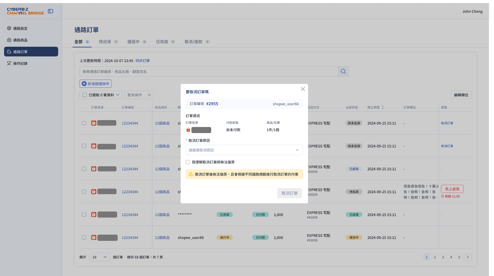{ title="選擇原因後取消訂單" .screenshot }

!!! warning "取消後無法復原"
    取消會依該通路的規則處理，且不能復原。已進入出貨中或運送中的訂單，不能用這個方式取消，請到蝦皮賣家中心處理。

## 更多操作 { #next-steps-shopee-orders }

- :lucide-key:{ .lg }
  [__安裝與授權蝦皮商店__](step1-install-and-activate.md)
  尚未授權，或授權過期時，先完成商店連結。

- :lucide-refresh-cw:{ .lg }
  [__官網與蝦皮商品庫存同步__](step3-sync-inventory-with-shopee.md)
  訂單成立或取消時，讓兩邊商品庫存一起更新。

