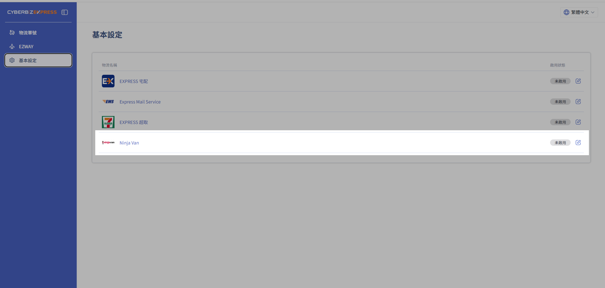
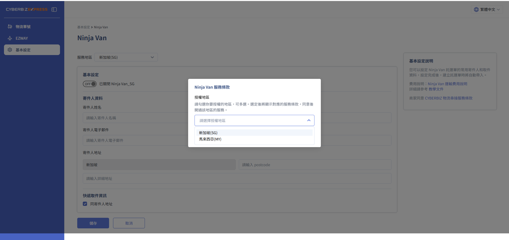
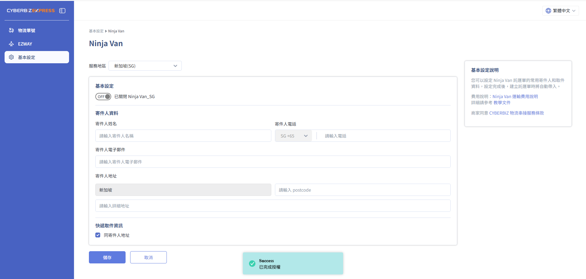
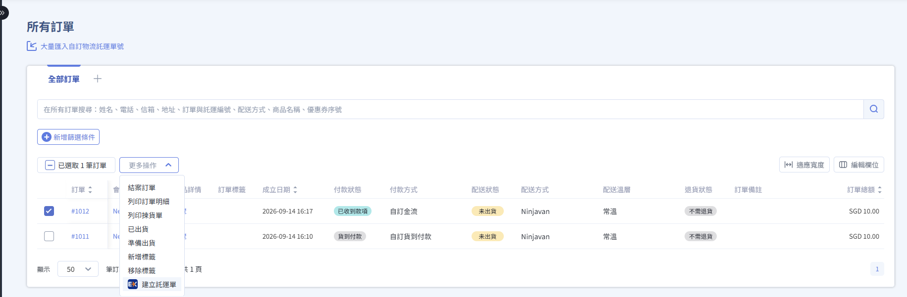
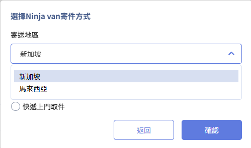
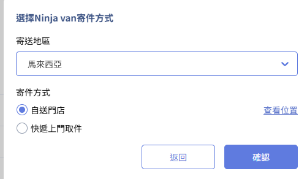
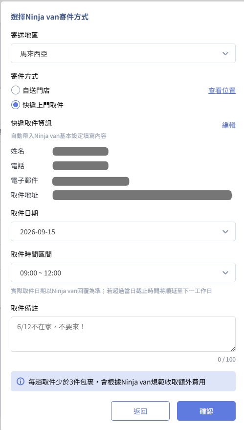
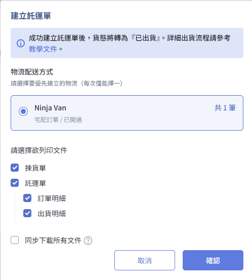
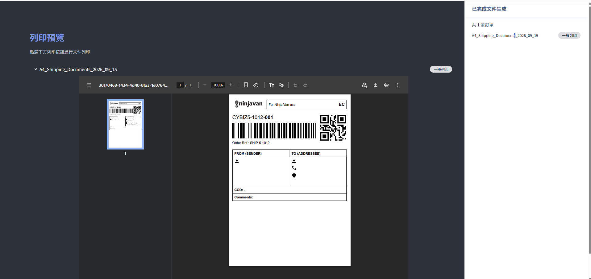
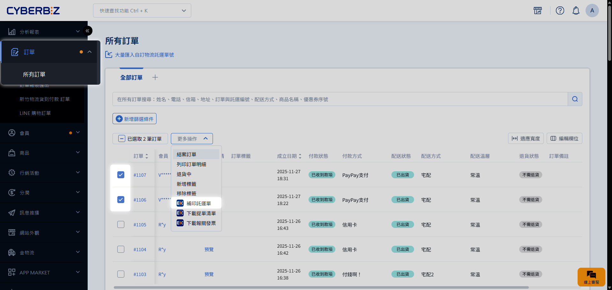

# CYBERBIZ EXPRESS Ninja Van 宅配（新加坡／馬來西亞）

說明如何啟用 Ninja Van 新加坡與馬來西亞宅配服務，完成物流設定、建立託運單、列印文件與查詢貨態。
{ .subtitle }

[:lucide-layers:{ title="適用產品" }](../../../resources/conventions#適用產品) | 跨境電商（新加坡落地版／馬來西亞落地版） 
[:lucide-grid-2x2-plus:{ title="適用擴充" }](../../../resources/conventions#適用擴充) | CYBERBIZ EXPRESS
{ .doc-badge }

## 服務說明 { #intro-ninja-van }

- **配送地區**：支援新加坡與馬來西亞當地配送。
- **配送模式**：提供宅配取貨不付款服務，消費者需先完成線上付款。
- **禁運品合規**：商家須遵守 Ninja Van 與 CYBERBIZ 的運送規範。

## 使用須知 { #prerequisites-ninja-van }

- 尚未安裝 CYBERBIZ EXPRESS APP 的商家，需先聯繫開店顧問完成安裝與物流設定。
- 建立託運單時，寄件地與收件地須位於同一個國家。
- Ninja Van 不提供消費者退貨服務；如需退貨，商家須自行聯繫消費者處理。

## 啟用 Ninja Van 物流 { #operate-ninja-van }

### 開啟物流設定入口 { #operate-ninja-van-entry }

1. 登入 CYBERBIZ 管理後台，前往 **APP MARKET > 我的擴充服務 > CYBERBIZ EXPRESS > 物流管理**。
2. 開啟物流設定入口。

    { .screenshot }

### 完成物流基本設定 { #operate-ninja-van-settings }

1. 選擇配送地區：**新加坡** 或 **馬來西亞**。

    { .screenshot }

2. 勾選同意 **Ninja Van 服務契約**。
3. 填寫寄件人資訊的所有欄位，完成後點選 **儲存**。

    { .screenshot }

4. 開啟對應的物流開關。

!!! warning "設定未完成時無法出貨"
    欄位未填寫完整或物流開關未開啟時，系統不會顯示對應配送方式，也無法進入建立託運單流程。

## 建立與列印託運單 { #operate-ninja-van-waybill }

### 建立託運單 { #operate-ninja-van-create }

建立託運單前，訂單須同時符合以下條件：

- `付款狀態`為 `已收到款項`。
- `配送狀態`為 `未出貨`。
- `退貨狀態`為 `不需退貨`。
- `配送方式`為 `Ninjavan`

操作步驟：

1. 前往 **訂單 > 所有訂單**。
2. 勾選符合條件的訂單，點選 **更多操作 > 建立託運單**。

    { .screenshot }

3. 選擇訂單的寄送地區，確認寄件地與收件地位於同一個國家。

    { .small-image }

4. 選擇寄件方式：
    
    === "自送門市" 

        { .small-image }
    
    === "快遞上門取件"

        若選擇 **快遞上門取件**，從下拉式選單選擇 Ninja Van 提供的取件資訊，並填寫取件日期、時間與備註。

        { .small-image }

!!! note "取件資訊只套用於目前訂單"
    在建立託運單視窗中修改取件資訊時，變更內容只套用於目前操作，不會覆寫物流基本設定。

### 直接列印文件 { #operate-ninja-van-print }

1. 在建立託運單視窗中，勾選要列印的文件。
2. 點選 **直接列印**。

    { .screenshot }

3. 系統開啟瀏覽器列印預覽頁，依照以下順序排列文件：

    { .screenshot }

    1. 揀貨單總表。
    2. 依訂單順序排列的託運單。
    3. 各筆訂單的訂單明細。
    4. 各筆訂單的出貨明細。

只有勾選 **託運單** 且成功產出託運單後，訂單配送狀態才會自動更新為 `已出貨`。

### 同步下載 ZIP 檔 { #operate-ninja-van-download }

1. 在建立託運單視窗中勾選要產出的文件。
2. 勾選 **同步下載 ZIP 檔**。
3. 完成建立託運單後，系統開啟列印預覽頁，並同步下載所選文件的 ZIP 檔。

### 補印託運單 { #operate-ninja-van-reprint }

1. 前往 **訂單 > 所有訂單**。
2. 勾選配送狀態為 `已出貨` 的訂單。
3. 點選 **更多操作 > 補印託運單**。

{ .screenshot }

系統會自動過濾非 EXPRESS 物流訂單。若同時勾選其他物流訂單，系統會提示並跳過不符合條件的訂單。

## 費用結算 { #specs-ninja-van }

- 建立託運單時，系統會依包裹重量預扣 CYBER 幣。
- 系統每月 5 日執行對帳，並依實際運費調整預扣金額。
- 馬來西亞配送會依東區與西區套用不同的費用級距。

## 查詢貨態 { #operate-ninja-van-tracking }

- :lucide-truck:{ .lg }
  [__CYBERBIZ EXPRESS 貨態追蹤與查詢__](order-tracking-and-query.md)
  查看商家與消費者查詢貨態及運費的方式。

