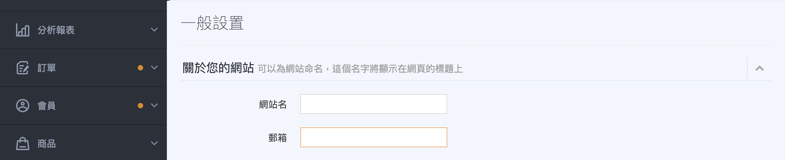
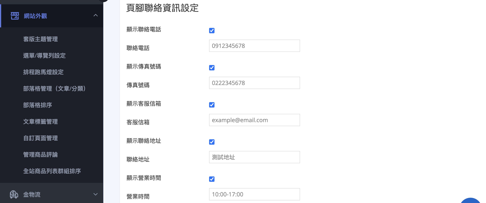
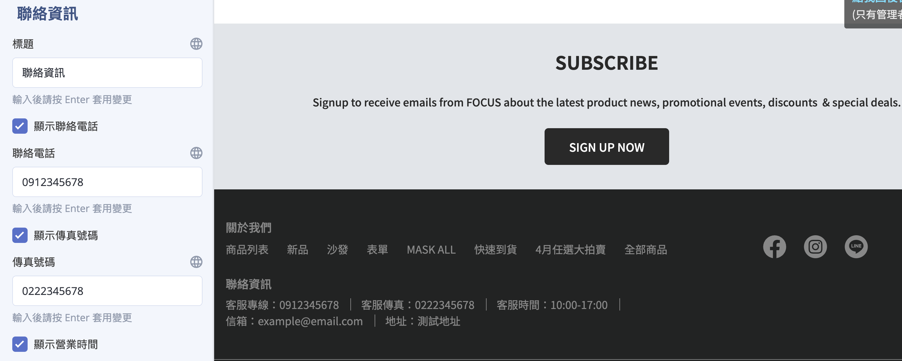
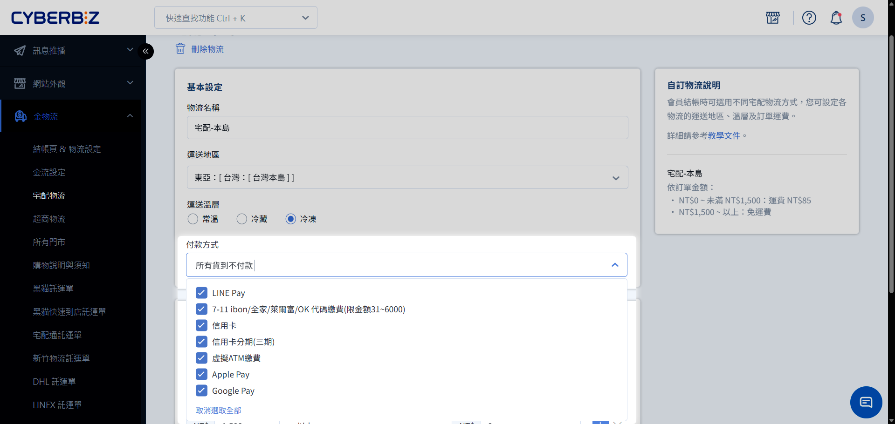

## 送審前要先對齊的資料 { #prerequisites-newebpay }

藍新收到申請後會立刻截圖官網並排程審查。請先做完本節再送表。資料正確且不用補件時，審核約 **1 個月**。

- **既有帳號**：已經有藍新線上收款帳號，也請填同一張串接表。後續由 CYBERBIZ 轉移帳號並完成串接。
- **商品頁**：請至少上架 **1** 個商品，頁面要有商品介紹與規格。
- **測試字樣**：公開頁面若出現「測試」，審查會判定為測試站而無法通過。請先移除這類字樣。

### 商店名稱 { #prerequisites-newebpay-name }

申請表的商店名，須與 **管理中心 > 一般設定** 的 **網站名** 相同。

1. 前往 **管理中心 > 一般設定**。
2. 核對 **網站名**，再把同一個名稱填進申請表。

{ title="網站名須與申請表商店名相同" .screenshot }

網站名稱與公司聯絡資訊的完整填法，見 [設定網站基本資訊](../website-management/setup-store-basic-info.md#operate-general-preferences-company-info){ title="設定網站基本資訊" }。

### 頁腳聯絡資訊 { #prerequisites-newebpay-footer }

頁腳須露出完整的 **電話**、**地址** 與 **電子信箱**。請填真實資料。

=== "一般版型"

    1. 前往 **網站外觀 > 套版主題管理 > 網站設定 > 頁腳**。
    2. 開啟 **聯絡電話**、**客服信箱**、**聯絡地址** 的顯示，並填入內容。

    { title="一般版型頁腳聯絡資訊" .screenshot }

=== "拖拉版型"

    1. 前往 **網站外觀 > 套版主題管理 > 網站設定**，點選 **頁腳**。
    2. 在 **聯絡資訊** 開啟 **聯絡電話**、**信箱**、**聯絡地址** 的顯示，並填入內容。

    { title="拖拉版型頁腳聯絡資訊" .screenshot }

### 政策頁 { #prerequisites-newebpay-policy }

**關於我們**、**隱私政策**、**退款政策**、**服務條款** 四頁的內文要齊，並且出現在頁腳選單。

1. 前往 **網站外觀 > 自訂頁面管理**。
2. 點選這四頁的編輯，把內文補齊。若預設頁已被刪除，請新增同名的四個頁面。
3. 前往 **網站外觀 > 選單/導覽列設定**，把這四頁加入頁腳選單。

頁面內容見 [設定與管理自訂頁面](../website-appearance/pages-and-content/custom-pages.md){ title="設定與管理自訂頁面" }。頁腳選單見 [設定選單與導覽列](../website-appearance/navigation/setup-menus-navigation.md#operate-menus-nav-footer){ title="設定選單與導覽列" }。

### 食品標示 { #prerequisites-newebpay-food }

只有販售食品時才需要這一項。

- **產地**：食品、肉品請寫上產地，例如「產地：台灣」。
- **進口食品**：網站須露出檢疫證明，並在商品介紹貼上以下警語。

    ```
    - 為防治動物傳染病，境外動物或動物產品等應施檢疫物輸入我國，應符合動物檢疫規定，並依規定申請檢疫，擅自輸入應施檢疫物者最高可處 7 年以下有期徒刑，得併科新臺幣 300 萬元以下罰金。未依規定申請檢疫者，將課以新臺幣 100 萬元以下罰鍰，並得按次處罰。
    - 境外商品不得隨貨贈送應施檢疫物。
    - 收件人違反動物傳染病防治條例第 34 條第 3 項規定，未將郵遞寄送輸入之應施檢疫物送交輸出入動物檢疫機關銷燬者，處新臺幣 3 萬元以上 15 萬元以下罰鍰。
    ```

## 送出串接申請 { #operate-newebpay-apply }

1. 確認 [送審前要先對齊的資料](#prerequisites-newebpay) 都已完成。
2. 填寫 [CYBERBIZ × 藍新串接申請表](https://docs.google.com/forms/d/e/1FAIpQLSd6W9Tt5jFFRH6FirT7ALANox1aHYy2QNCe9B9gkQCBGwq13g/viewform)。
3. 審核結果以電子郵件通知。收到通知後，再進行下一節的後台串接。

!!! warning "請先完成官網再送表"
    審查人員收到申請就會截圖官網。官網尚未完成就送出，申請會被退回。

## 把金鑰填進 CYBERBIZ { #operate-newebpay-bind }

### 複製商店代號與 API 金鑰 { #operate-newebpay-keys }

1. 登入藍新後台，前往 **會員中心 > 商店管理 > 詳細資料**。
2. 複製 **商店代號**。
3. 滑到 API 串接金鑰，複製 **HashKey** 與 **HashIV**。

### 啟用付款方式 { #operate-newebpay-enable }

1. 登入 CYBERBIZ 管理後台，前往 **金物流 > 金流設定 > 藍新金流**。
2. 貼上 **商店代號**、**HashKey**、**HashIV**。
3. 開啟要提供給顧客的付款方式，點擊 **儲存**。

!!! warning "金鑰前後不可有空格"
    貼上的商店代號、HashKey、HashIV 若含空格，金流無法啟用。

!!! info "信用卡分期"
    信用卡分期限企業戶，且須另外向藍新申請。需要開通時，請洽 CYBERBIZ 後台客服。

### 開通國外卡 { #operate-newebpay-overseas }

請先確認信用卡一次付清已啟用。

1. 登入藍新後台，前往 **會員中心 > 商店管理 > 詳細資料**。
2. 在支付工具的 **國外卡** 點選 **啟用**。藍新會自動送審。

### 把新付款方式勾進物流 { #operate-newebpay-logistics }

系統不會自動把新付款方式加到物流。未勾選時，結帳頁不會出現該付款方式。

1. 前往 **金物流 > 宅配物流**。
2. 編輯要開放結帳的物流，在 **付款方式** 勾選剛啟用的藍新選項。
3. 點擊 **儲存**。

{ title="在物流勾選藍新付款方式" .screenshot }

自訂物流的付款方式欄位，見 [建立宅配貨到不付款/自訂物流](setup-home-delivery-non-cod-custom-logistics.md){ title="建立宅配貨到不付款/自訂物流" }。

## 退款與提領 { #operate-newebpay-refund }

### 信用卡退款 { #operate-newebpay-refund-card }

1. 登入藍新後台，前往 **銷售中心 > 銷售紀錄查詢 > 信用卡交易專用查詢**。
2. 查出要退款的交易，點選 **退款**。

請在交易成立後 **90 天內** 完成。超過 90 天無法在藍新後台退此筆信用卡交易。

### ATM 與超商代碼 { #operate-newebpay-refund-transfer }

虛擬 ATM、超商代碼繳費不能在藍新後台退款。請與顧客約定退款方式後，自行退款。

- **提領**：款項從藍新虛擬帳戶提出，不支援自動提領。提領次數與手續費以藍新公告為準。

!!! info "收款與帳務問題"
    串接完成後的收款、退款與提領，請先查 [藍新常見問題](https://www.newebpay.com/website/Page/content/faq)，或洽藍新客服。

    - 客服電話：02-2786-3655
    - 客服信箱：cs@newebpay.com

## 後續步驟 { #next-steps-newebpay }

<div class="grid cards" markdown>

- :lucide-search:{ .lg }
  [__查詢顧客付款狀態 :lucide-external-link:__](https://www.newebpay.com/website/Page/content/transaction_inquiry)
  在藍新付款查詢頁確認顧客是否已付款。

- :lucide-circle-question-mark:{ .lg }
  [__藍新常見問題 :lucide-external-link:__](https://www.newebpay.com/website/Page/content/faq)
  查看藍新官方整理的收款與帳務問答。

</div>
