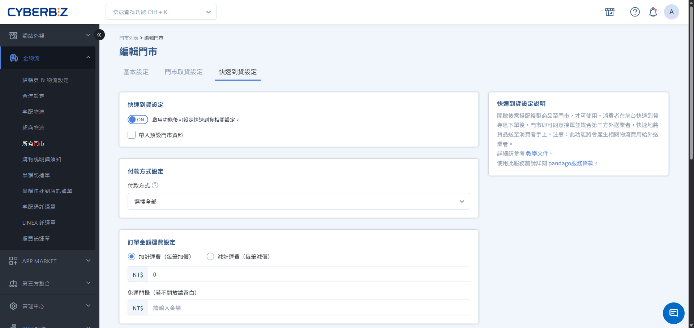
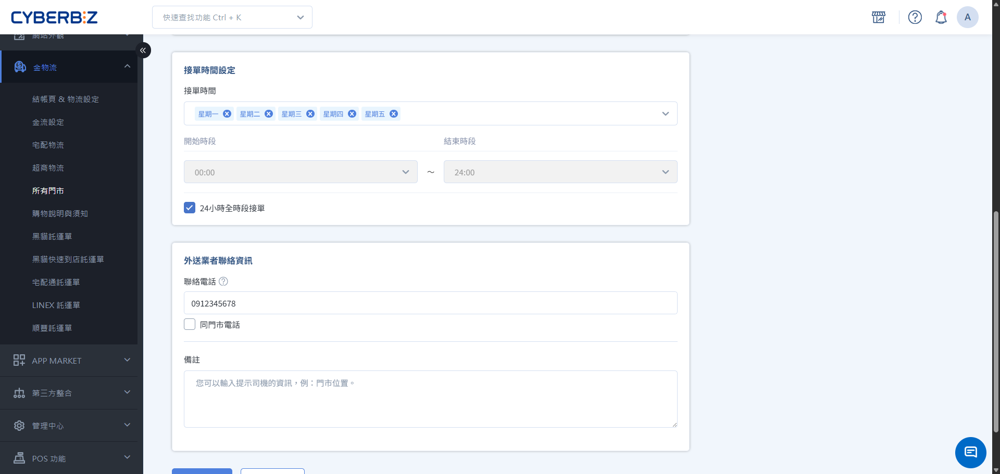
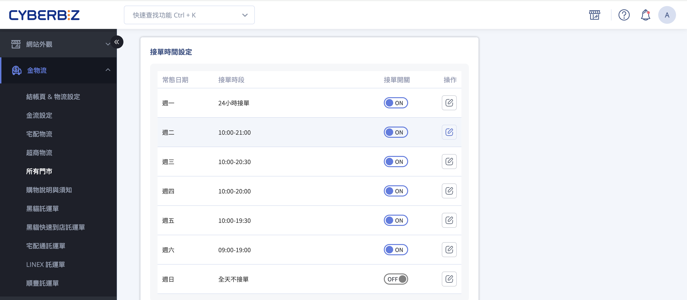
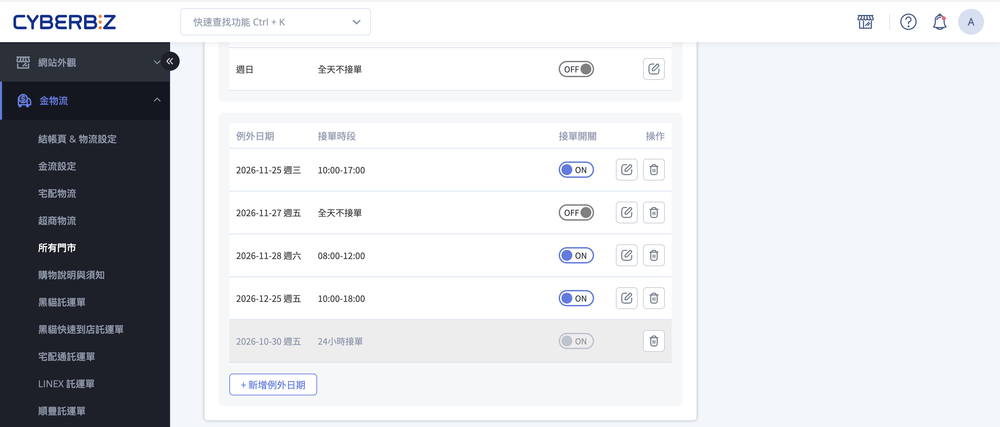

# 開啟門市快速到貨服務

完成門市快速到貨 (CYBERBIZ NOW) 服務設定，包含啟用功能、接單時間、運費規則與外送資訊管理。
{ .subtitle }

[:lucide-tag:{ title="適用方案" }](../../resources/conventions#適用方案) | 所有PLUS / 企業
{ .doc-badge }

!!! info "版本差異說明"
    「快速到貨」在 PLUS 方案中屬於選配模組（11 選 2），商家需確認已選配該模組方可使用。企業版則直接內建此功能。

{ .hero-page }

## 使用須知 { #prerequisites-cyberbiz-now }

開始設定門市參數前，請務必完成以下基礎配置，並留意相關資料連動規則：

- **建立門市**：請先於 **金物流 > 所有門市** 建立門市資訊，再行設定。
- **門市地址正確性**：配送範圍由外送系統依門市地址自動計算（約半徑 3-5 公里），地址錯誤將導致無法配送。
- **設定複製**：若有多個門市，可利用 **帶入預設門市資料** 快速同步運費與接單時間。
- **刪除門市**：若刪除門市，與門市設定與對應商品都會一併刪除。

## 操作流程 { #operate-cyberbiz-now }

### 步驟 1：開啟門市快速到貨功能 { #operate-cyberbiz-now-enable }

1. 登入 CYBERBIZ 管理後台，前往 **金物流 > 所有門市**。
2. 找到欲設定的門市，點擊右側 **編輯**。
3. 切換至 **快速到貨設定** 頁籤。
4. 將 **啟用快速到貨** 開關切換為 `開啟 (ON)`。

### 步驟 2：設定接單時間與運費規則 { #operate-cyberbiz-now-hours-fee }

1. **付款方式設定**：點擊選單並勾選允許使用的付款方式（如：信用卡、LINE Pay）。
2. **運費規則**：

    - **欄位說明**

        - **運費加計/減計**：可在基礎外送費上額外加價或減價（如偏遠地區加價）。
        - **免運門檻**：輸入滿額免運金額，若不開放免運請留白。

    - **運費計算方式**

        | 設定項目 | 消費者結帳運費計算方式 |
        | :--- | :--- |
        | **加計運費** | Pandago 或 Uber Direct 實際運費 ＋ 加計運費 |
        | **減計運費** | Pandago 或 Uber Direct 實際運費 － 減計運費 |
        | **免運門檻** | 商品總金額達門檻時，整筆運費 = 0 |

    - **運費調整範圍**
      
        加計或減計只調整消費者結帳時看到的運費。CYBERBIZ 向商家收取的實際運費金額不變。

{ .screenshot }

### 步驟 3：設定接單時間 { #operate-cyberbiz-now-hours }

接單時間決定消費者前台何時可選擇此門市下單，分為兩層規則：

| 類型 | 用途 | 設定單位 | 優先順序 |
| --- | --- | --- | --- |
| **常態日期** | 每週固定循環的接單時段 | 週一～週日各一列 | 預設套用 |
| **例外日期** | 單一日期覆寫常態（連假、公休等） | 指定一天 | **高於常態**；與常態衝突時以例外為準 |

請先完成常態日期，再依連假或公休補上例外日期。兩種設定皆可開關是否接單；關閉時該日顯示 **全天不接單**，前台無法選擇此門市。

#### 常態日期  { #operate-cyberbiz-now-hours-weekly }

每週循環的固定接單規則，顯示週一至週日共 7 列，每列可獨立設定該星期的接單時段與是否接單。

1. 點選 :lucide-square-pen:，開啟 **編輯接單時段** 彈窗。
2. 設定接單時段：若全天接單，可勾選 24 小時接單。
3. 開啟／關閉 **接單開關**：
    - ON：**接單時段** 欄位顯示已設定的時段，若勾選 24 小時接單則顯示 **24 小時接單**。
    - OFF：**接單時段** 欄位顯示 **全天不接單**，當天消費者於前台無法選擇此門市。

{ .screenshot }

#### 例外日期  { #operate-cyberbiz-now-hours-exception }

當單一日期需要設定例外接單時間時，可於此區塊新增該日期，一般多應用於連假、公休等情境。

##### 操作步驟  { #operate-cyberbiz-now-hours-exception-steps }

1. 點選 **新增例外日期**：可選擇單一日期、開始時間／結束時間，或勾選 24 小時接單。
2. 點擊儲存後，該日期將顯示於例外日期列表中。
3. 開啟／關閉 **接單開關**：

    - ON ：**接單時段** 欄位顯示設定時段
    - OFF ：**接單時段** 欄位將顯示 **全天不接單**。

4. 點選 :lucide-square-pen: 可 **編輯例外日期**。
5. 點選 :lucide-trash: 可 **刪除例外日期**。

{ .screenshot }

##### 系統規則  { #operate-cyberbiz-now-hours-exception-rules }

- **不可設定區間**：僅支援單一日期，不支援一次設定連續多日。
- **不可重複**：同一日期已存在例外時，無法再新增。
- **過期僅能刪除**：已過期的例外會反灰，不可編輯，僅可刪除。
- **數量上限**：每間門市最多 10 組（含已過期）。額滿時請先刪除既有例外再新增。
- **優先順序**：例外日期與常態日期衝突時，以例外日期為準。

### 步驟 4：設定外送聯絡與備註資訊 { #operate-cyberbiz-now-contact }

1. 填寫 **聯絡電話**，供外送司機聯繫門市使用。
2. 在 **備註資訊** 欄位填寫給司機的指引（如：門市位於百貨 B1 美食街、請由東側電梯上樓等）。

### 步驟 5：管理門市排序（適用多門市） { #operate-cyberbiz-now-sort }

若有多家門市開啟快速到貨，可控制前台展示順序：

1. 回到 **金物流 > 所有門市** 列表頁。
2. 在列表中使用以下方式調整：
    - **拖曳排序**：滑鼠左鍵點擊門市欄位不放，上下移動調整位置。
    - **輸入數字**：直接在排序欄位輸入數字，數字越小排序越前面。

## 常見問題 { #faq-cyberbiz-now }

??? quote "快速到貨的配送範圍如何計算？"
    配送範圍由外送業者根據門市地址自動計算，通常為 3-5 公里。若消費者輸入的地址超出範圍，結帳時將無法選擇快速到貨。

??? quote "為什麼有些門市無法啟用功能？"
    請確認：1. 門市地址是否完整正確。 2. 該地區是否有第三方外送業者服務。 3. 是否已向 CYBERBIZ 申請並開通 NOW 功能。

??? quote "門市人員無法及時接單怎麼辦？"
    若門市暫時人手不足，可進入該門市設定，暫時將 **啟用快速到貨** 切換為 `關閉`，待狀況緩解後再行開啟。

??? quote "如果商品缺貨如何處理？"
    若接單後發現商品缺貨，請立即聯繫客戶說明，並於後台取消訂單安排退款，以維持顧客滿意度。

## 後續步驟 { #next-steps-cyberbiz-now }

- :lucide-copy-plus:{ .lg }   
  [__複製商品到快速到貨門市__](../../products/copy-products-to-quick-delivery-stores.md)       
  將適合即時配送的商品同步至門市專區。

- :lucide-layout-template:{ .lg }     
  [__設定快速到貨前台頁面__](../../website-appearance/setup-quick-delivery-frontend-entry.md)  
  配置前台入口與視覺樣板。

- :lucide-clipboard-check:{ .lg }     
  [__處理快速到貨訂單__](../../orders/store-pickup-orders.md)  
  了解門市端如何操作揀貨與司機媒合流程。

