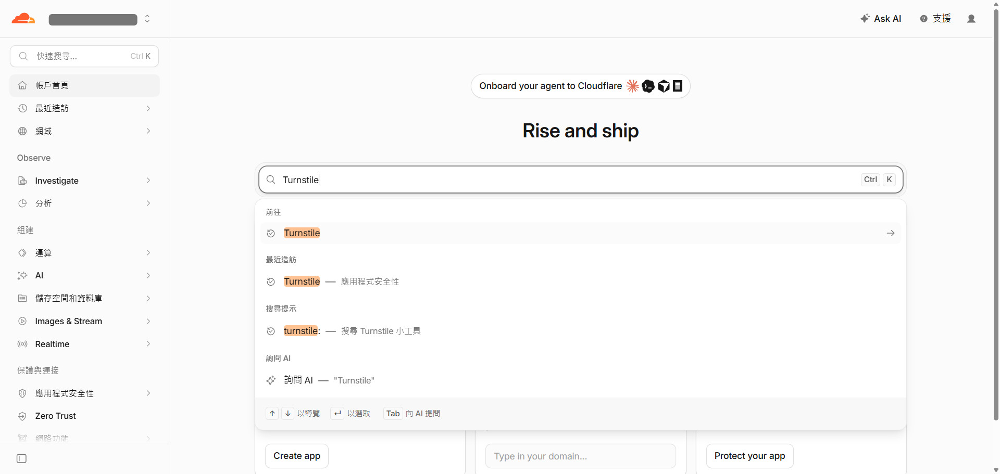
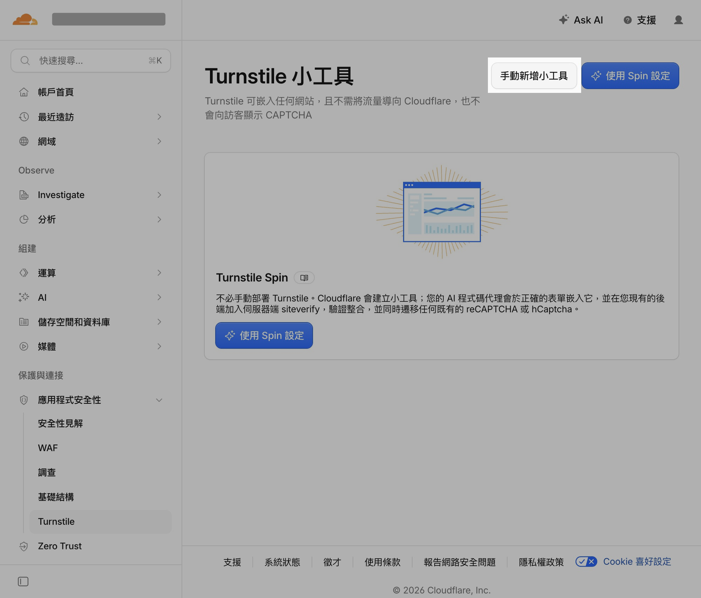
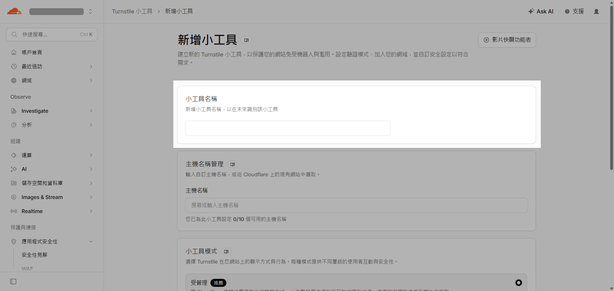
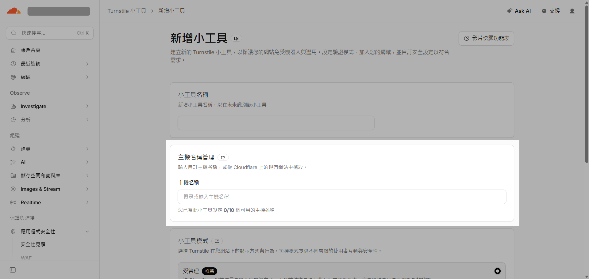
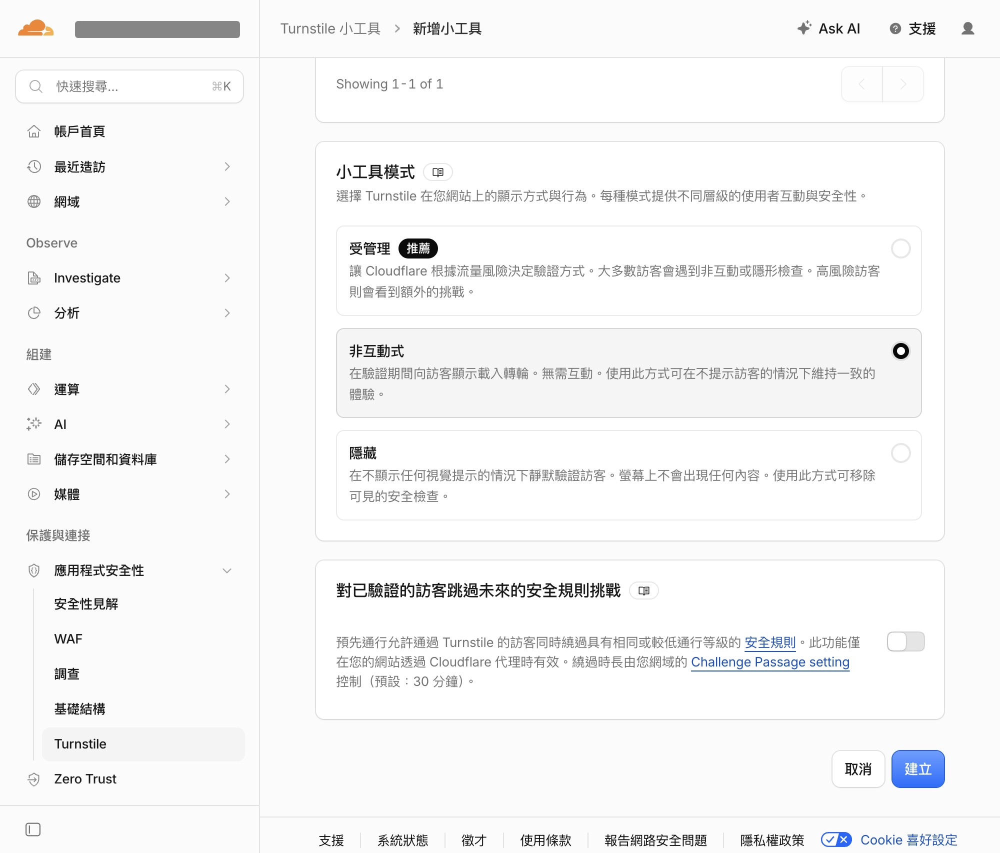
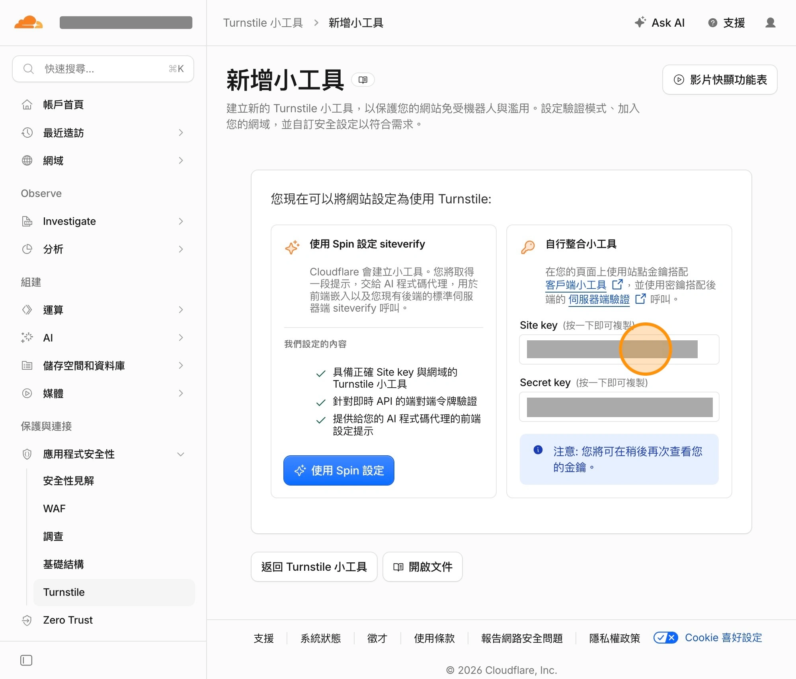
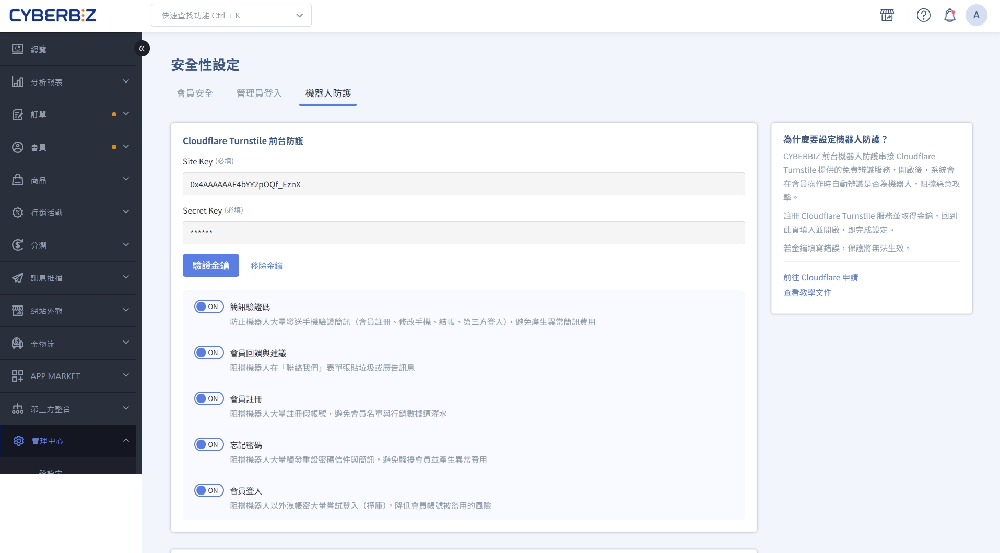
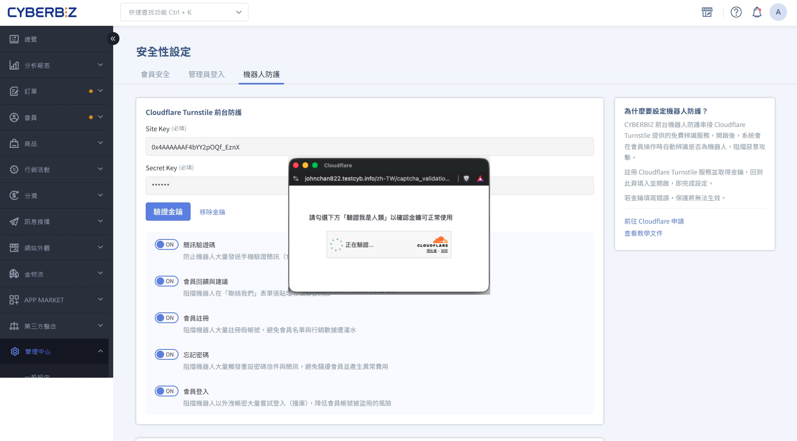
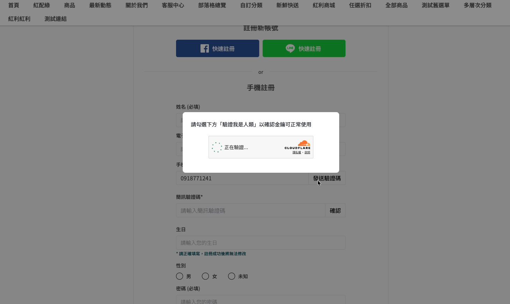

# 設定機器人防護

開啟對應開關後，顧客須先通過機器人驗證，系統才執行簡訊發送、會員註冊、登入、忘記密碼或回饋建議。
{ .subtitle }

[:lucide-tag:{ title="適用方案" }](../../resources/conventions#適用方案) | 全方案
{ .doc-badge }

## 安全性設定說明 { #intro-security }

「安全性設定」是 CYBERBIZ 後台的資安控制中心，協助你降低帳號被盜用、顧客個資外洩與惡意造訪的風險。頁面位於後台「管理中心」>「安全性設定」，並分為三個主要防護領域：

- **[會員安全](member-security-settings/)**：負責保護網站與顧客資料。
- **[管理員登入](admin-security-settings/)**：負責保護你與員工登入後台的安全。
- **機器人防護**：在指定的前台操作前驗證是否為機器人，通過後系統才繼續。

## 使用前提與限制 { #prerequisites-security }

開始設定前，請先確認下列條件：

- [x] **「設置」權限**：本分頁區塊需要您的帳號在 **網站權限** 中具備 **設置** 權限，才能檢視與編輯。您可[修改管理員權限](add-admin-set-permissions/#operate-admin-perms-edit)。

## 設定前台機器人防護 { #operate-security-sms-bot-protection }

可依前台操作分別開啟防護。顧客執行該操作前，須先通過 Cloudflare Turnstile 機器人驗證，通過後系統才繼續。

- **簡訊驗證碼**：避免機器人反覆觸發「發送驗證碼」。若已開通海外簡訊，可能造成短時間大量發送簡訊，產生簡訊費用。
- **會員回饋與建議**：避免機器人在「聯絡我們」表單張貼垃圾或廣告訊息。
- **會員註冊**：避免機器人大量註冊假帳號，造成會員名單與行銷數據遭灌水
- **忘記密碼**：避免機器人大量寄出重設密碼的信件與簡訊，騷擾會員並產生異常費用。
- **會員登入**：避免機器人用外洩的帳號密碼反覆嘗試登入（撞庫），降低會員帳號被盜用的風險。

### 步驟 1：取得驗證金鑰 { #operate-security-sms-key }

1. **前往 Cloudflare 後台**：[註冊或登入 Cloudflare 帳號](https://dash.cloudflare.com/login)，於 Cloudflare 後台搜尋 **Turnstile**。

    { .screenshot }

2. **建立 Turnstile 工具**：點擊 **手動新增小工具**。

    { .screenshot }

    - **小工具名稱**：輸入可以識別這組小工具的名稱。

        { .screenshot }

    - **主題名稱管理**：在 **主機名稱** 欄位，輸入您的您的商店站台網域。

        { .screenshot }

        
        !!! tip "兩種網域皆須加入"
            新增主機名稱時，請同時加入商店的 **自有網域** 與 **CYBERBIZ 網域**：

            - **自有網域**：若商店綁定多個自有網域，請將 **所有網域逐一加入**。輸入時請移除網址開頭的 `https://`，僅保留完整網域名稱。

                - 範例網址： `https://www.你的網域.com`
                - **填寫格式**： `www.你的網域.com`
                - 範例網址： `https://www.你的網域.com.tw`
                - **填寫格式**： `www.你的網域.com.tw`

                
            - **CYBERBIZ 網域**：
                - 範例網址： `https://你的店名.cyberbiz.co`
                - **填寫格式**： `你的店名.cyberbiz.co`

    - **小工具模式**：依需求選擇即可。

        { .screenshot }

3. **取得驗證金鑰**：點擊 **建立**，取得 **Site key** 與 **Secret key**。

    { .screenshot }

### 步驟 2：後台綁定金鑰 { #operate-security-sms-bind }

1. **進入設定頁：** 前往 **管理中心 > 安全性設定 > 機器人防護**。
2. **填入金鑰：** 分別輸入 **Site key** 與 **Secret key**。

    

3. **測試金鑰：** 點擊 **驗證金鑰**，確認顯示 `驗證成功`；若顯示 `驗證失敗：無效金鑰`，請重新核對後再儲存。

    

4. **啟用防護：** 依要保護的操作開啟開關，再點擊 **儲存**。

    - **簡訊驗證碼**
    - **會員回饋與建議**
    - **會員註冊**
    - **忘記密碼**
    - **會員登入**

已開啟的項目，顧客執行該操作前須先通過機器人驗證，通過後系統才繼續。

> 下圖以 **簡訊驗證碼** 為例，顧客點擊 **發送驗證碼** 後，驗證成功彈窗即關閉，系統才發送簡訊驗證碼。

!!! note "清除金鑰"
    若清除已儲存的金鑰，已開啟的防護開關會同步關閉，前台將不再顯示機器人驗證。

## 常見問題 { #faq-security }

??? quote "設定時出現 **目前網域未授權，請至 Cloudflare 後台舊網域加入允許清單** 錯誤訊息？"
    1. 登入 Cloudflare 後台，進入Turnstile 小工具頁面，點選編輯小工具，前往 **主機名稱管理**。
    2. 將商店使用的所有網域逐一加入。
    3. 輸入網域時，移除開頭的 `http://` 或 `https://`，僅保留完整網域名稱。
        
        **填寫範例**：`abc.cyberbiz.co`、`www.abc.com.tw`、`www.abc.com`

??? quote "設定時出現 **Site Key 無效** 錯誤訊息？" 
    請重新比對 Cloudflare 後台與 CYBERBIZ 後台的 **Site Key**，確認金鑰內容完全一致後，再重新填入。

??? quote "設定時出現 **此 Site Key 已停用** 錯誤訊息？"
    登入 Cloudflare 後台，找到對應的 Site Key，將其重新啟用後，再回到 CYBERBIZ 後台重新填入金鑰。

??? quote "設定時出現 **找不到此 Site Key，請確認金鑰或 Cloudflare 後台設定** 錯誤訊息？"
    請確認 Cloudflare 後台的 **Site Key** 與 **Secret Key**，是否都已正確填入 CYBERBIZ 後台，並確認兩組金鑰屬於同一個 Turnstile 工具。