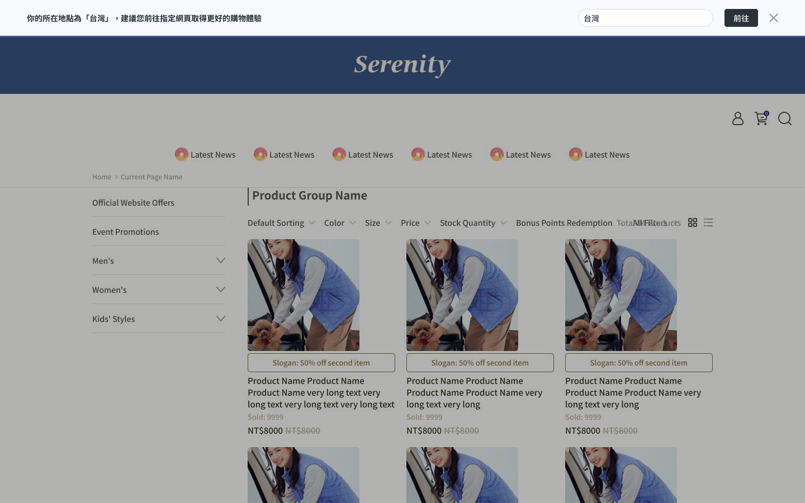
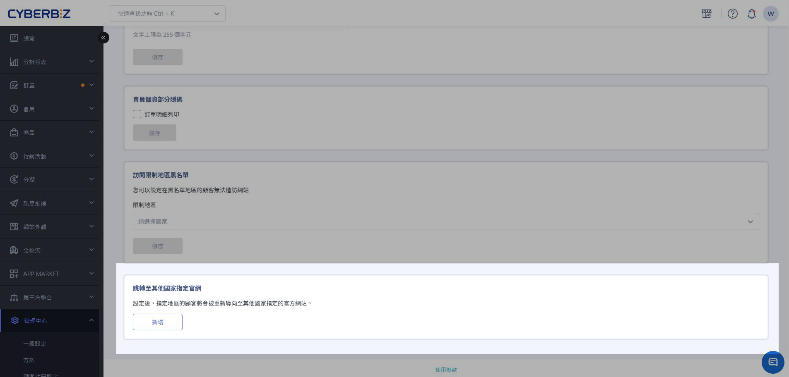
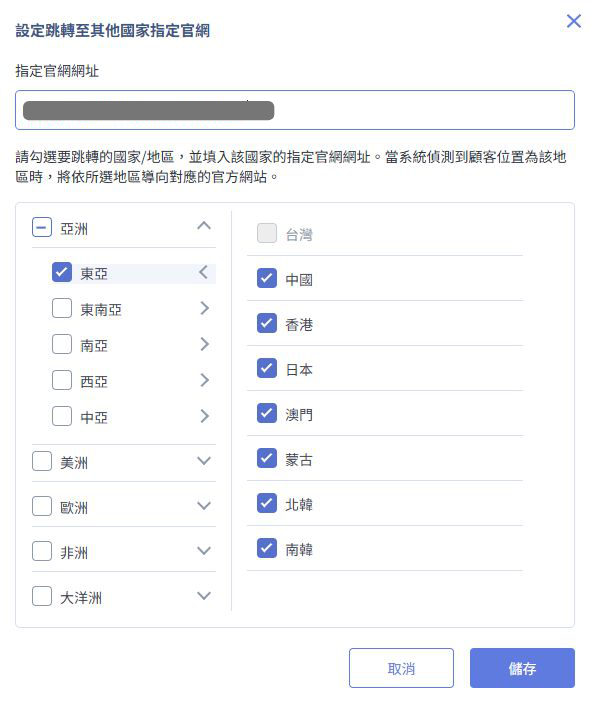
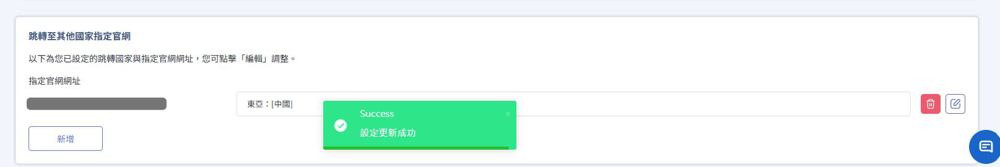
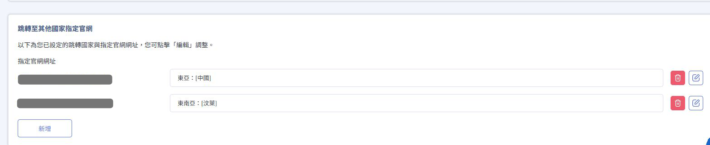
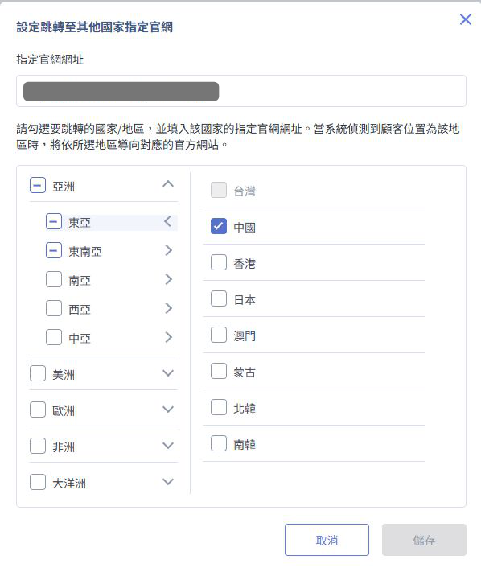
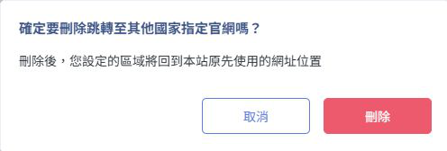
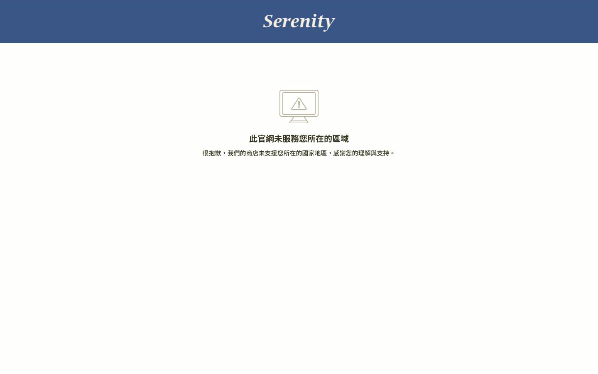

# 跳轉至其他國家指定官網

{ title="前台頂端跳轉提示列" .hero-page }

## 功能說明 { #intro-country-redirect }

當您為不同國家 **建立各自的官網站台** 時，系統可依顧客 IP 所在國家，在前台顯示提示列，引導顧客前往對應官網。

顧客從搜尋、廣告或社群連結進到「非當地」官網時，會看到不對的幣別、物流或價格。設定本功能後，符合條件的顧客會在網站頂端看到提示；點選 **前往** 才會跳到您指定的另一個官網。

!!! tip "應用情境"
    一位在日本的顧客，從社群點進您的台灣站（`www.twstore.com`），結帳時發現只有台幣、物流也寄不到日本。

    若您另有獨立的日本官網（`www.jpstore.com`），可在台灣站設定本功能：系統依 IP 判斷國家後顯示提示列，顧客點 **前往** 才會換到日本站。

    :lucide-triangle-alert: 這不是把同一站從繁中切成日文；同一個 `www.example.com` 內的語系切換，請用 [多國語言與多幣別](setup-multi-language-and-multi-currency/)。

!!! warning "系統不會自動轉走顧客"
    - 只有顧客點選 **前往** 才會跳到您設定的官網網址。
    - 顧客可隨時關閉提示，繼續留在目前這個官網購物。
    - 未命中任何國家設定的顧客，看到的網站與原本相同。

## 使用須知 { #prerequisites-country-redirect }

- **適用對象**：請先確認您已同時經營 **兩個以上、網域各自獨立** 的官網。若只有單一官網的多語系需求，請改用 [多國語言與多幣別](setup-multi-language-and-multi-currency.md){ title="設定前台多國語言與多幣別" }。
- **適用網址**：可導向 CYBERBIZ 建立的官網，也可導向其他網站。
- **權限**：帳號需具備 **設置** 權限，才能編輯 **會員安全** 分頁。詳見 [新增網站管理員並設定權限](add-admin-set-permissions.md){ title="新增網站管理員並設定權限" }。
- **設定生效時間**：新增、修改或刪除後，首次進站的顧客會立即套用；曾進站的顧客可能最多需等待 **2 小時** 才套用最新設定。
- **判斷限制**：顧客使用 **VPN、公司網路或行動網路** 時，偵測到的國家可能與實際所在地不同。

## 操作步驟 { #operate-country-redirect }

### 新增跳轉設定 { #operate-country-redirect-add }

1. 登入 CYBERBIZ 管理後台，前往 **管理中心 > 安全性設定**，點選上方 **會員安全** 分頁。
2. 捲到頁面最下方，找到 **跳轉至其他國家指定官網** 區塊。

    { title="跳轉至其他國家指定官網設定區塊" }

3. 點選 **新增**，開啟設定視窗。
4. 在 **指定官網網址** 填入目標官網網址。

    { .small-image title="設定跳轉官網網址與國家" }

5. 勾選要導向此網址的國家／地區。

    !!! info "設定規則"
        - **一組設定 = 一個官網網址 + 多個國家／地區**。勾選的國家都會導向同一個指定網址。
        - **國家不可重複**：每個國家只能屬於一組設定。若國家已被選取，勾選框會顯示為灰色、無法勾選。
        - **本站國家不可勾選**：CYBERBIZ 本站所屬國家無法勾選，避免顧客被導回目前這個官網。

            **範例**：您登入的是 CYBERBIZ 台灣站後台：站台所屬國家為台灣，故「台灣」呈現灰色。此時可設定「馬來西亞 → 馬來西亞站」，但不能設定「台灣 → 台灣站」。

6. 網址與國家都至少填一項後，點選 **儲存**。

    { title="設定更新成功提示" }

!!! tip "新增多組設定"
    不同區域要導向不同官網時（例如亞洲 → A 官網、歐洲 → B 官網），再點一次 **新增** 即可。筆數沒有上限；當所有可選國家都已設定完，會無法繼續新增。

### 查看已設定內容 { #operate-country-redirect-list }

有設定後，區塊改為列表，每一列是一組設定：

| 位置 | 顯示內容 |
| --- | --- |
| 左側 | **指定官網網址**：點擊可在新分頁開啟；網址過長時會截斷，滑鼠移上去可看完整網址。 |
| 右側 | **已選國家／地區**： 整區都選 → 顯示區域名稱（如「北歐」）； 只選部分 → 顯示「區域：[國家、國家]」。 文字過長以「…」截斷，滑鼠移上去可看全部。 |
| 列尾 | 紅色為 **刪除**，藍色為 **編輯**。 |

{ title="已設定的跳轉國家與官網網址" }

### 編輯設定 { #operate-country-redirect-edit }

1. 點選該列右側的藍色 **編輯** 圖示。
2. 視窗會帶入原本的網址與國家；可修改網址，或取消／保留本組已選國家。
3. 被其他組選走的國家、以及本站自己的國家，仍為灰色無法勾選。
4. 點選 **儲存** 完成更新。

{ .small-image title="編輯跳轉至其他國家指定官網" }

### 刪除設定 { #operate-country-redirect-delete }

1. 點選該列右側的紅色 **刪除** 圖示。
2. 確認後刪除。該區域的顧客不再看到導向此網址的提示列。

{ title="刪除跳轉設定確認視窗" }

## 前台顧客會看到什麼 { #overview-country-redirect-storefront }

### 頂端提示列 { #overview-country-redirect-banner }

當顧客所在國家有對應的其他官網設定時，網站最上方會出現提示列。

- 提示文字使用 **顧客所在國家的語言**，不是您目前這個官網本身的語言。例如：日本顧客誤入台灣站時，提示列會以日文顯示。
- 顧客點選 **前往** 後，才會開啟您設定的指定官網網址。
- 顧客點選 **X** 可關閉提示列。

{ title="前台頂端國家跳轉提示列" }

### 關閉提示列之後 { #overview-country-redirect-dismiss }

- 顧客點 **X** 關閉後，這次瀏覽中換頁、重新整理都不會再出現。
- 針對同一個國家，**30 天內** 再次進站也不會再出現。
- 若顧客之後在 **另一個國家** 進站，且該國家也有設定，提示列仍會正常顯示。

## 與訪問限制地區黑名單併用 { #specs-country-redirect-blacklist }

本功能與 [訪問限制地區黑名單](member-security-settings.md#operate-security-restricted-locations){ title="設定會員安全與網站保護" } 可同時使用，常見兩種情況如下。

### 顧客國家被「目前這個官網」封鎖 { #specs-country-redirect-blocked-here }

例如：台灣站透過地區黑名單封鎖「馬來西亞 IP」，同時把馬來西亞 IP 導向馬來西亞站。馬來西亞顧客進入台灣站時會看到封鎖頁，但 **頂端提示列仍會顯示**；點選 **前往** 後可進入馬來西亞站，不會卡在封鎖頁。

### 顧客國家被「要前往的那個官網」封鎖 { #specs-country-redirect-blocked-target }

例如：澳洲站把「馬來西亞 IP」導向台灣站，但台灣站透過地區黑名單封鎖馬來西亞 IP。馬來西亞顧客在澳洲站仍看得到提示列，點 **前往** 會進到台灣站，隨即看到台灣站的封鎖頁。系統不會自動偵測此衝突，請自行確認各官網設定一致。

{ title="封鎖頁與國家跳轉提示列" }

!!! warning "跨官網設定請保持一致"
    A 官網導向 B 官網、B 官網又把同一國家導回 A 官網時，系統不會阻擋。顧客可能在兩站之間來回看到提示，請在各官網確認同一個國家的導向方向一致。

## 更多操作 { #next-steps-country-redirect }

- :lucide-user-check:{ .lg }
  [__設定會員安全與網站保護__](member-security-settings.md){ title="設定會員安全與網站保護" }
  調整網站密碼、個資隱碼與訪問限制地區黑名單。

- :lucide-languages:{ .lg }
  [__設定前台多國語言與多幣別__](setup-multi-language-and-multi-currency.md){ title="設定前台多國語言與多幣別" }
  若您要的是 **同一個官網** 內切換語系與幣別，請改走這篇，不是本功能。

## 常見問題 { #faq-country-redirect }

??? quote "系統會不會自動幫顧客轉到別的官網？"
    不會。系統只會顯示提示列，是否前往由顧客自己決定。

??? quote "IP 判斷一定準嗎？"
    不一定。顧客使用 VPN、公司網路或行動網路時，偵測到的國家可能和實際所在地不同。這也是提示列一定可以關閉、且不會自動跳轉的原因。

??? quote "可以導向非 CYBERBIZ 的網站嗎？"
    可以，任何網址都能填。

??? quote "為什麼某些國家是灰色、不能勾？"
    可能是 (1) 已經被其他組設定選走，或 (2) 是本站自己的國家。若要改到另一組，請先到原本那組設定中取消勾選或刪除該設定。
