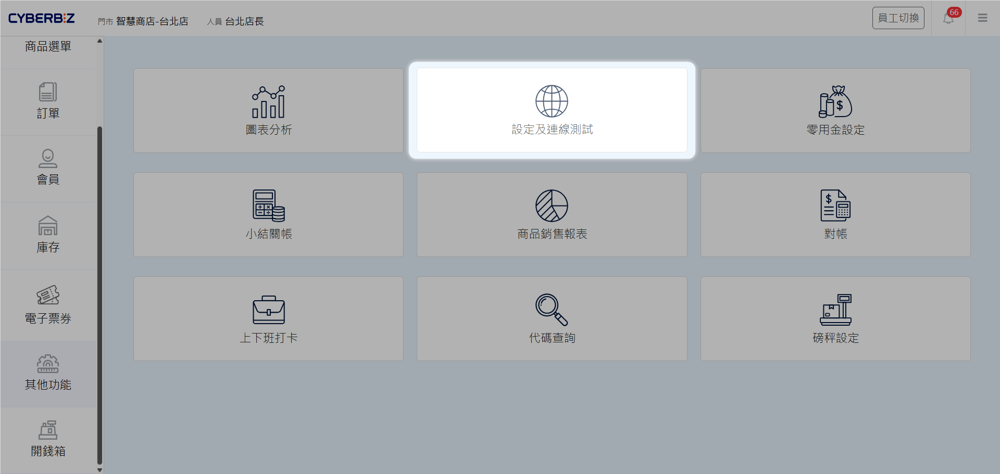
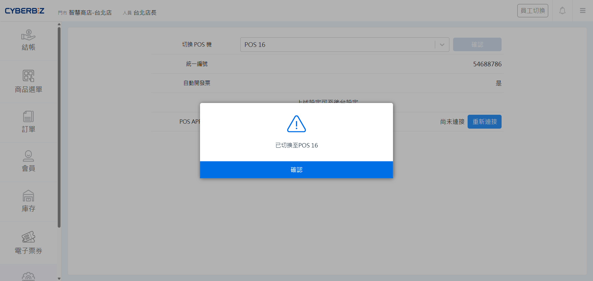
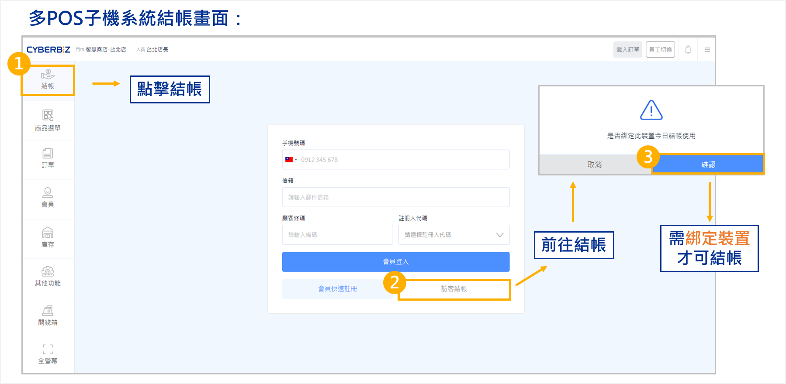
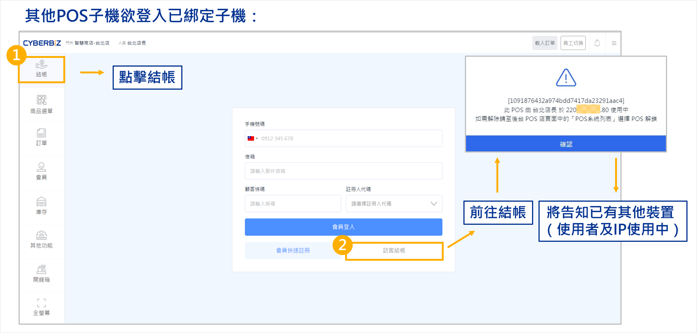
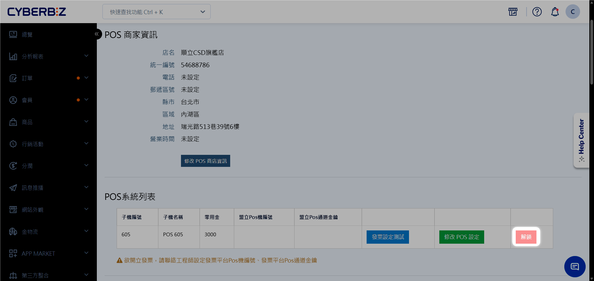
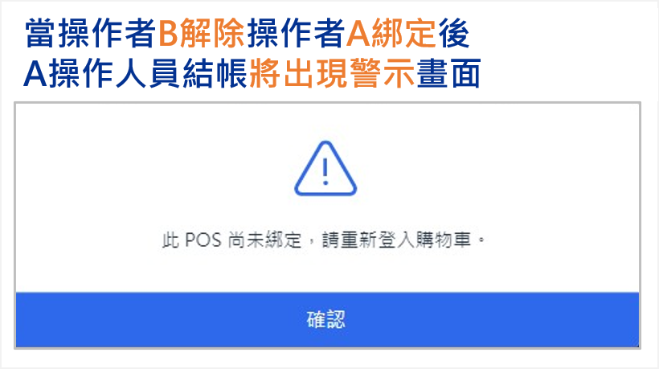
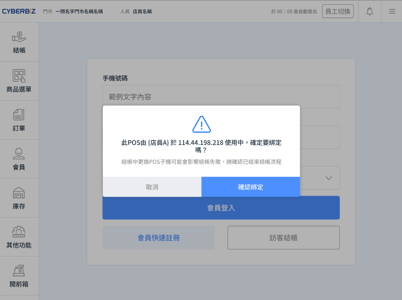
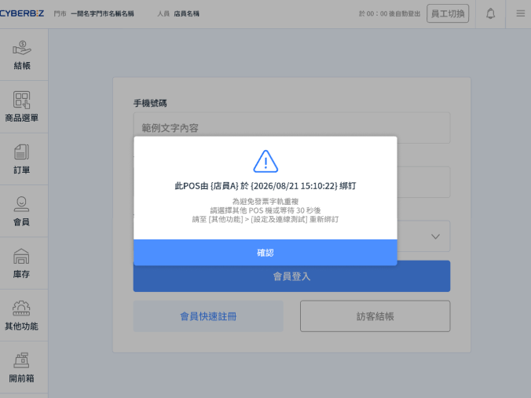

# 子機結帳綁定

說明 POS 子機綁定機制，以及預設由後台解除綁定、或開通後由新裝置確認綁定並自動解除原裝置綁定的兩種交接方式。
{ .subtitle }

[:lucide-layers:{ title="適用產品" }](../../resources/conventions#適用產品) | 智能 POS
{ .doc-badge }

## 使用須知 { #prerequisites-subdevice-checkout }

- [x] **系統預設機制**：子機綁定為系統核心保護機制，無法手動關閉。一台子機同時僅能由一台裝置使用。
- [x] **預設解鎖權限**：未另行開通時，僅 **網站擁有者** 與 **POS 店長** 可於管理後台解除子機綁定。一般店員無法自行解鎖。
- [x] **彈性聯繫客服開通**：若要由新裝置確認綁定並自動解除原裝置綁定，請聯繫 CYBERBIZ 客服開通。開通後仍可使用後台解鎖。
- [x] **同機換人不必解綁**：同一台裝置只更換店員時，請用 [員工切換](../store/staff-login/#operate-staff-login-switch)，不要解除綁定。

### 解除綁定方式對照 { #prerequisites-subdevice-checkout-modes }

| 類型 | 方式 | 操作位置 | 誰可操作 | 流程摘要 |
| --- | --- | --- | --- | --- |
| **預設** | 後台解除綁定 | 管理後台 | **網站擁有者** **POS 店長** | 1.原裝置已綁定子機 2.後台 **解鎖** 原裝置子機 3.新裝置再綁定 |
| **另行開通** | 新裝置直接取代綁定 | POS 前台 | 前台操作者 | 1.原裝置已綁定子機 2.新裝置 **確認綁定** 該子機 3.系統自動解除原裝置綁定 |

## 操作流程 { #operate-subdevice-checkout }

### 子機登入與結帳綁定 { #operate-subdevice-checkout-bind }

開始使用某台 POS 子機結帳時，系統會自動建立綁定關係。

1. 登入 POS 前台，前往 **其他功能 > 設定及連線測試**。

    { title="設定及連線測試畫面" .screenshot }

2. 選擇欲使用的子機編號（店內僅一台子機時，系統會自動跳過此步）。

    { title="選擇並綁定 POS 子機" .screenshot }

3. 前往 **結帳**，選擇任一結帳方式，於彈窗點選 **確認綁定**。

    { title="結帳時確認綁定子機" .screenshot }

### 其他裝置要使用同一子機時 { #operate-subdevice-checkout-transfer }

一台 POS 子機同時僅能由一台裝置使用。請依門市是否開通「新裝置確認綁定」選配，選擇下方對應方式。

=== "預設：後台解除綁定後再改綁"

    1. 當操作者 B 點擊 **結帳** 時，系統提示 **此 POS 機目前由 [操作者 A] 使用中**。
        { .screenshot }
    2. 若操作者 B 確定接手該子機，請先確認具備管理後台權限，並執行遠端解鎖。
    3. 登入 CYBERBIZ 管理後台，前往 **POS 功能 > 所有 POS 商店**。
    4. 找到對應門市並進入該店 **POS 系統列表**。
    5. 在子機管理清單中，找到使用中的裝置，點選 **解鎖**。
        { .screenshot }

    6. 解鎖後，新設備即可重新執行綁定並進入結帳畫面。
    7. 原本的操作者 A 若嘗試進行任何結帳動作，畫面會立即跳出 **POS 未綁定** 的警示，且無法繼續結帳作業。

        { .small-image }

    !!! warning "解除前請確認"
        解除原裝置綁定後，該裝置會立即無法繼續結帳。解鎖前請確認不影響他人作業。

=== "開通：新裝置直接綁定並自動解除原機綁定"

    已聯繫客服開通後，其他設備可於前台直接確認綁定；系統會自動解除原裝置綁定，無須再到後台解鎖。

    1. 於新裝置前往 **結帳**。系統顯示此 POS 目前由其他人員（含 IP）使用中，並詢問是否確定綁定。
    2. 確認原裝置已結束結帳後，點選 **確認綁定**。系統將子機改綁至新裝置。
    3. 原裝置若再操作結帳，會跳出 **POS 未綁定** 警示，且無法繼續結帳。

    { title="此 POS 使用中，確認是否綁定" }

    !!! warning "結帳中請勿改綁"
        結帳中更換 POS 子機可能導致結帳失敗。點選 **確認綁定** 前，請確認原裝置已結束結帳流程。

    **綁定後 30 秒無法改綁**

    開通後，子機剛完成綁定會進入 30 秒保護期。此期間其他裝置若嘗試改綁，系統會提示目前綁定者與綁定時間。您可依下列任一方式處理：

    - 選擇其他 POS 機
    - 等待 30 秒後，前往 **其他功能 > 設定及連線測試** 重新綁定

    { title="綁定保護期內無法重新綁定" }

## 常見問題 { #faq-subdevice-checkout }

??? quote "我只是更換店員，一定要解除綁定嗎？"
    不需要。同一台裝置更換人員，請直接使用 [員工切換](../store/staff-login/#operate-staff-login-switch)。這不會破壞子機綁定，也能讓銷售紀錄正確歸給新員工。

??? quote "一般店員可以自己解鎖子機嗎？"
    預設不行。僅 **網站擁有者** 與 **POS 店長** 可於管理後台解除綁定。若已開通選配，新裝置可於前台確認綁定並自動解除原裝置綁定，不必再請後台解鎖。

??? quote "為什麼我的門市無法在新裝置直接確認綁定？"
    此功能需聯繫 CYBERBIZ 客服開通。未開通時，請依預設流程由 **網站擁有者** 或 **POS 店長** 至後台解鎖後再綁定。
