# A910S 刷卡機
在 iPad POS 安裝憑證、連線 A910S 卡機，完成一般結帳、多付款刷卡、當日取消與結帳後退款，以及重印簽單與卡機結帳。
{ .subtitle }

[:lucide-layers:{ title="適用產品" }](../../resources/conventions#適用產品) | 智能 POS
{ .doc-badge }

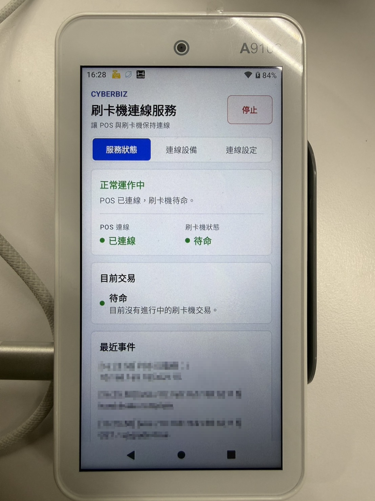{ title="A910S Mini Bridge 正常運作" .small-image }

## 使用須知 { #prerequisites-a910s }

- **裝置限制**：目前僅支援 **iPad**。請勿以 Windows 作為正式作業環境。
- **憑證先行**：憑證檔由客服提供，檔案格式為 `.cer` 檔。請先裝在 **POS 裝置（iPad）**，再開機連線卡機。
- **同網連線**：卡機與 iPad 必須連同一個 Wi-Fi 或熱點。
- **防休眠**：卡機進入休眠會導致結帳異常。請將螢幕自動關閉設為 `永遠不要`。
- **電量門檻**：卡機電量低於 **10%** 時無法結帳（插電中亦同），請先充電。
- **必備 App**：卡機開機後須有 **Mini Bridge** 與 **環匯多元支付** 兩個 App。
- **後台開關**：前台看不到 A910S 付款選項時，請先到後台開啟 **信用卡(A910S卡機)**。

## 設備設置 { #operate-a910s-setup }

### 安裝憑證 { #operate-a910s-install-cert }

憑證共約五步，請依序完成後再連線卡機。

1. 將客服提供的憑證檔下載到 iPad，點擊檔案安裝。系統會提示 **已下載描述檔**。

    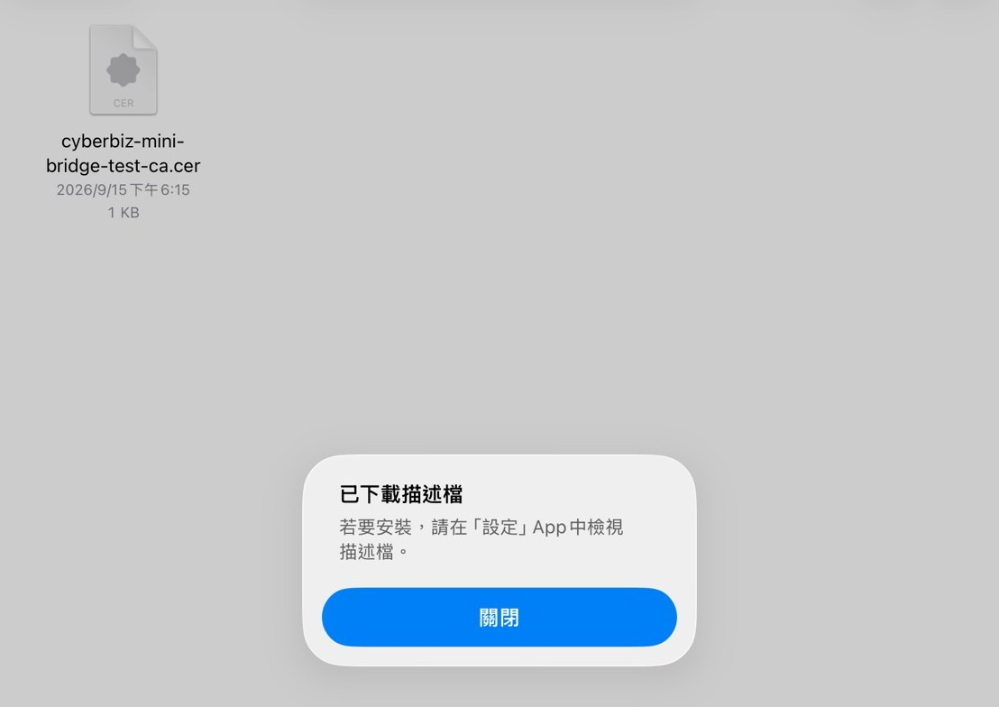{ title="下載憑證後的描述檔提示" .screenshot }

2. 前往 iPad **設定 > 一般 > VPN 與裝置管理**，點選 **CYBERBIZ Mini Bridge Test CA**。

    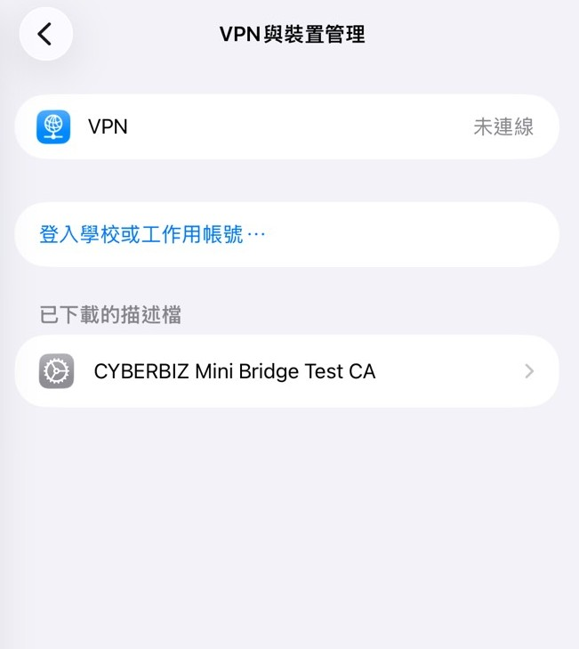{ title="VPN 與裝置管理中的憑證" .small-image }

3. 點選 **安裝** 完成描述檔安裝。

    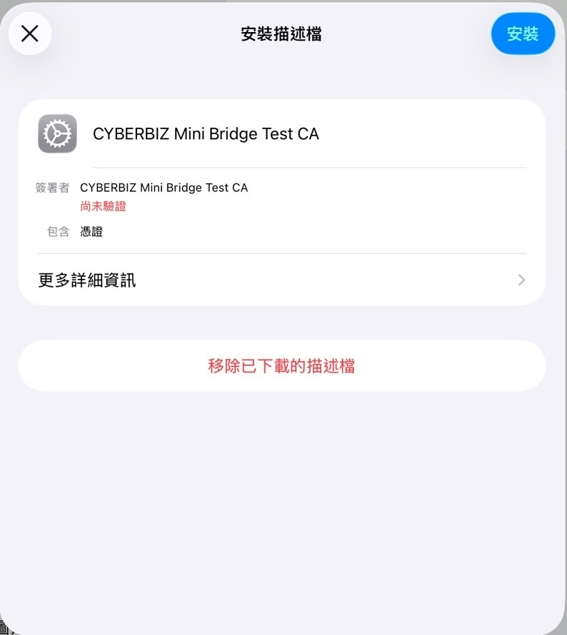{ title="安裝 CYBERBIZ Mini Bridge 描述檔" .small-image }

4. 前往 **設定 > 一般 > 關於本機 > 憑證信任設定**，找到 **CYBERBIZ Mini Bridge Test CA**，將開關切換為 `開啟 (ON)` 以完整信任。

    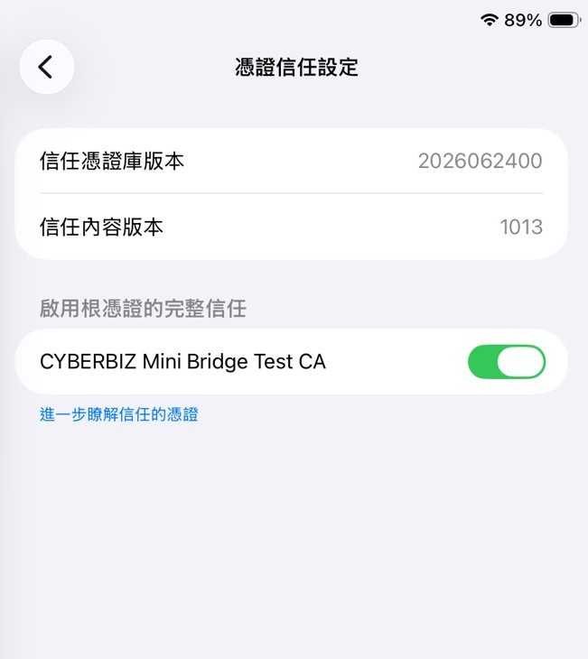{ title="開啟完整信任憑證" .small-image }

5. **完整關閉** Safari 或 Chrome 後再重新開啟瀏覽器／POS 前台。

### 卡機基本設定 { #operate-a910s-device-setup }

1. 按卡機左側電源鍵開機，確認桌面有 **Mini Bridge** 與 **環匯多元支付**。
2. 自卡機左側邊緣向右滑，開啟 **設置**。

    

    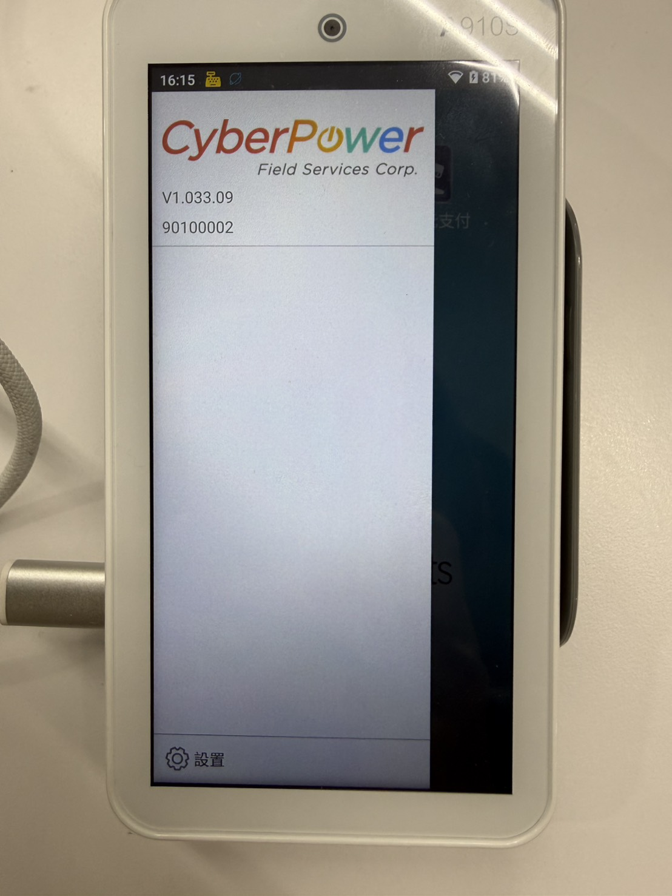{ title="卡機設置入口" .small-image }
    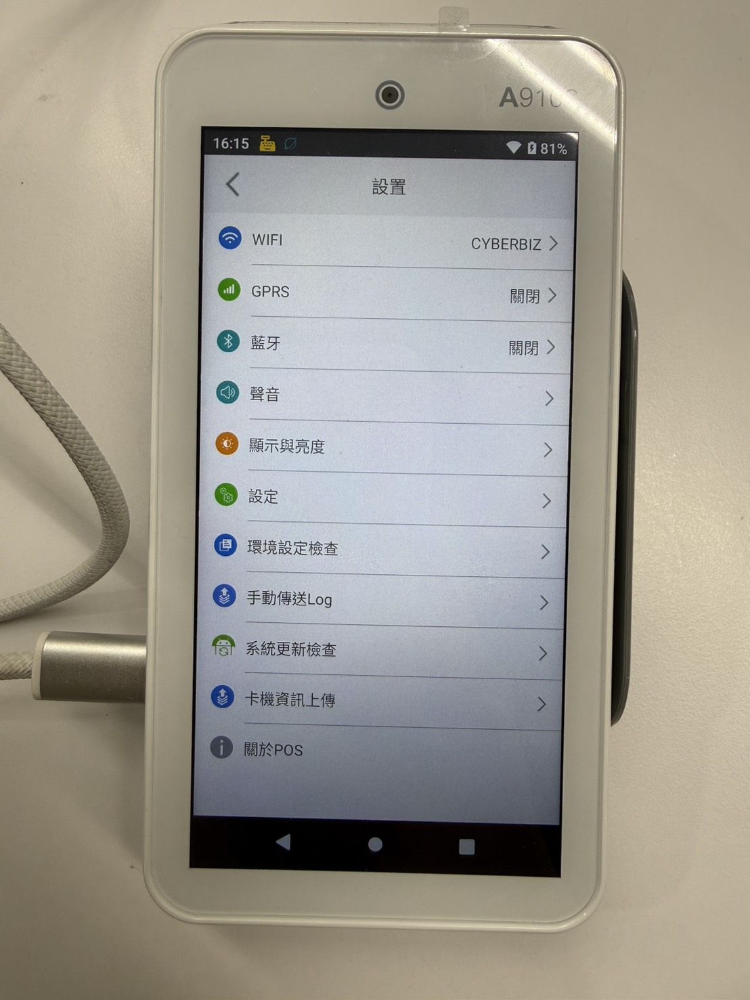{ title="卡機設置選單" .small-image }

    

3. 將卡機連上與 iPad 相同的 Wi-Fi 或熱點。
4. 前往 **顯示與亮度**，將螢幕自動關閉設為 `永遠不要`。
5. 確認電量高於 10% 後再進行連線與結帳。

### 連線 POS 前台 { #operate-a910s-connect }

1. 在卡機開啟 **Mini Bridge**，點選右上方 **啟動**。
2. 點選 **連線設定**，畫面會顯示本機連線資訊（下圖紅線處）。請記下完整名稱，同一門市多台卡機時每台名稱須不同。

    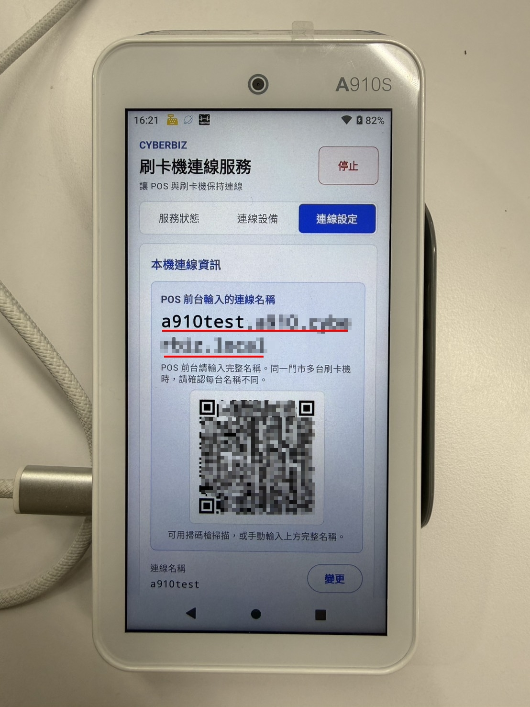{ title="Mini Bridge 本機連線資訊" .small-image }

3. 登入 POS 前台，前往 **其他功能 > 設定與連線測試 > A910S信用卡機**，點選 **進行連接**。
4. 輸入卡機顯示的完整連線名稱，點選 **進行連接與測試**。

    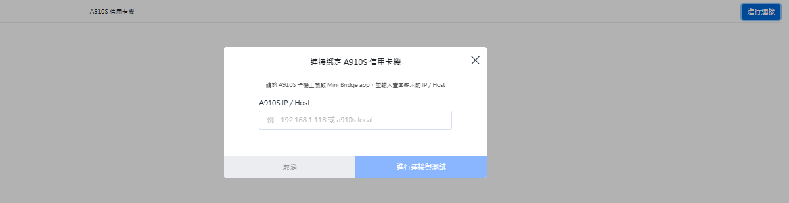{ title="連接綁定 A910S 信用卡機" .small-image }

5. 連線成功時：
    - POS 前台 **A910S 信用卡機** 旁顯示綠色勾勾。

        { title="前台顯示連線成功" .screenshot }

    - 卡機 Mini Bridge **服務狀態** 顯示 **正常運作中**，且 POS 已連線。

        { title="卡機顯示正常運作中" .small-image }

## 結帳 { #operate-a910s-checkout }

### 支援支付類型 { #operate-a910s-checkout-pay-types }

| 類型 | 說明 |
| --- | --- |
| 信用卡 | Mastercard、VISA、JCB（刷卡、插卡、感應皆可） |
| 行動支付 | Apple Pay、Samsung Pay、Google Pay |

### 一般結帳 { #operate-a910s-checkout-general }

1. 在結帳頁選擇付款方式 **信用卡（A910S卡機）**。

    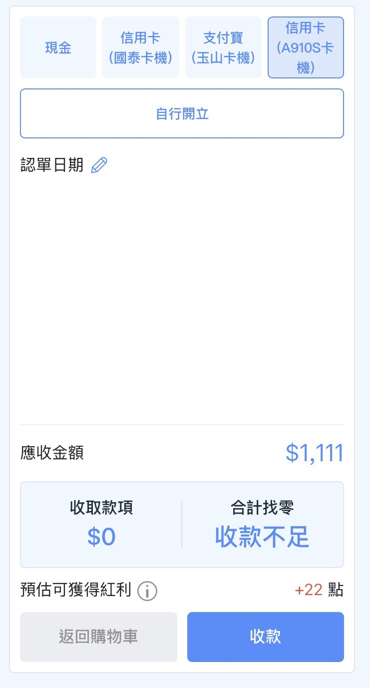{ title="結帳頁選擇 A910S 信用卡" .screenshot }

2. 點選 **收款**。卡機會自動帶出金額，店員無需手動輸入。
3. 引導顧客刷卡、插卡或感應完成付款。

    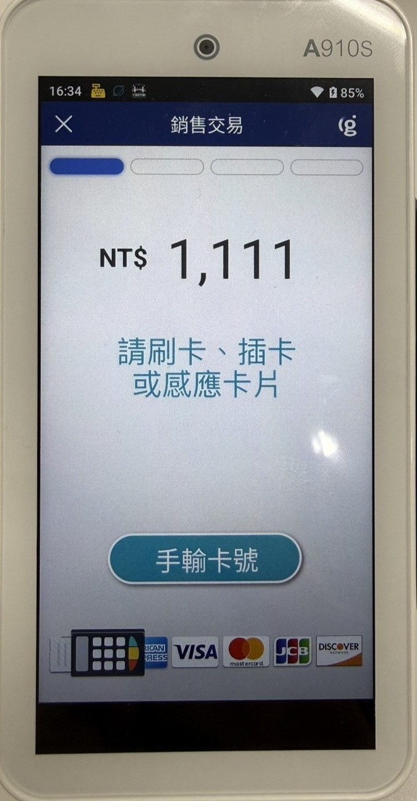{ title="卡機顯示金額並等待刷卡" .small-image }

### 多付款方式結帳 { #operate-a910s-multi-pay }

多付款方式由店員手動判斷各支付金額，**不會自動串接** 卡機金額。刷卡部分請在卡機另外操作。

- :lucide-hand-coins:{ .lg }  
  [__多付款方式__](../check/payment-method/multiple-payment-methods.md)  
  開啟多付款方式功能，單筆訂單可拆多種支付支付方式。

1. 結帳頁選擇 **多付款方式**，分別記錄信用卡與其他付款金額。
2. 在卡機開啟 **環匯多元支付**，點選 **銷售交易**。

    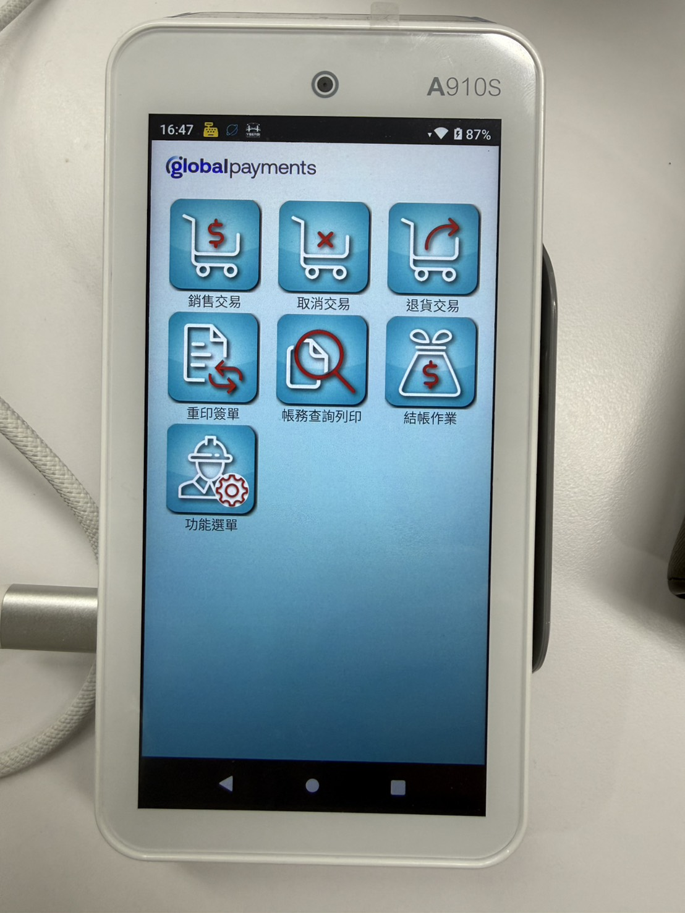{ title="環匯多元支付功能選單" .small-image }

3. 輸入本次刷卡金額，確認後選擇 **信用卡**，再引導顧客刷卡、插卡或感應。

    

    - 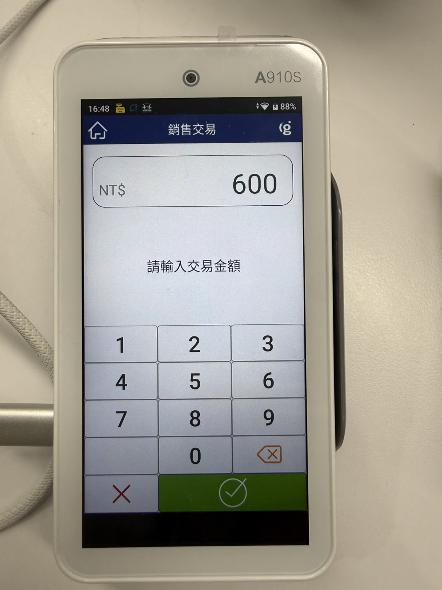{ title="手動輸入交易金額" .small-image }
    - 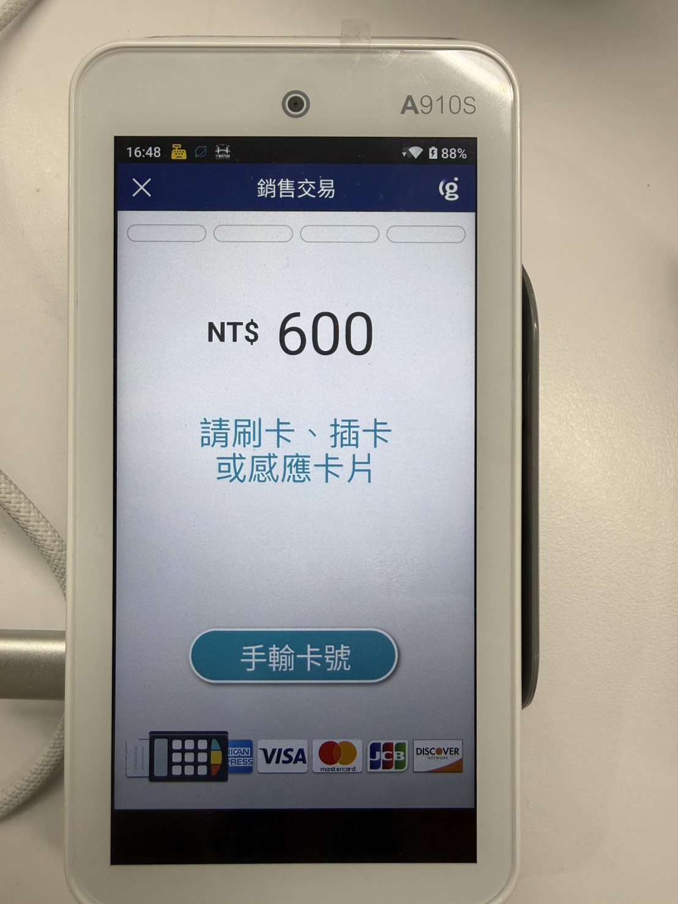{ title="手動銷售等待刷卡" .small-image }

    

### 疑難排解 { #operate-a910s-checkout-card-error }

若刷卡方式錯誤，卡機可能顯示：

- **卡片為晶片卡，請插卡交易**：顧客以磁條刷晶片卡，請改插卡。
- **讀卡錯誤，請改刷磁條**：卡片無效（例如刷到健保卡），請換卡。

## 退款 { #operate-a910s-refund }

=== "當日卡機未結帳"

    1. 在 POS 前台找到指定訂單，點選 **取消訂單**。
    2. 確認後點選 **退款**。
    3. 卡機會顯示退款金額與授權碼，確認後完成刷退。

=== "卡機已結帳"

    1. 在 POS 前台找到指定訂單，點選 **取消訂單** → **退款**。
    2. 若卡機顯示「無此交易」、前台顯示 **信用卡取消失敗**，點選 **執行退款**。

        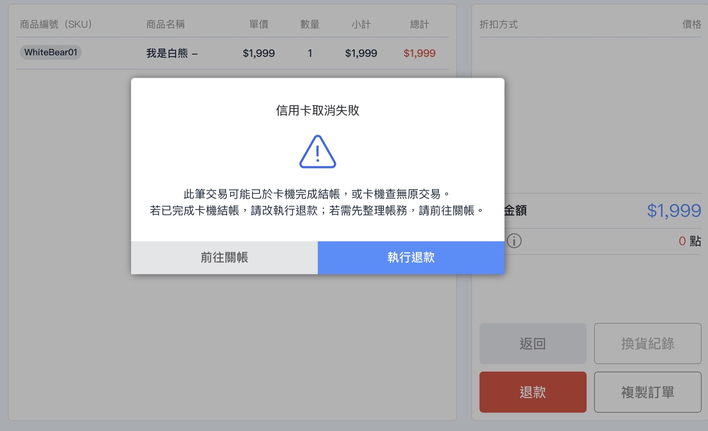{ title="信用卡取消失敗改執行退款" .screenshot }

    3. 卡機會顯示退款金額；請使用 **原交易信用卡** 感應，並依畫面手動輸入簽單資訊（授權碼、序號 Ref No）完成退款。

        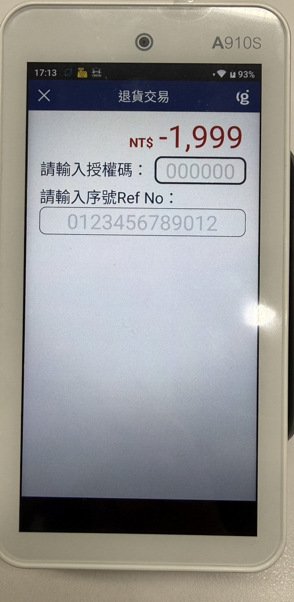{ title="退貨交易輸入授權碼與序號" .small-image }

    4. 若仍無法退款，請致電卡機標示的環匯亞太客服協助退款。

## 其他操作 { #operate-a910s-other }

### 重印簽單 { #operate-a910s-reprint }

1. 在卡機開啟 **環匯多元支付**，點選 **重印簽單**。
2. 輸入調閱編號。
3. 選擇要重印的 **商店聯** 或 **客戶聯**，卡機即重新列印。

### 列印明細 { #operate-a910s-print-detail }

1. 登入 POS 前台，前往 **訂單列表**。
2. 點選指定訂單。
3. 點選 **其他 > 列印明細**，由卡機列印交易明細。

### 卡機結帳 { #operate-a910s-settle }

1. 在卡機開啟 **環匯多元支付**，點選 **結帳作業**。
2. 結帳單位選擇 `GP一般`。
3. 點選 **結帳**，卡機列印結帳報表。

### 以 A910S 列印發票 { #operate-a910s-admin }

點選 **修改 POS 設定**，於 **POS 發票設定** 將 **發票機設定** 改為 **A910S 發票機**。

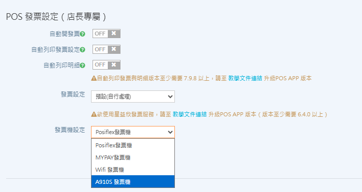{ title="發票機設定改為 A910S" .screenshot }

## 常見問題 { #faq-a910s }

??? quote "刷卡一直失敗，要先查什麼？"
    先確認 iPad 與卡機是否進入休眠或自動鎖定。喚醒裝置後，將卡機螢幕自動關閉設為 `永遠不要`，再重試結帳。

??? quote "POS 已進結帳，卡機卻沒跳出畫面？"
    請確認 **環匯多元支付** 已開啟並在背景執行，且卡機畫面停在已啟動的 **Mini Bridge**（服務狀態為正常運作中）。

??? quote "前台結帳看不到 A910S 選項？"
    前往 **POS 功能 > 所有 POS 商店 > 付款方式**，確認 **信用卡(A910S卡機)** 已開啟。

    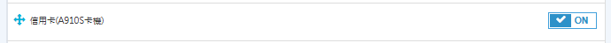{ title="後台啟用 A910S 付款方式" .screenshot }

??? quote "憑證與連線都設了還是失敗？"
    請依序再核對一次：

    1. iPad 是否已安裝 `.cer` 憑證檔
    2. 是否已開啟完整信任
    3. 瀏覽器是否已完整關閉後重開
    4. Web POS 填入的是否為 **完整** 連線名稱
    5. iPad 與卡機是否在同一個 Wi-Fi／熱點

## 更多操作 { #next-steps-a910s }

- :lucide-tablet:{ .lg }
  [__平板裝置使用說明__](tablet-device-user-guide.md)
  確認 iPad 解析度、相容週邊與加入主畫面設定。

- :lucide-credit-card:{ .lg }
  [__MYPAY 無線刷卡機__](mypay-wireless-credit-card-machine.md)
  若走商米／MyPay 方案，改依此頁申請與綁定。

