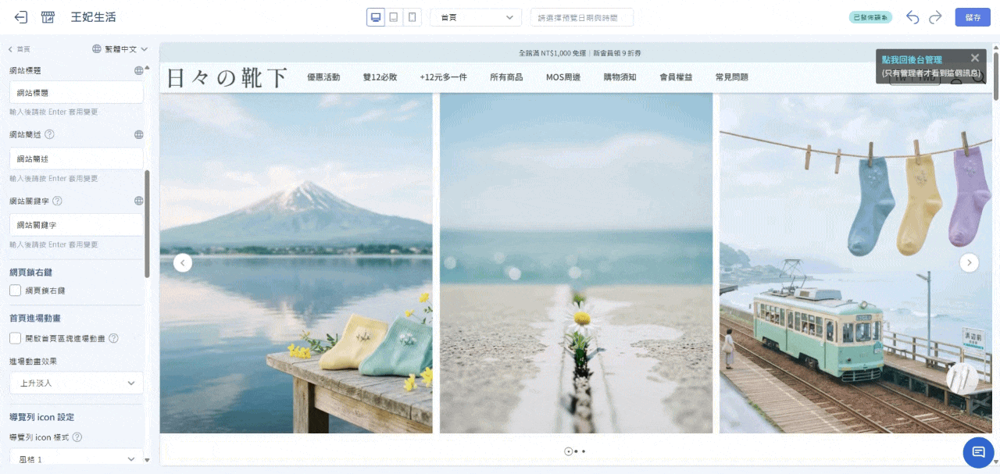
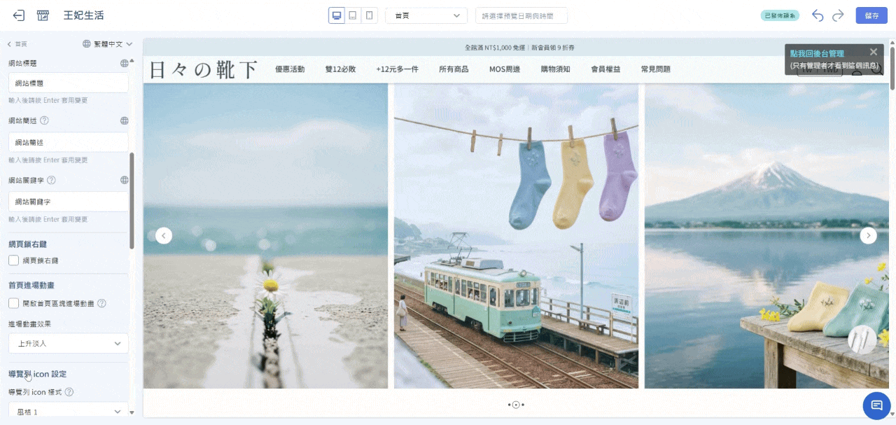
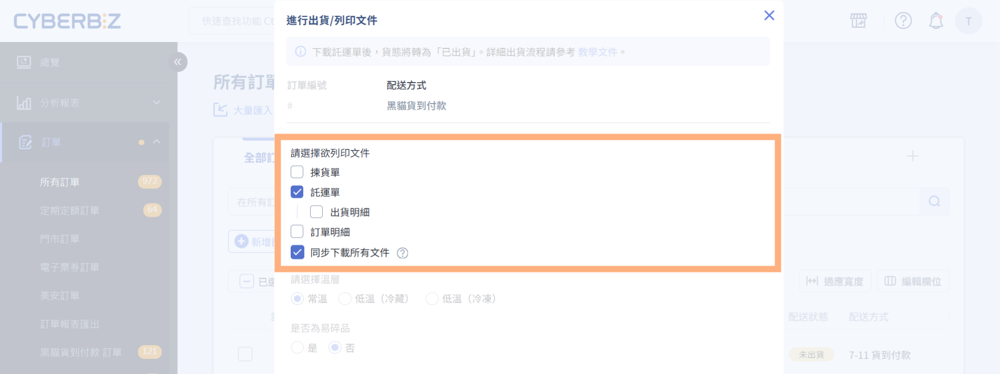
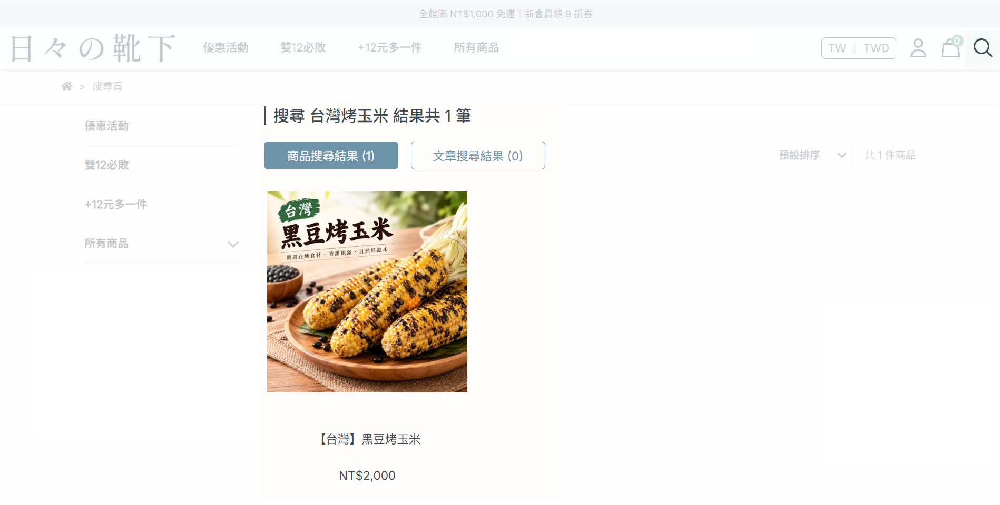
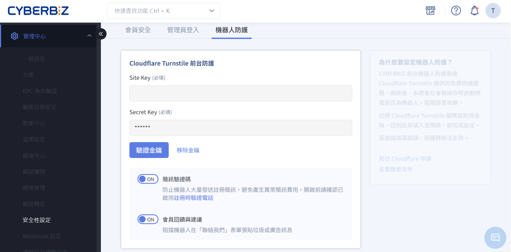

# 2026 年 10 月 | 新功能報報

<!-- wp:html -->

  
  
目錄 

（點選標題可直接跳至該段落）

  

    

      🚀
      <a href="#a" style="text-decoration: none;">本月重點功能</a>
    

    
  

      
<a href="#a1" style="text-decoration: none;">1. 官網首頁區塊進場動畫功能</a>

    

  

  

    

      ⚡
      <a href="#b" style="text-decoration: none;">功能優化</a>
    

    
    

      
<a href="#b1" style="text-decoration: none;">1. 黑貓訂單出貨文件支援直接列印</a>

      
<a href="#b2" style="text-decoration: none;">2. 前台站內搜尋（放大鏡）功能優化</a>

      
<a href="#b3" style="text-decoration: none;">3. 會員註冊簡訊驗證碼新增機器人防護機制</a>

    

  

 
<!-- /wp:html -->

<!-- wp:html -->

  
  

    <h2 style="font-size: 28px; font-weight: bold; color: #222222; margin: 0; letter-spacing: 0.5px; line-height: 1.2; border-bottom: none;" id="a">🚀 本月重點功能</h2>
  

  

    
    <h3 style="font-size: 22px; font-weight: bold; color: #222222; margin: 0 0 16px 0; line-height: 1.3;" id="a1">1. 官網首頁區塊進場動畫功能</h3>
    
    

      #拖拉版型
    

    
    

      
想讓官網首頁更有動態感，提升顧客瀏覽時的視覺體驗？

      
本次新增「上升淡入」與「置中展開」兩種進場動畫，啟用後首頁區塊將隨顧客滾動畫面自然浮現，您可依版面需求選擇合適的動畫，讓首頁呈現更具層次感~

    

    
    

      後台路徑：
      網站外觀 → 套版主題管理 → 網站設定 → 全站設定 → 首頁進場動畫
    

    

      

        
上升淡入

        
      

      

        
置中展開

        
      

    

    

    <a href="../../ec/website-appearance/theme-and-layout/setup-global-theme-settings/#overview-global-settings-brand" style="display: inline-block; background-color: #00338c; color: #ffffff; font-size: 18px; font-weight: 500; text-decoration: none; padding: 8px 20px; border-radius: 9999px; transition: background-color 0.2s ease; cursor: pointer;" target="_blank" rel="noopener">
      立即前往設定
    </a>
    

  

 
<!-- /wp:html -->

<!-- wp:html -->

  
  

    <h2 id="b" style="font-size: 28px; font-weight: bold; color: #222222; margin: 0; letter-spacing: 0.5px; line-height: 1.2; border-bottom: none;"> ⚡功能優化</h2>
  

  

    
    <h3 id="b1" style="font-size: 22px; font-weight: bold; color: #222222; margin: 0 0 16px 0; line-height: 1.3;">1. 黑貓訂單出貨文件支援直接列印</h3>

    

      
想更快速地列印託運單、訂單明細等文件，減少下載與開啟檔案的操作步驟？

      
使用 CYBERBIZ 串接的黑貓宅配或黑貓快速到店服務，出貨時可直接列印託運單、訂單明細、出貨明細與揀貨單。點選列印後，系統將於瀏覽器另開新分頁，顯示所勾選文件的 PDF，方便直接列印；若需留存檔案，也可同步下載。

      
另支援依「文件類型」或「訂單編號」設定列印排序，方便依不同作業習慣安排列印順序。本次率先支援黑貓宅配與黑貓快速到店，後續也將陸續優化其他物流方式，提供更便利的出貨體驗！

    

    
    

      後台路徑：
      訂單 → 所有訂單
    

    

    

    <a href="../../ec/orders/home-delivery/tcat-home-delivery-v2/" style="display: inline-block; background-color: #00338c; color: #ffffff; font-size: 18px; font-weight: 500; text-decoration: none; padding: 8px 20px; border-radius: 9999px; transition: background-color 0.2s ease; cursor: pointer;" target="_blank" rel="noopener">
      立即了解新功能
    </a>
    

  

<!-- /wp:html -->

<!-- wp:html -->

  

    
    <h3 id="b2" style="font-size: 22px; font-weight: bold; color: #222222; margin: 0 0 16px 0; line-height: 1.3;">2. 前台站內搜尋（放大鏡）功能優化</h3>

    

      
消費者不一定記得完整商品名稱，希望輸入部分關鍵字，也能更容易找到想要的商品？

      
本次優化前台商品搜尋功能，支援中文關鍵字斷詞比對與型號前綴搜尋，並調整預設排序方式，依搜尋相關性排列結果，讓搜尋結果更貼近消費者的需求。

      
範例：

      
• 中文關鍵字：搜尋「台灣烤玉米」，即可找到「【台灣】黑豆烤玉米」

      
• 商品型號：搜尋「CH」或「CH2026」，即可找到型號為「CH2026GW16T-3」的商品

      
• 搜尋排序：商品 A 的「商品名稱」含搜尋關鍵字、商品 B 僅在「商品介紹」中含有時，商品 A 會排在前面

    

    

  

<!-- /wp:html -->

<!-- wp:html -->

  

    
    <h3 id="b3" style="font-size: 22px; font-weight: bold; color: #222222; margin: 0 0 16px 0; line-height: 1.3;">3. 會員註冊簡訊驗證碼新增機器人防護機制</h3>

    

      
擔心網站會員註冊簡訊驗證功能遭惡意程式觸發，產生非預期費用？

      
現在您可於後台自行開啟 Cloudflare Turnstile 前台防護，啟用後會員在註冊頁點擊「發送驗證碼」時，須先通過驗證才會發送簡訊，降低簡訊驗證碼遭惡意觸發的風險。

      
此外，「會員回饋與建議」的機器人防護設定也整合至同一處，方便統一管理~

    

    
    

      後台路徑：
      管理中心 → 安全性設定 → 機器人防護
    

    

    

    <a href="../../ec/website-management/bot-protection-settings/#operate-security-sms-bot-protection" style="display: inline-block; background-color: #00338c; color: #ffffff; font-size: 18px; font-weight: 500; text-decoration: none; padding: 8px 20px; border-radius: 9999px; transition: background-color 0.2s ease; cursor: pointer;" target="_blank" rel="noopener">
      立即前往設定
    </a>
    

  

<!-- /wp:html -->
